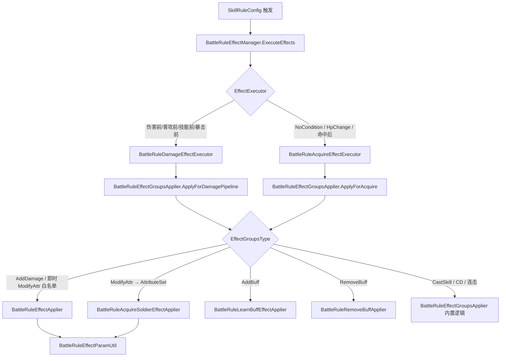

# 战斗规则 EffectGroup 重构说明

> 文档生成时间：2026-06-04  
> 最后更新：2026-07-13  
> Buff 专项：`BattleRule_BuffEffect_Context.md`  
> 可叠层获得规则（怪物猎人 112012）：`BattleRule_RepeatableAcquire_Context.md`

---

## 1. 背景与动机

### 1.1 配置层变化

| 项目 | 旧结构 | 新结构 |
|------|--------|--------|
| `EffectGroupConfig` | `Attributes` + `Effects` 两套列表 | **仅保留** `Effects` |
| 效果行为区分 | 靠 `AttributeType`（如 `LearnBuffEffect`） | 靠 **`EffectGroupsType`** |
| 数值表达 | `AttributeStruct.Value` + `ValueType`（二选一） | **`BaseValue` + `PreValue`（可同时生效）** |

### 1.2 设计目标

1. 一条 `EffectParamStruct` 通过 `EffectType` 明确表达「加 Buff / 放技能 / 改 CD / 改属性 / 加伤害」等行为。
2. `BaseValue`（固定值）与 `PreValue`（百分比）互不排斥，可同时配置。
3. 伤害管线与获得/命中管线共用同一套配置结构，按场景分发到不同执行器。

---

## 2. 配置数据结构（Luban 生成，勿手改）

### 2.1 `EffectGroupConfig`

**文件：** `Assets/Scripts/Data/Client/Luban/EffectGroupConfig.cs`  
**JSON：** `Assets/Res/Config/Json/tbeffectgroupconfig.json`

```csharp
// Luban 自动生成
public sealed partial class EffectGroupConfig : Luban.BeanBase
{
    public readonly int Id;                                          // 效果组 Id
    public readonly int PersistToAttributeSet;                       // 0=持久(AttributeSet) 1=临时(仅当次 DamageContext)
    public readonly List<EffectParamStruct> Effects;                 // 效果列表（唯一数据源）
}
```

| 字段 | 值 | 含义 |
|------|-----|------|
| `PersistToAttributeSet` | **0** | **持久**：`ModifyAttr` 写入英灵/技能 `AttributeSet`，整局保留；获得管线执行 |
| `PersistToAttributeSet` | **1** | **临时**：伤害/施法管线仅改当次 `DamageContext` 或走 `BattleRuleCastDamageSession`；获得管线跳过 `ModifyAttr` |

> **注释：** 字段在 **效果组级**，组内所有 `ModifyAttr` 共用同一持久策略。`AddDamage(7/8/9)` 始终仅当次，不受此字段影响。

---

### 2.2 `EffectParamStruct`

**文件：** `Assets/Scripts/Data/Client/Luban/EffectParamStruct.cs`

| 字段 | 类型 | 说明 |
|------|------|------|
| `EffectType` | `EffectGroupsType` | **效果行为类型**（分发入口） |
| `AttributeType` | `AttributeType` | 目标属性类型（`ModifyAttr` / `AddDamage` 时使用） |
| `SourceUnitType` | `UnitType` | 来源单位：`Self` = 英灵，`Target` = 模块/怪物 |
| `SourceAttrType` | `AttributeType` | 来源属性；`Null(201)` 表示未配置来源 |
| `TargetUnitType` | `UnitType` | AddBuff：`Self`=英灵，`Target`=受击怪物（如冻结 2070051） |
| `BaseValue` | `float` | **固定数值**（Buff Id、技能 Id、固定加值、CD 秒数等，视 EffectType 而定） |
| `PreValue` | `float` | **百分比/系数**（可与 BaseValue 同时存在） |

```csharp
// Luban 自动生成 — 字段含义见上表
public readonly EffectGroupsType EffectType;
public readonly AttributeType AttributeType;
public readonly UnitType SourceUnitType;
public readonly AttributeType SourceAttrType;
public readonly UnitType TargetUnitType;
public readonly float BaseValue;
public readonly float PreValue;
```

---

### 2.3 `EffectGroupsType` 枚举

**文件：** `Assets/Scripts/Data/Client/Luban/EffectGroupsType.cs`

| 值 | 枚举名 | 中文 | 主要参数字段 | 典型执行场景 |
|----|--------|------|--------------|--------------|
| 0 | `AddBuff` | 添加霸符 | `BaseValue` = **SkillBuffTemplateLibrary.BuffId** | 获得规则 / 命中后 / 伤害管线 |
| 1 | `RemoveBuff` | 移除霸符 | `BaseValue` = **同上 BuffId**（匹配 `buff.BuffId`） | 获得规则 / 命中后 |
| 2 | `CastSkill` | 使用技能 | `BaseValue` = 技能 Id | 获得规则 / 命中后 |
| 3 | `ReduceCoolDown` | 剩余冷却修正 | `BaseValue` = 秒数（负值缩短） | 获得规则 / 命中后 |
| 4 | `ResetCoolDown` | 冷却重置 | `BaseValue` = 技能 Id（0=全部） | 获得规则 / 命中后 |
| 5 | `ModifyAttr` | 添加属性 | `AttributeType` + `BaseValue`/`PreValue` | NoCondition / HpChange / 伤害管线 |
| 6 | `ContinuousAttack` | 连击 | `BaseValue` = 技能 Id，`PreValue` = 次数 | 获得规则 / 命中后 |
| 7 | `AddDamage` | 添加伤害 | `AttributeType` + `SourceAttrType` + `PreValue` | 伤害管线（OnDamageBefore 等） |

---

## 3. BaseValue 与 PreValue 语义（核心）

### 3.1 与 `AttributeData` 的区别

| 类型 | 数值模型 | 能否同时固定+百分比 |
|------|----------|---------------------|
| `AttributeStruct` / `AttributeData` | 单 `Value` + `ValueType` | ❌ 二选一 |
| `EffectParamStruct` | `BaseValue` + `PreValue` | ✅ **可同时生效** |
| 运行时 `AttributeModifier` | `FlatAdd` + `PercentAdd` | ✅ 底层一直支持 |

### 3.2 转换规则（`BattleRuleEffectParamUtil.BuildModifier`）

**文件：** `Assets/Scripts/Battle/Rules/BattleRuleEffectParamUtil.cs`

持久 `ModifyAttr`（NoCondition / HpChange / OnDamageAfter 叠层等）**必须**经 `BuildModifier` 写入 `AttributeSet`，由 `GetFinal` 统一结算：

```
FlatAdd     = BaseValue（非 0 时）
PercentAdd  = PreValue（非 0 且 SourceAttrType == Null(201) 时）
PercentAdd  = PreValue（ModifyAttr 且 SourceAttrType == AttributeType 时，同属性百分比加成）
FlatAdd    += 来源属性 × PreValue（PreValue 非 0、来源已配置、且来源 ≠ 目标属性时）
```

**最终属性公式（`AttributeValue`）：**

```
FinalValue = (BaseValue × (1 + ΣPercentAdd)) + ΣFlatAdd
```

> **禁止：** 在伤害管线中对英灵/技能 `ModifyAttr` 的 `PreValue` 反复执行 `FinalDamage *= (1 + PreValue)`。  
> 除穿透/附加魔法等「单次命中即时」白名单外，英灵/技能属性改 `AttributeSet`，由 `DamageContextBuilder` / `SkillBase` / `AttributesModifier` 读 `GetFinal` 一次生效。

### 3.2.1 同属性 PreValue（常见配表坑）

| 配法 | 结果 |
|------|------|
| `AttributeType=2`, `SourceAttrType=201`, `PreValue=0.05` | ✅ `PercentAdd=0.05`，攻击力 **基础值 ×1.05** |
| `AttributeType=2`, `SourceAttrType=2`, `PreValue=0.05` | ⚠️ 代码兜底为 `PercentAdd`（2026-06-17）；**配表仍应写 201** |
| `AttributeType=2`, `SourceAttrType=52`, `PreValue=0.05` | ✅ `FlatAdd += 怪物MaxHp × 0.05`（跨属性来源系数） |

**怪物猎人 212012 正确示例（攻/法/攻速各 +5%）：**

```json
{
  "EffectType": 5,
  "AttributeType": 2,
  "SourceAttrType": 201,
  "BaseValue": 0,
  "PreValue": 0.05
}
```

### 3.3 配置示例

```json
// 仅百分比：真实伤害 +20%
{
  "EffectType": 5,
  "AttributeType": 122,
  "BaseValue": 0,
  "PreValue": 0.2
}

// 仅固定值：全伤害加成 +1.5
{
  "EffectType": 5,
  "AttributeType": 124,
  "BaseValue": 1.5,
  "PreValue": 0
}

// 固定 + 百分比同时生效（需配在同一条或拆两条 Effect）
{
  "EffectType": 5,
  "AttributeType": 2,
  "BaseValue": 10,
  "PreValue": 0.2
}
// → 攻击力 +10 固定，再 +20% 百分比

// 来源属性 × 系数 → 追加到 FlatAdd（AddDamage / ModifyAttr 均适用）
{
  "EffectType": 7,
  "SourceAttrType": 52,
  "PreValue": 0.2
}
// → 追加伤害 = 怪物最大生命(MonsterMaxHealth=52) × 0.2
```

> **注释：** `SourceAttrType = 201 (Null)` 表示「未配置来源属性」，此时 `PreValue` 走百分比分支，不会误乘来源属性。

---

## 4. 运行时架构

### 4.1 调用链路



### 4.2 两条管线支持的效果类型

| EffectGroupsType | 伤害管线 | 获得/命中管线 | 备注 |
|------------------|----------|---------------|------|
| AddBuff | ✅ | ✅ | |
| RemoveBuff | ❌ | ✅ | |
| CastSkill | ❌ | ✅ | |
| ReduceCoolDown | ❌ | ✅ | |
| ResetCoolDown | ❌ | ✅ | |
| ModifyAttr | ✅（`PersistToAttributeSet=1` 或穿透/AddMagic 等白名单 → ctx；**0** → AttributeSet） | ✅（仅 `PersistToAttributeSet=0` 且 NoCondition/HpChange/ByTriggerCount） | `PreValue` 走 `PercentAdd`，见 §3.2 |
| ContinuousAttack | ✅ | ✅ | 伤害前（OnAttackBefore / OnSkillBefore 等）与命中后均可连击 |
| AddDamage | ✅ | ❌ | |

---

## 5. 涉及文件清单

### 5.1 配置（Luban 自动生成）

| 文件 | 作用 |
|------|------|
| `Assets/Scripts/Data/Client/Luban/EffectGroupConfig.cs` | 效果组 Bean |
| `Assets/Scripts/Data/Client/Luban/EffectParamStruct.cs` | 单条效果参数 |
| `Assets/Scripts/Data/Client/Luban/EffectGroupsType.cs` | 效果类型枚举 |
| `Assets/Scripts/Data/Client/Luban/TbEffectGroupConfig.cs` | 效果组表 |
| `Assets/Res/Config/Json/tbeffectgroupconfig.json` | 运行时 JSON 配置 |

### 5.2 运行时（手写/本次新增或修改）

| 文件 | 职责 |
|------|------|
| **`BattleRuleEffectGroupsApplier.cs`** | **核心分发器**：按 `EffectGroupsType` 路由到各 Applier |
| **`BattleRuleEffectParamUtil.cs`** | **参数解析**：`BaseValue`/`PreValue`/`SourceAttrType` → `AttributeModifier`；`ruleContext` 经 `BattleRuleSourceParamSupport` 读链式学习来源配置 |
| **`BattleRuleSourceParamSupport.cs`** | **链式学习来源 Skill 类参数**：装备词条 / 流派星级 / 轮语者 / 技能配置 |
| `BattleRuleEffectApplier.cs` | 伤害结算：`AddDamage`；**白名单**即时 `ModifyAttr`（穿透/AddMagic 等） |
| `BattleRuleAcquireSoldierEffectApplier.cs` | 英灵/技能持久属性：`ModifyAttr` → `AttributeSet.AddModifier` |
| `BattleRuleCastDamageSession.cs` | 施法临时 `ModifyAttr`：Register 写 AttributeSet，结束 RemoveModifier |
| `BattleRuleNewSoldierSyncSupport.cs` | `BuildSourceKey` / `BuildDamagePipelineSourceKey` |
| `BattleRuleAcquireSupport.cs` | `BattleRuleAcquireEffectExecutor`：获得/命中效果入口 |
| `BattleRuleDamageSupport.cs` | `BattleRuleDamageEffectExecutor`：伤害管线效果入口 |
| `CareerDamageModifier.cs` | 职业系伤害修正：攻击方职业匹配时读 `BaseAttributes` 增伤（见 §7） |
| `BattleRuleLearnBuffEffectApplier.cs` | `AddBuff` → `BuffApplier`（**不经过** `EffectsExecutor` / `TbEffectsConfig`） |
| `BattleRuleRemoveBuffApplier.cs` | `RemoveBuff` → `ResolveRemoveBuffId` 直接用 BaseValue |
| `BattleRuleEffectTargets.cs` | Add 校验模板；Remove 不校验模板 |
| `BattleRuleEffectManager.cs` | 效果组调度（未改逻辑，读表不变） |
| `BattleRuleService.cs` | 规则服务（调用上述 Executor） |

---

## 6. 关键代码说明（带注释）

### 6.1 参数解析 — `BattleRuleEffectParamUtil.cs`

```csharp
/// EffectParamStruct 字段解析：BaseValue=固定值，PreValue=百分比；二者可同时生效。
/// PreValue + SourceAttrType（非 Null）时，额外叠加「来源属性 × PreValue」到固定值。
public static AttributeModifier BuildModifier(
    EffectParamStruct effect,
    string sourceKey,
    AttributeSourceType sourceType,
    SoldierCard soldier)
{
    var modifier = new AttributeModifier
    {
        SourceKey = sourceKey,
        SourceType = sourceType,
        // 固定加值：BaseValue 非 0 即写入 FlatAdd
        FlatAdd = HasFlatValue(effect) ? effect.BaseValue : 0f,
        PercentAdd = 0f,
    };

    if (!HasPercentValue(effect))
        return modifier;

    if (HasSourceAttribute(effect))
    {
        // 同属性百分比：PreValue 表示对该属性 BaseValue 的 PercentAdd
        if (effect.EffectType == EffectGroupsType.ModifyAttr
            && effect.SourceAttrType == effect.AttributeType)
        {
            modifier.PercentAdd = effect.PreValue;
        }
        else
        {
            // 跨属性来源 × 系数 → FlatAdd
            modifier.FlatAdd += ResolveSourceAttributeValue(effect, soldier) * effect.PreValue;
        }
    }
    else
    {
        modifier.PercentAdd = effect.PreValue;
    }

    return modifier;
}

/// SourceAttrType == Null(201) 视为「未配置来源」
public static bool HasSourceAttribute(EffectParamStruct effect)
{
    return effect != null && effect.SourceAttrType != AttributeType.Null;
}
```

### 6.2 伤害追加 — `BattleRuleEffectApplier.ApplyAddDamageEffect`

```csharp
// AddDamage：BaseValue 与 PreValue 分别独立结算，可同时生效
public static void ApplyAddDamageEffect(DamageContext ctx, EffectParamStruct effect)
{
    var sourceValue = ResolveSourceValue(ctx, effect);

    // 1) 固定伤害
    if (BattleRuleEffectParamUtil.HasFlatValue(effect))
        ApplyAddDamageMagnitude(ctx, effect, sourceValue, effect.BaseValue, usePercent: false);

    // 2) 比例伤害 或 来源属性×系数
    if (BattleRuleEffectParamUtil.HasPercentValue(effect))
    {
        if (BattleRuleEffectParamUtil.HasSourceAttribute(effect))
            ApplyAddDamageMagnitude(ctx, effect, sourceValue, sourceValue * effect.PreValue, usePercent: false);
        else
            ApplyAddDamageMagnitude(ctx, effect, sourceValue, effect.PreValue, usePercent: true);
    }
}
```

### 6.3 分发入口 — `BattleRuleEffectGroupsApplier`

```csharp
// 伤害管线：OnDamageBefore / OnAttackBefore / OnSkillBefore / OnCriticalBefore
private static void ApplyForDamagePipeline(...)
{
    switch (effect.EffectType)
    {
        case EffectGroupsType.AddDamage:    // 仅本次伤害
        case EffectGroupsType.ModifyAttr:   // 白名单即时 ctx；英灵/技能/模块 → AttributeSet
        case EffectGroupsType.AddBuff:      // 少数规则在伤害前加 Buff
        case EffectGroupsType.ContinuousAttack: // PreValue = 连击次数，BaseValue = 技能 Id（0=上下文技能）
        default:                            // 其他类型打 Warning
    }
}

// 获得/命中管线：NoCondition / HpChange / OnAttackAfter / OnSkillAfter 等
private static void ApplyForAcquire(...)
{
    // ModifyAttr：NoCondition / HpChange；或 NewSoldierSync=ByTriggerCount 的 OnDamageAfter
    var allowModifyAttr = ruleTrigger == TriggerType.NoCondition
                       || ruleTrigger == TriggerType.HpChange
                       || AllowsOnDamageAfterModifyAttr(ruleConfig);

    switch (effect.EffectType)
    {
        case EffectGroupsType.AddBuff:
        case EffectGroupsType.RemoveBuff:
        case EffectGroupsType.CastSkill:        // BaseValue = skillId
        case EffectGroupsType.ReduceCoolDown:   // BaseValue=秒数；可 SourceAttr×PreValue；BaseValue≈0 时清空上下文技能 CD
        case EffectGroupsType.ResetCoolDown:    // BaseValue = skillId，0=全部
        case EffectGroupsType.ModifyAttr:       // 受 allowModifyAttr 约束
        case EffectGroupsType.ContinuousAttack: // PreValue = 连击次数
    }
}
```

**ReduceCoolDown（2026-07-13）：**  
`adjustSeconds = BaseValue + SourceAttr×PreValue`；若仍为 0 且存在 `DamageContext.SkillId`，则对该技能 `ReduceSkillCooling(..., MaxValue)`（武器 1101「不进入冷却」）。  
武器 1101 规则 Trigger 为 **`OnSkillUse`**，在 `SoldierCard.UseSkill` 成功后由 `BattleRuleCastSupport.TriggerSkillAfterUse` 触发一次，**不要**挂 `OnSkillAfter`（多段命中会重复判定）。

**伤害管线 ModifyAttr + 规则来源参数（Persist=1）：**  
`UsesSkillSourceAttribute` 时：`bonus = BaseValue + 参数×PreValue`，按目标 `AttributeType`（如 `AllDamageBonuses`）百分比写入当次 `DamageContext`（武器 1006）。
### 6.4 执行器入口（薄封装）

```csharp
// BattleRuleDamageSupport.cs — 伤害规则效果执行器
public void ExecuteEffect(BattleRuleEffectExecuteInfo executeInfo)
{
    BattleRuleEffectGroupsApplier.ApplyForDamagePipeline(
        damageContext, executeInfo.Context, effectGroup.Effects);
}

// BattleRuleAcquireSupport.cs — 获得/命中规则效果执行器
public static void ApplyEffectGroup(...)
{
    BattleRuleEffectGroupsApplier.ApplyForAcquire(
        ruleContext, ruleConfig.Trigger, effectGroup.Effects,
        sourceKey, sourceType, soldier);
}
```

---

## 7. 配置 Id 对照表（当前 JSON）

| Id | EffectType | 说明 |
|----|------------|------|
| 201001 | ModifyAttr(5) | 真实伤害 +20%（PreValue=0.2） |
| 201002 | ContinuousAttack(6) | 连击 1 次 |
| 202001 / 202002 / 206001 | ReduceCoolDown(3) | CD -1s / -2s |
| 202003 / 211001 | AddBuff(0) | 添加 Buff 20011 / 20012 |
| 203001 | ModifyAttr(5) | 全伤害加成 +1.5 固定 |
| 204001 / 210001 | CastSkill(2) | 释放技能 2110003 / 2110002 |
| 205001 / 207001 | ModifyAttr(5) ×2 | 属性 12、13 各 +1 |
| 208001 | AddDamage(7) | 追加伤害 = 怪物最大生命 × 20% |
| 211003 | AddBuff(0) | 添加 Buff **20014**（2203001 满血） |
| 211004 | RemoveBuff(1) | 移除 Buff **20014**（2203001 受伤） |
| 211005 | AddBuff(0) | 添加 Buff **21004**（2202006 低血治疗） |

---

## 8. 职业系英灵伤害修正（Category=Soldier）

战斗规则通过 `ModifyAttr` 写入下列属性后，**伤害管线**在 `AttributesModifier` 之后、`TakeDamageModifier` 之前由 `CareerDamageModifier` 读取并增伤。

| AttributeType | 枚举名 | 中文 | 生效条件 |
|---------------|--------|------|----------|
| 52 | `SoldierDamageChange` | 战士系英灵伤害修正 | 攻击方 `SoldierBattleConfig.CarType == Warrior` |
| 53 | `ArcherDamageChange` | 射手系英灵伤害修正 | `CarType == Archer` |
| 54 | `MageDamageChange` | 法师系英灵伤害修正 | `CarType == Wizard` |
| 55 | `AssassinDamageChange` | 刺客系英灵伤害修正 | `CarType == Assassin` |
| 56 | `AssistantDamageChange` | 辅助系英灵伤害修正 | `CarType == Assistant` |

**结算公式（与 `AllDamageBonuses` 一致）：**

```
FinalDamage += FinalDamage × GetFinal(对应职业属性)
TrueDamage  += TrueDamage  × GetFinal(对应职业属性)
```

**配表示例（全场战士 +10% 伤害，持久）：**

```json
{
  "Id": 2xxxxx,
  "PersistToAttributeSet": 0,
  "Effects": [
    {
      "EffectType": 5,
      "AttributeType": 52,
      "SourceAttrType": 201,
      "BaseValue": 0,
      "PreValue": 0.1
    }
  ]
}
```

> 属性写在 **英灵 `BaseAttributes`**（`Category=Soldier`）。仅 **SoldierDamage** 管线生效；怪物攻击英灵不走此节点。

**代码：** `Assets/Scripts/Game/DamageCalculator/DamageModifier/CareerDamageModifier.cs`

---

## 9. 配表注意事项

1. **`SourceAttrType` 占位**：未使用来源属性时填 `201 (Null)`，不要依赖 `0` 表示「无」——`0` 是 `SoldierMaxHealth`。
2. **`BaseValue` 含义随 EffectType 变化**：Buff Id（**SkillBuffTemplateLibrary**）、技能 Id、CD 秒数、固定属性值，不要混用语义。
3. **AddBuff/RemoveBuff 勿填 TbEffectsConfig 行 Id**：例如规则应填 BuffId `21004`，不是 EffectsConfig Id `21004` 或其 `EffectsId`。
4. **需要固定+百分比**：同一条 `EffectParamStruct` 可同时填 `BaseValue` 和 `PreValue`；或拆成两条 `ModifyAttr` Effect。
5. **命中后规则**：默认只做 Buff/技能/CD/连击，不做持久 `ModifyAttr`（除非 Trigger 为 NoCondition / HpChange）。
6. **`PersistToAttributeSet`**：当次真伤/穿透填 **1**；整局叠层填 **0**（如怪物猎人 212012）。
7. **职业系伤害修正**：`AttributeType` 52~56 须 **0=持久** 写入 AttributeSet，由 `CareerDamageModifier` 按攻击方职业读取。
8. **链式学习规则参数**（2026-07-09）：`LearnSkillRule` 来源的 `Attributes` 中配置 **Category=Skill** 参数行；`ModifyAttr` 用 `SourceAttrType` + `PreValue` 读取，`BaseValue` 作偏移。装备/流派/轮语者与技能共用此模式。见 `BattleRule_SkillSourceBuff_Context.md` §6.0。
9. **Luban 代码勿手改**：改 Excel/XML 后重新导表，`EffectGroupConfig.cs` 等会自动覆盖。

---

## 10. 测试检查清单

- [ ] NoCondition 规则：`ModifyAttr` 正确加到全场英灵 `BaseAttributes`
- [ ] 新召唤英灵：`BattleRuleService.ApplyLearnedRulesToNewSoldier` 补同步 ModifyAttr
- [ ] 命中后：`AddBuff` / `RemoveBuff` 正常
- [ ] `CastSkill`：指定技能能延迟/立即释放
- [ ] `ReduceCoolDown`：负值 BaseValue 缩短 CD
- [ ] `AddDamage`：来源属性 × PreValue 伤害正确（如 208001）
- [ ] `BaseValue + PreValue` 同时配置：固定与百分比均生效
- [ ] 伤害前规则：`AddDamage` 仅影响当前命中；英灵 `ModifyAttr` 写 AttributeSet 不叠乘 ctx
- [ ] `SourceAttrType = Null(201)` + `PreValue`：走 `PercentAdd`
- [ ] 112012 怪物猎人：10 杀 +5%，20 杀累计约 +10%（见 `BattleRule_RepeatableAcquire_Context.md`）
- [ ] 施法会话（203003）：`BattleRuleCastDamageSession` 临时 Modifier 施法结束移除
- [ ] `PersistToAttributeSet=1`：生命裁决等仅当次真伤，不挂 AttributeSet
- [ ] 职业系伤害修正 52~56：战士/射手/法师/刺客/辅助英灵攻击时分别增伤

---

## 11. 变更历史

| 日期 | 内容 |
|------|------|
| 2026-07-13 | **ReduceCoolDown** 支持 SourceAttr×PreValue；无秒数时清空上下文技能 CD。伤害管线 Persist=1 ModifyAttr 可读规则来源参数（武器 ExtraAttributes） |
| 2026-07-09 | **链式学习来源参数**：`SourceAttrType` 可读装备/流派/轮语者配置；见 `BattleRuleSourceParamSupport` |
| 2026-06-17 | **`PersistToAttributeSet`**（0 持久 / 1 临时）接入 `BattleRuleEffectGroupsApplier` |
| 2026-06-17 | **职业系伤害修正 52~56**：新增 `CareerDamageModifier`，SoldierDamage 管线按 `CarType` 增伤 |
| 2026-06-17 | **PreValue 持久 ModifyAttr 改绑 AttributeSet**；收窄即时 `ModifyAttr` 白名单；`BattleRuleCastDamageSession` 改 AttributeSet 临时修饰 |
| 2026-06-17 | **BuildModifier**：`SourceAttrType == AttributeType` 时走 `PercentAdd`；212012 `SourceAttrType` 修正为 201 |
| 2026-06-17 | **300002** `MaxValue` 修正为 10（怪物猎人每 10 杀触发，非每 1 杀） |
| 2026-06-08 | EffectGroup AddBuff/RemoveBuff 直接读 `SkillBuffTemplateLibrary`；Remove 不再经 `TbEffectsConfig` |
| 2026-06-08 | 2203001 补学规则 111004；文档化 111003/111004/112010 ↔ Buff 20014 |
| 2026-06-04 | 移除 `EffectGroupConfig.Attributes`，引入 `EffectGroupsType` 分发 |
| 2026-06-04 | 新增 `BattleRuleEffectGroupsApplier`、`BattleRuleEffectParamUtil` |
| 2026-06-04 | 修正 `BaseValue`/`PreValue` 二选一 bug，支持同时生效 |
| 2026-06-04 | 修正 `SourceAttrType == Null(201)` 时 PreValue 被误清零的问题 |
