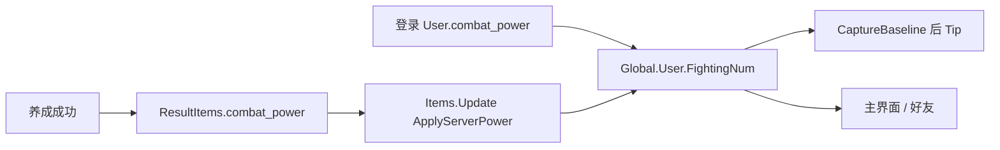
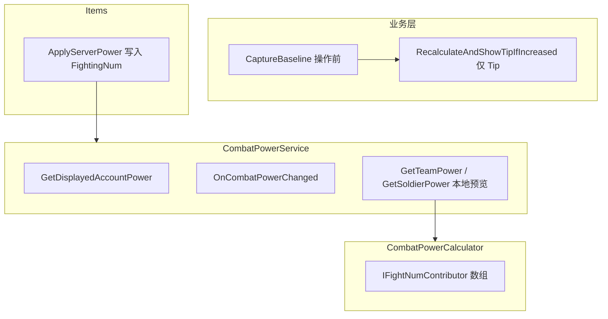

# 战力模块（FightNum / CombatPower）使用文档

## 概述

战力模块位于 `Assets/Scripts/Game/CombatPower/`。

| 类型 | 类 | 职责 |
|------|-----|------|
| **业务入口** | `CombatPowerChangeHelper` | 养成前基线、应用服务端战力、提升 Tip |
| **服务** | `CombatPowerService` | 账号战力缓存、事件、提示 UI；编队/预览仍可本地算 |
| **汇总** | `CombatPowerCalculator` | 按 Scope 调度 Contributor（**仅预览/编队/红点**，非账号真值） |
| **模块** | `IFightNumContributor` | 各养成系统的 FightNum 贡献 |
| **计算** | `FightNumCalcHelper` | 读 Global + 配表，算单模块 FightNum |

设计原则：

- **账号战力真值在服务端**：登录 `User.combat_power`、养成回包 `ResultItems.combat_power` 下发；客户端写入 `Global.User.FightingNum`。
- **配表驱动**：服务端与客户端预览公式均为各模块 `FightNum` 累加，不用属性换算。
- **单一入口**：禁止在 `UserModel` 或业务里直接改 `Global.User.FightingNum`（登录 MapUser / `Items.Update` / `ApplyServerPower` 除外）。
- **与属性分离**：战力（FightNum）与战斗属性（AttributeSet）独立维护。

注册入口：`GameStartMono.cs` → `GameServiceManager.Register(new CombatPowerService())`

---

## 数据流（账号战力）



---

## 架构



---

## 目录结构

```
Game/CombatPower/
├── Fight.md
├── CombatPowerScope.cs
├── CombatPowerSourceType.cs
├── CombatPowerContext.cs
├── CombatPowerSnapshot.cs
├── FightNumEntry.cs
├── IFightNumContributor.cs
├── FightNumCalcHelper.cs
├── CombatPowerCalculator.cs
├── CombatPowerChangeHelper.cs
└── Contributors/
    ├── CardFightNumContributor.cs
    ├── TalentFightNumContributor.cs
    ├── SpeakerFightNumContributor.cs
    ├── WeaponFightNumContributor.cs
    ├── FusionGemFightNumContributor.cs
    └── SeatFightNumContributor.cs

Game/UI/Services/CombatPowerService.cs
```

---

## 产品规则（当前版本）

### 账号主战力（Account）— 服务端计算口径

```
AccountPower =
  CardPower(全收藏)
  + TalentPower(所有已解锁天赋)
  + SpeakerSkin + WearerEquip(槽位/词条/特效)
  + Weapon + FusionGem + Seat
```

| 维度 | 规则 |
|------|------|
| 卡牌 | 全收藏 |
| 天赋 | 已解锁（不遍历配表全部 Id） |
| 全局模块 | 见「已接入 Contributor」 |

### 养成提示

1. 操作**前**：`CaptureBaseline()`（记录当前 `FightingNum`）
2. 服务器成功、`Items.Update` 写入 `ResultItems.combat_power` 后：`RecalculateAndShowTipIfIncreased()`（**仅对比基线弹 Tip，不再本地重算**）
3. **仅当新战力 > 基线** 时弹提示；持平或下降不显示

### 第一版暂不计入

- 奥数共鸣（ArcResonance）
- 职业羁绊（CarBinding）
- 城墙等级（配表无 FightNum）

---

## 查询口径（CombatPowerScope）

| Scope | 用途 | 真值来源 |
|-------|------|----------|
| Account | 主界面、好友、存档 | **服务端下发** `FightingNum` |
| Team | 卡组面板预览 | 本地 Calculator |
| Soldier | 英灵详情预览 | 本地 Calculator |
| Module | 单模块预览 | 本地 Calculator |

```csharp
// 账号展示（服务端真值）
service.GetDisplayedAccountPower();
service.GetAccountPower(); // TotalPower == FightingNum

// 本地预览
CombatPowerContext.ForTeam(cardIds: cardList);
CombatPowerContext.ForSoldier(soldierId: 2010001);
CombatPowerContext.ForModule(CombatPowerSourceType.Speaker);
```

---

## 已接入模块（预览公式 / 服务端应对齐）

| SourceType | Contributor | FightNum 来源 |
|------------|-------------|---------------|
| Card | CardFightNumContributor | 英灵等级/皮肤/觉醒、技能等级 |
| Talent | TalentFightNumContributor | TalentList.FightNum + ExtraFightNum |
| Speaker | SpeakerFightNumContributor | 皮肤 + 装备 + 槽位 + 词条/特效 |
| Weapon | WeaponFightNumContributor | WeaponStarList.FightNum |
| FusionGem | FusionGemFightNumContributor | GemFusionLevelList.FightNum |
| Seat | SeatFightNumContributor | 城墙槽位技能 SeatLevelList.FightNum |

### 配表字段

| 模块 | 配表 | 字段 |
|------|------|------|
| 英灵等级 | TbSoldierBattleConfig | LevelPropertyList[].FightNum |
| 英灵觉醒 | TbSoldierBattleConfig | AwakingFightNum |
| 英灵皮肤 | TbSkinConfig | FightNum |
| 技能卡 | TbSpecialEffectsConfig | LevelPropertyList[].FightNum |
| 天赋 | TbTalentConfig | TalentList[].FightNum / ExtraFightNum |
| 装备 | TbEquipConfig | FightNum / EntryFightNum / EffectsFightNum |
| 装备槽 | TbEquipSlotConfig | SlotLevelList[].FightNum |
| 轮语者皮肤 | TbPlayerFigureConfig | ImageStarList[].FightNum |
| 武器 | TbPlayerWeaponConfig | WeaponStarList[].FightNum |
| 融合石 | TbGemFusionConfig | LevelList[].FightNum |
| 城墙技能 | TbHeroSeatConfig | SeatLevelList[].FightNum |

### 装备词条 / 特效战力规则

```
词条战力 = EntryFightNum × equip.Entrys.Count
特效战力 = EffectsFightNum × equip.Effects.Count
```

- 只统计已生效的 `equip.Entrys` / `equip.Effects`
- **不含**洗炼临时 `TempEntrys` / `TempEffects`

---

## 业务 API

### 养成操作

```csharp
using Game.CombatPower;

CombatPowerChangeHelper.CaptureBaseline();
// await 养成请求 ...
Items.Update(proto.Items); // 内部 ApplyServerPower(ResultItems.combat_power)
CombatPowerChangeHelper.RecalculateAndShowTipIfIncreased(); // 仅 Tip
```

### 登录读档

```csharp
// MapUser 已写入 User.CombatPower → FightingNum
CombatPowerChangeHelper.SyncFromUserFightingNum();
```

### 查询

```csharp
var service = GameServiceManager.Get<CombatPowerService>();
var account = service.GetDisplayedAccountPower();
var team = service.GetTeamPower(cardIds);
var soldier = service.GetSoldierPower(cardId);
```

---

## 协议字段

| 位置 | 字段 | 含义 |
|------|------|------|
| `User.combat_power` | int32 | 登录账号战力 |
| `ResultItems.combat_power` | optional CombatPower | 养成后最新战力；nil=无变化 |
| `PlayerBaseInfo.combat_power` | int64 | 好友/搜索展示 |

客户端消费：

- `ProtoMappers.MapUser` → `FightingNum`
- `Items.ToItemGroup` / `Items.Update` → `ApplyServerPower`
- `ProtoMappers.MapPlayerBaseInfo` → 好友 `CombatPower`

---

## 新增模块接入（5 步）

预览侧仍按 Contributor 接入；**账号真值需服务端同步实现同一 FightNum 口径**，并在相关养成回包填 `ResultItems.combat_power`。

### Step 0：策划

- 配表增加 `FightNum` 字段
- 确认是否计入 Account 主战力
- 导出 Luban（客户端 + 服务端）

### Step 1–4：本地预览 Contributor（同旧流程）

`CombatPowerSourceType` → `FightNumCalcHelper` → Contributor → 注册到 Calculator

### Step 5：养成流程

```csharp
CombatPowerChangeHelper.CaptureBaseline();
// await 升级，Items.Update 消费 combat_power ...
CombatPowerChangeHelper.RecalculateAndShowTipIfIncreased();
```

---

## 维护规则

| 编号 | 规则 |
|------|------|
| M1 | 禁止在 `UserModel` 加战力计算方法 |
| M2 | 禁止业务代码直接写 `Global.User.FightingNum`（除 MapUser / ApplyServerPower） |
| M3 | 账号展示禁止再本地 `Calc(ForAccount)` 覆盖真值 |
| M4 | 养成必须 CaptureBaseline → Items.Update → RecalculateAndShowTipIfIncreased（Tip） |
| M5 | 编队/红点/单件预览可继续用本地 Calculator |

---

## FAQ

**战力与战斗属性不一致？**  
设计如此。FightNum 用于展示；战斗走 AttributeSet。

**换装备没涨为什么不提示？**  
仅 `新值 > 基线` 时提示。

**服务端尚未下发 combat_power 时？**  
`FightingNum` 不变，Tip 不弹；需服务端在养成回包填字段。

**Team 与 Account 为何不同？**  
Account 为服务端全收藏战力；Team 为本地指定卡列表预览。

---

## 后续扩展

- 奥数共鸣 / 职业羁绊 / 城墙等级 Contributor（服务端同步）
- Breakdown 拆解 UI（`CombatPowerSnapshot.Entries` 已预留）
- 预览公式与服务端抽样对齐校验
