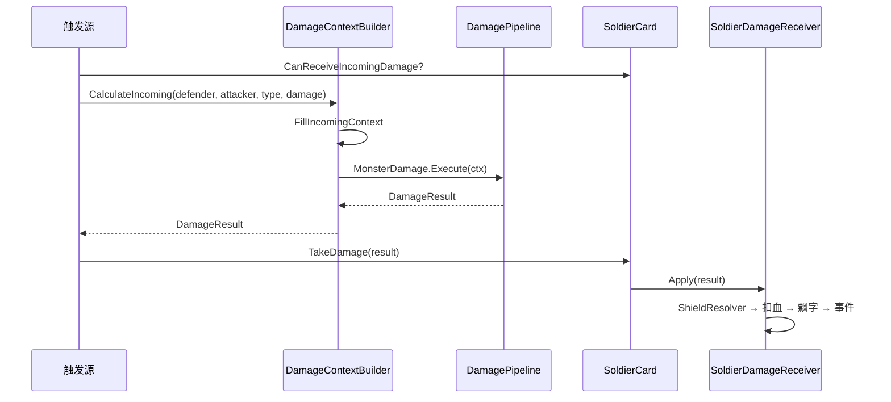
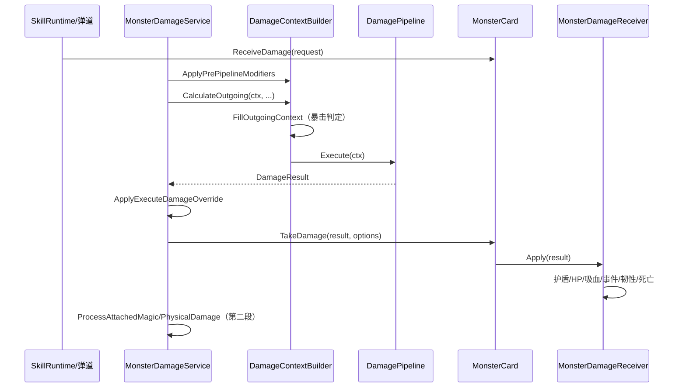

# 伤害链路说明（Damage Chain）

> 文档生成时间：2026-07-04  
> 适用版本：FusionContinent `cardwar1.9_dev`  
> 关联文件：`DamageContextBuilder.cs`、`DamagePipeline.cs`、`DamageSystem_README.md`

本文档聚焦**完整伤害链路**——从技能/攻击触发到最终扣血，说明各阶段的职责边界与数据流向。

---

## 1. 总览：计算与结算分离

```
┌─────────────────────────────────────────────────────────────────┐
│                        伤害触发层                                │
│  SkillRuntime / 弹道命中 / BurnBuff / 怪物攻击 / 场景技能        │
└────────────────────────────┬────────────────────────────────────┘
                             │
                             ▼
┌─────────────────────────────────────────────────────────────────┐
│              DamageContextBuilder（只读属性，无副作用）           │
│  ApplyPrePipelineModifiers → FillIncoming/OutgoingContext       │
└────────────────────────────┬────────────────────────────────────┘
                             │ DamageContext
                             ▼
┌─────────────────────────────────────────────────────────────────┐
│              DamagePipeline.Execute（纯公式，不扣血）              │
│  按 PipelineType 顺序执行 IDamageModifier 链                     │
│  IsMiss=true 时立即中断，FinalDamage=0                           │
└────────────────────────────┬────────────────────────────────────┘
                             │ DamageResult
                             ▼
┌─────────────────────────────────────────────────────────────────┐
│              后处理（仍在 MonsterDamageService 内）               │
│  ApplyExecuteDamageOverride / 附加魔法·物理伤害第二段           │
└────────────────────────────┬────────────────────────────────────┘
                             │
                             ▼
┌─────────────────────────────────────────────────────────────────┐
│              DamageReceiver（副作用层）                           │
│  SoldierDamageReceiver / MonsterDamageReceiver                    │
│  护盾 → 扣血 → 飘字 → 事件 → 死亡/韧性                          │
└─────────────────────────────────────────────────────────────────┘
```

**核心原则：**

| 阶段 | 能否改角色状态 | 典型类 |
|------|----------------|--------|
| 上下文构建 | 否 | `DamageContextBuilder` |
| 管线计算 | 否 | `DamagePipeline` + `IDamageModifier` |
| 斩杀升格 | 仅改 ctx | `MonsterDamageService.ApplyExecuteDamageOverride` |
| 结算 | 是 | `*DamageReceiver`、`ShieldResolver` |

---

## 2. 两条主链路

### 2.1 入站：怪物 → 英灵



**入口调用点：**

| 文件 | 场景 |
|------|------|
| `MainCity.cs` | 主城英灵受击 |
| `GamePlayManager.cs` | `VillageSoldierTaskDamage` |
| `BurnBuff.cs` | 灼烧 DOT 对英灵 |
| `BulletController.cs` | 弹道直接命中英灵 |
| `SoldierDamageCalculator.cs` | 兼容层 API |

**FillIncomingContext 填充的关键字段：**

| 字段 | 来源 | 用途 |
|------|------|------|
| `missRate` | `SoldierMissNum` | DodgeModifier 闪避判定 |
| `SoldierTakeDamage` | 英灵属性 | TakeDamageModifier |
| `FragileBonus` | `SoldierFragileDamage` | FragileModifier |
| `Resistance` | 物理/魔法抗性 | ResistanceModifier |
| `CritRate` | 固定 0 | 怪物攻击不暴击 |

---

### 2.2 出站：英灵/场景 → 怪物



**入口调用点：**

| 文件 | 场景 |
|------|------|
| `MonsterCard.ReceiveDamage` | 聚合入口，委托 `MonsterDamageService` |
| `BurnArea.cs` | 灼烧区域 DOT（BuffSkillDamage 管线） |
| `AbnormalBuff.cs` / `EffectsExecutor.cs` | Buff 伤害 |

**出站链路阶段详解：**

| 阶段 | 方法 | 说明 |
|------|------|------|
| 1. 前置修正 | `ApplyPrePipelineModifiers` | SkillDamage%、灼烧层数×SkillFireDamage |
| 2. 上下文填充 | `FillOutgoingContext` | 暴击判定、穿透、斩杀预判、PreHitMonsterHp |
| 3. 模板斩杀线 | `BuffApplier.PrepareTemplateExecuteThreshold` | 写入 TemplateExecuteThreshold |
| 4. 管线执行 | `DamagePipeline.Execute` | Modifier 链逐节点修改 FinalDamage |
| 5. 斩杀升格 | `ApplyExecuteDamageOverride` | 血量≤阈值 → FinalDamage=99999 |
| 6. 结算 | `MonsterDamageReceiver.Apply` | 扣 HP/护盾、飘字、事件 |
| 7. 附加伤害 | `ProcessAttachedMagic/PhysicalDamage` | 规则追加的独立第二段伤害 |

---

## 3. DamageContextBuilder API 速查

| 方法 | 方向 | 职责 |
|------|------|------|
| `CalculateIncoming` | 怪物→英灵 | 新建 ctx + FillIncoming + 执行 MonsterDamage 管线 |
| `FillIncomingContext` | 怪物→英灵 | 仅填充 ctx，不执行管线 |
| `ApplyPrePipelineModifiers` | 英灵→怪物 | 管线前 SkillDamage / 灼烧加成 |
| `FillOutgoingContext` | 英灵→怪物 | 填充 ctx（含暴击判定），不执行管线 |
| `CalculateOutgoing` | 英灵→怪物 | FillOutgoing + 执行指定管线 + 清理临时标志 |

---

## 4. 四条 DamagePipeline 与 Modifier 顺序

> 任意节点设置 `ctx.IsMiss = true` 后，管线立即返回，后续 Modifier 不再执行。

### 4.1 MonsterDamage（怪物 → 英灵）

```
AttributesModifier
→ DodgeModifier          ← miss 中断
→ TakeDamageModifier
→ ResistanceModifier     ← 公式: FinalDamage × 500 / (res + 500)
→ CritFinalModifier      ← CritRate=0，实际不触发
→ FragileModifier
→ ComboModifier
→ BrokenStateDamageModifier
→ ExecutionThresholdModifier
```

### 4.2 SoldierDamage（英灵 → 怪物）

```
BattleRuleDamageModifier ← 规则：OnDamageBefore / OnAttackBefore / OnSkillBefore / OnCriticalBefore
→ AttributesModifier     ← AllDamageBonus 全局增伤
→ CareerDamageModifier   ← 职业系增伤
→ TakeDamageModifier
→ StrengthModifier       ← 力量型：RawDamage 20% 转 FinalDamage
→ ResistanceModifier
→ CritFinalModifier      ← IsCrit 时 × CritMultiplier/100
→ FragileModifier
→ SoulFlawsBreakModifier ← 破盾增伤
```

### 4.3 BuffSkillDamage（Buff / DOT）

```
ResistanceModifier
→ FragileModifier
```

### 4.4 SceneSkillDamage（无攻击者场景技能）

```
ResistanceModifier
```

> **注意**：`GamePlayManager.InitializeDamagePipelines` 当前仅注册 MonsterDamage / SoldierDamage / SceneSkillDamage。请求 `BuffSkillDamage` 时会 fallback 到 SoldierDamage 管线（`GetDamagePipeline` 的 TryGetValue 失败分支）。

---

## 5. DamageContext 关键字段流转

### 5.1 伤害数值字段

| 字段 | 写入时机 | 读取/修改者 |
|------|----------|-------------|
| `BaseDamage` | Builder 初始化 | 调试日志 |
| `RawDamage` | Builder 初始化 | StrengthModifier |
| `FinalDamage` | Builder 初始化，Modifier 链逐步修改 | 最终结算 |
| `TrueDamage` | BattleRuleDamageModifier | MonsterDamageReceiver 独立飘字 |
| `ToughnessDamage` | Builder（技能属性） | ComboModifier、Receiver 扣韧性 |

### 5.2 暴击链路

```
SkillRuntime 释放时预掷
  → monster.damageContext.HasPreRolledCrit / PreRolledCrit
  → FillOutgoingContext 消费预掷（或现场 RandomTool 判定）
  → ctx.IsCrit
  → BattleRuleDamageModifier.OnCriticalBefore（SoldierDamage）
  → CritFinalModifier 应用倍率
  → MonsterDamageReceiver 暴击特效 / 落雷
```

### 5.3 斩杀链路

| 类型 | 判定位置 | 条件 | 结果 |
|------|----------|------|------|
| 模块斩杀 | FillOutgoingContext + ApplyExecuteDamageOverride | 普通怪 + 血量比例 ≤ MonsterExecutionThreshold | FinalDamage=99999 |
| 模板斩杀 | PrepareTemplateExecuteThreshold + ApplyExecuteDamageOverride | PreHitMonsterHp ≤ TemplateExecuteThreshold | FinalDamage=99999 |
| Boss | ApplyExecuteDamageOverride | 跳过 | 不升格 |

---

## 6. 抗性公式（ResistanceModifier）

```
有效抗性 res =
  ctx.Resistance × (1 - (穿透% + 穿透固定%) × (1 + 穿透倍率))
  - (固定穿透 + resistanceIgnoreValue) × (1 + resistanceIgnorePenre)

res = max(res, 0)

若 res > 0:
  FinalDamage = Ceil(FinalDamage × 500 / (res + 500))
```

穿透固定值 `resistanceIgnoreValue` 由 `BattleRuleDamageModifier` 在管线内通过规则写入。

---

## 7. 结算层差异

### 7.1 SoldierDamageReceiver（英灵）

1. `IsMiss` → 飘字 "MISS"，返回 0
2. `ShieldResolver.Resolve(FinalDamage)` → 月影盾 / 普通护盾
3. 扣 `SoldierHealth`
4. 飘字、发布 `HeroAfterHarmed` 事件
5. `BattleRuleComputerSupport.OnBeHit`

### 7.2 MonsterDamageReceiver（怪物）

1. 护盾（Armor）吸收 → 溢出转 HP 伤害
2. 扣 `hp`、吸血、破盾图标
3. 发布 `HpDamageEvent`（含斩杀 99999 飘字）
4. `TrueDamage` 独立飘字（RealDamage 类型）
5. 暴击后规则、普攻后规则
6. 死亡判定 → `Die()`
7. 韧性伤害（非 weak 状态）
8. 受击特效、连续伤害计数

---

## 8. 附加伤害第二段

`BattleRuleDamageModifier` 可能向 ctx 写入：

| 字段 | 触发条件 | 后续处理 |
|------|----------|----------|
| `AttachedMagicDamage` | 物理主伤害 + 规则 AddMagicDamage | `ProcessAttachedMagicDamage` 独立走 MagicDamage 管线 |
| `AttachedPhysicalDamage` | 非物理主伤害 + 规则 AddADDamage | `ProcessAttachedPhysicalDamage` 独立走 PhysicalDamage 管线 |

第二段均设 `skipBattleRuleBeforeTrigger=true`、`isAgainDamage=true`，避免规则递归。

---

## 9. 快速接入

### 新增英灵受击来源

```csharp
if (soldier.CanReceiveIncomingDamage(baseDamage))
{
    var result = DamageContextBuilder.CalculateIncoming(
        soldier, monsterAttacker, damageType, baseDamage);
    soldier.TakeDamage(result);
}
```

### 新增怪物受击来源

```csharp
// 技能多类型伤害
monster.ReceiveDamage(MonsterDamageRequest.ForSkillSumTypes(
    monster, skillCard, hitPos, damageInheritance, soldier));

// 单段伤害（Buff/DOT/弹道）
monster.ReceiveDamage(MonsterDamageRequest.Single(
    monster, damageType, baseDamage, skill, hitPos,
    soldier, DamagePipelineType.BuffSkillDamage));
```

---

## 10. 相关文档索引

| 文档 | 内容 |
|------|------|
| `DamageSystem_README.md` | 重构架构、文件清单、设计约束 |
| `BattleRuleDamageSupport.cs` | BattleRuleDamageModifier 规则触发顺序 |
| `Assets/Scripts/Game/Skill/Doc/ExecuteBuff_配置说明.md` | 模板斩杀 Buff 配置 |
