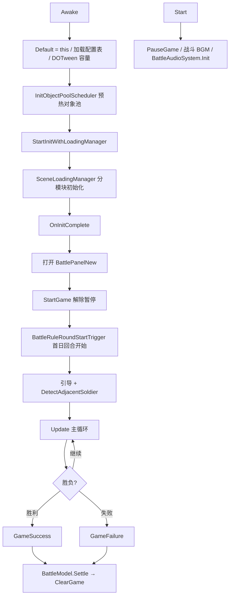
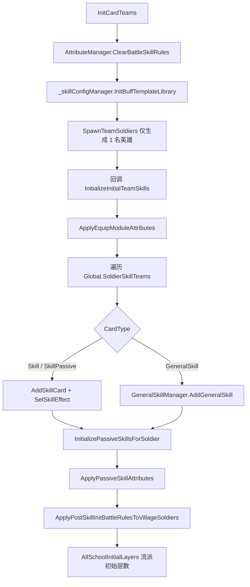
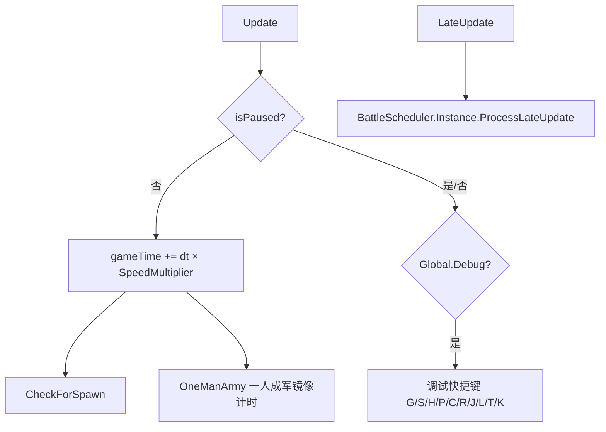
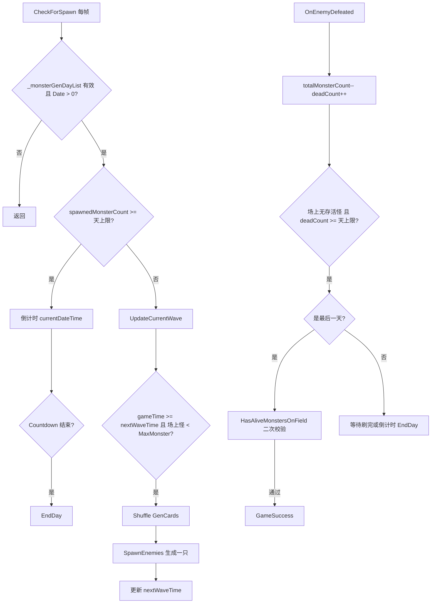
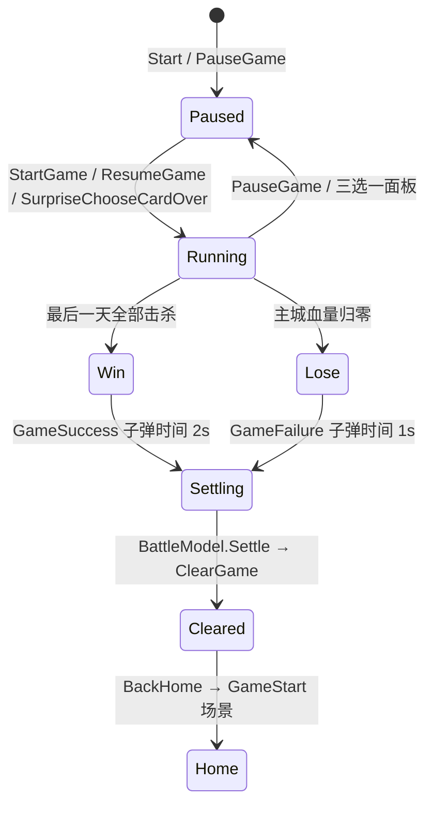
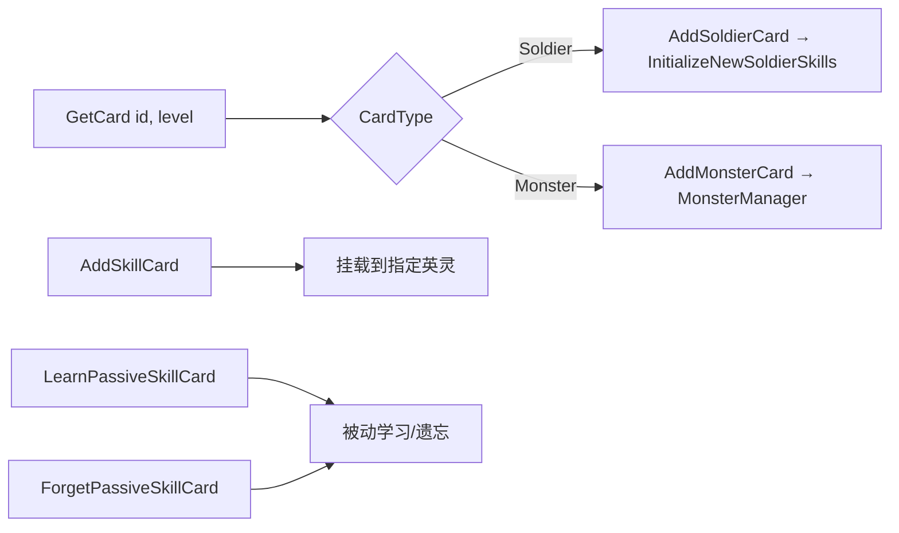
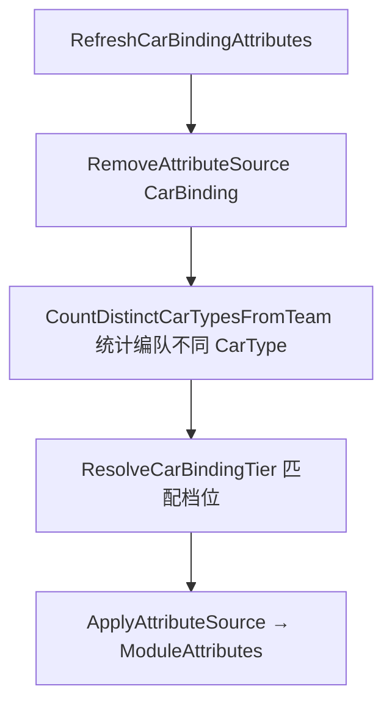
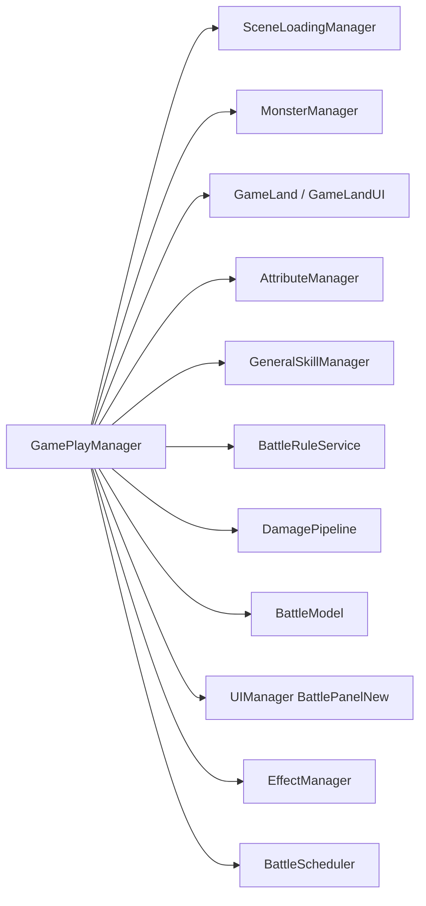

# GamePlayManager 战内核心控制器 AI 上下文

> 供后续 AI 对话或开发接续使用。  
> 最后更新：2026-07-08  
> 关联：`BattleRule_RoundStart_2150102_Context.md`、`SceneInitAttributeAggregation_Context.md`、`EffectManager_Context.md`

---

## 1. 功能概述

`GamePlayManager` 是战斗场景的**全局单例控制器**（`GamePlayManager.Default`），负责战内生命周期、分模块场景初始化、出战阵容、刷怪/天数推进、暂停恢复、胜负结算、法力/BUFF/属性聚合等。

| 项 | 说明 |
|----|------|
| 基类 | `ViewController`（QFramework） |
| 组织形式 | `partial class`，主逻辑 + `CarBinding` 分部 |
| 入口场景 | 战斗场景挂载于场景根节点 |
| 初始化方式 | `SceneLoadingManager` 分模块串行加载，完成后 `OnInitComplete` |

---

## 2. 文件清单

| 文件 | 路径 | 职责 |
|------|------|------|
| 主逻辑 | `Assets/Scripts/Game/GamePlayManager.cs` | 生命周期、刷怪、卡牌、法力、BUFF、结算（~2800 行） |
| 职业羁绊 | `Assets/Scripts/Game/GamePlayManager.CarBinding.cs` | `RefreshCarBindingAttributes` 编队职业种类加成 |
| Designer | `Assets/Scripts/Game/GamePlayManager.Designer.cs` | QFramework 生成，当前为空，**禁止手改** |

### 2.1 关联 SceneInit 模块

初始化由 `StartInitWithLoadingManager()` 注册，经 `SceneLoadingManager` 执行：

**数据模块（顺序执行）：**

| 模块 | 文件 | 调用 GamePlayManager 方法/字段 |
|------|------|-------------------------------|
| SceneInitObjectPool | `Scenes/LoadingModules/Data/SceneInitObjectPool.cs` | 对象池预热 |
| SceneInitAttributes | `Scenes/LoadingModules/Data/SceneInitAttributes.cs` | 重置 `ModuleAttributes`、`MonsterAttributes`、`ClearBattleLegacySkillState` |
| SceneInitMonsterConfig | `Scenes/LoadingModules/Data/SceneInitMonsterConfig.cs` | 加载 `_monsterGenCfg`、`StageCfg`、刷怪天上限映射 |
| SceneInitStageSettings | `Scenes/LoadingModules/Data/SceneInitStageSettings.cs` | 关卡设置 |
| SceneInitAttributeAggregation | `Scenes/LoadingModules/Data/SceneInitAttributeAggregation.cs` | 外部养成属性聚合到 `ModuleAttributes` |

**显示模块（顺序执行，刷怪必须在最后）：**

| 模块 | 文件 | 调用 GamePlayManager 方法/字段 |
|------|------|-------------------------------|
| SceneInitBuildingSlots | `Scenes/LoadingModules/Display/SceneInitBuildingSlots.cs` | 建筑槽位 |
| SceneInitPositions | `Scenes/LoadingModules/Display/SceneInitPositions.cs` | 友方/怪物出生点 |
| SceneInitWaveConfig | `Scenes/LoadingModules/Display/SceneInitWaveConfig.cs` | 波次配置 |
| SceneInitManagers | `Scenes/LoadingModules/Display/SceneInitManagers.cs` | 各 Manager 初始化 |
| SceneInitCardTeams | `Scenes/LoadingModules/Display/SceneInitCardTeams.cs` | `InitCardTeams()` |
| SceneInitGreedyAdvance | `Scenes/LoadingModules/Data/SceneInitGreedyAdvance.cs` | 贪婪预支卡开局金币（须在 CardTeams 之后） |
| SceneInitStartSpawning | `Scenes/LoadingModules/Display/SceneInitStartSpawning.cs` | `InitFirstDay()` → `EndDay()` |

---

## 3. 核心字段速查

| 字段 | 类型 | 说明 |
|------|------|------|
| `Default` | `static GamePlayManager` | 全局单例，Awake 赋值 |
| `gameTime` | `float` | 战内累计时间，刷怪间隔基准 |
| `isPaused` | `bool` | 暂停标志，`Start()` 初始为 true |
| `isDayInProgress` | `bool` | 当前天是否进行中，`StartGame()` 置 true |
| `totalMonsterCount` | `int` | 场上存活怪物数 |
| `spawnedMonsterCount` | `int` | 本天已生成怪物总数 |
| `deadCount` | `int` | 本天已击杀怪物数 |
| `currentWaveIndex` | `int` | 当前波次下标 |
| `nextWaveTime` | `float` | 下次刷怪时间点 |
| `_monsterGenCfg` | `MonsterGenConfig` | 当前关卡刷怪总配置 |
| `_monsterGenDayList` | `MonsterGenStage` | 当前天刷怪配置 |
| `_monsterGenDayUpperLimitMap` | `Dictionary<int,int>` | 每天刷怪数量上限 |
| `villageGameCards` | `List<SoldierCard>` | 场上英灵列表 |
| `buildingDic` | `Dictionary<int, BuildingCard>` | 建筑槽位映射 |
| `ModuleAttributes` | `AttributeSet` | 模块聚合属性（装备/奥数/羁绊等） |
| `MonsterAttributes` | `AttributeSet` | 怪物属性加成 |
| `_damagePipelines` | `Dictionary<...>` | 伤害计算管线（Soldier/Monster/SceneSkill） |
| `_spawnedTeamSoldierCount` | `int` | 已从编队上场的英雄数量 |
| `_gameOver` | `bool` | 战斗已结束标志 |
| `_dayState` | `BattleDayState` | 战斗天状态 |

---

## 4. 总体生命周期



### 4.1 Awake vs Start 分工

| 阶段 | 方法 | 行为 |
|------|------|------|
| `Awake` | 基础设施 | 单例、配置表、对象池、Spine Bake、**启动分模块加载** |
| `Start` | 表现层 | `PauseGame()`、播放战斗 BGM、`BattleAudioSystem.Init()` |

> **首日 RoundStart 触发点**：`OnInitComplete → StartGame()` 之后调用 `BattleRuleRoundStartTrigger.Trigger()`。  
> `InitFirstDay → EndDay()` 时 `isDayInProgress=false`，**不会**在首日 EndDay 触发 RoundStart。详见 `BattleRule_RoundStart_2150102_Context.md`。

### 4.2 OnInitComplete 时序

```
OnInitComplete
  → new BattlePanelViewModel + OpenPanelAsync<BattlePanelNew>
  → DelayedCall 0.2s
      → StartGame()
      → BattleRuleRoundStartTrigger.Trigger()   // 首日 RoundStart
      → DelayedCall 0.5s
          → TriggerGuide(GuideStageStory)
          → DetectAdjacentSoldier()
```

---

## 5. 出战单位初始化（InitCardTeams）



### 5.1 关键设计约束

| 约束 | 说明 |
|------|------|
| 开局只上 1 英雄 | `SpawnTeamSoldiers(cardsPosition, 1, ...)`；其余通过 `TryAddHeroFromTeamByLevelUp()` 城市升级添加 |
| 装备属性时机 | `ApplyEquipModuleAttributes` 在奥数卡 `AddGeneralSkill` **之前**，保证 `LearnSkillRule` 顺序正确 |
| 技能后补同步 | `ApplyPostSkillInitBattleRulesToVillageSoldiers` 处理装备/月影祝福等在技能挂载后的属性叠加 |
| 清除旧战内状态 | `SceneInitAttributes` 调用 `ClearBattleLegacySkillState`，须在 `LearnSkillRule` 生效前执行 |

### 5.2 ApplyEquipModuleAttributes 链路

```
Equip.GetModuleAttributeEntries()           → SourceType.Equip
WeaponService.GetModuleAttributeEntries()   → SourceType.SpeakerSkin（轮语者武器）
SpeakerService.GetModuleAttributeEntries()  → SourceType.SpeakerSkin（轮语者皮肤）
ApplyEquipBattleGoldBonus()                 → BattleGoldInitialQuantity 修正局内金币
```

---

## 6. Update 主循环



### 6.1 调试快捷键（Global.Debug == 1）

| 键 | 功能 |
|----|------|
| G | +9999 金币 |
| S | 切换速度倍率 1~5 |
| H | 全场英灵满血 |
| P | 解锁详情面板 + battleLog |
| C | 打开 SchoolChooseCardPanel |
| R | 技能 CD -100 |
| J | 掉落惊喜三选一 |
| L | ToolPanel 流派卡 |
| T | ToolPanel 场景技能 |
| K | 全屏伤害测试属性 |

---

## 7. 刷怪与天数推进



### 7.1 天数推进两条路径

| 路径 | 触发条件 | 入口 |
|------|----------|------|
| 击杀清场 | 场上无存活怪 + `deadCount >= 天上限` | `OnEnemyDefeated` |
| 刷完倒计时 | `spawnedMonsterCount >= 天上限` + 倒计时结束 | `CheckForSpawn → EndDay` |

### 7.2 EndDay 重置项

```
EndDay()
  → 最后一天直接 return（不推进天数）
  → 清空 spawnedMonsterCounts / spawnedWaves / spawnedMonsterPositions
  → gameTime = 0, spawnedMonsterCount = 0, currentWaveIndex = 0
  → Global.Date.Value++
  → 切换 _monsterGenDayList 为新天配置
  → 英灵 RoundBeHitCount 未受击主属性加成
  → AddListenerCondition(SurvivalDays)
  → 若 isDayInProgress: BattleRuleRoundStartTrigger.Trigger()  // 换波 RoundStart
```

### 7.3 SpawnEnemies 要点

- 按 `MonsterQuality` 选择出生点：Ordinary / Elite / Boss
- Ordinary 怪数量受 `FollowUpMonsterNum` 模块属性修正
- 同种怪有 `uniqueKey = cardId_level_maxCount` 数量上限
- 每次 `CheckForSpawn` 只生成一只，`currentWaveSpawnDataIndex` 递增；波内全部生成完后 `currentWaveIndex++`

### 7.4 InitFirstDay

```csharp
public void InitFirstDay() => EndDay();
```

在 `SceneInitStartSpawning`（所有初始化最后）调用，将 `Global.Date` 推进到第 1 天并设置 `_monsterGenDayList`。此时 `isDayInProgress=false`。

---

## 8. 暂停 / 恢复 / 胜负



| 方法 | 触发来源 | 行为 |
|------|----------|------|
| `PauseGame()` | 开局/结算/三选一 | `Time.timeScale=0`，暂停 DOTween 和怪物 |
| `StartGame()` | 初始化完成/三选一结束 | 解除暂停，`isDayInProgress=true`，恢复怪物 |
| `ResumeGame()` | UI 恢复按钮 | 同 StartGame 但不设 `isDayInProgress` |
| `GameSuccess()` | 最后一天清怪 | 子弹时间 2s → `BattleModel.Settle` → `ClearGame` |
| `GameFailure()` | `GameLandUI` / `MainCity` 城墙被破 | 子弹时间 1s → 失败结算 → `ClearGame` |
| `BackHome()` | 主动退出 | 结算 → `ClearGame` → 加载 `GameStart` 场景 |
| `RestartGame()` | 重开 | 结算 → `ClearBattleLegacySkillState` → `BattleModel.Start` |

### 8.1 ClearGame / ClearBattleLegacySkillState

**ClearBattleLegacySkillState**（战内状态清理，Restart 也会调用）：
- `BattleRuleService.Reset()` + `ClearComputerCounters()`
- 停止 Legacy 技能运行时
- `StopAllBattleTweens` + `StopActiveLegacySceneEffects`
- `villageGameCards.Clear()`

**ClearGame**（完整清场，回主界面）：
- `PauseGame` + `_gameOver = true`
- `ClearBattleLegacySkillState`
- `Global.ResetGemData` + `Global.ResetProperties`
- 销毁 `GameMap` / `GameLand` / `GameLandUI` / `GuideManager`

---

## 9. 卡牌创建入口



| 方法 | 说明 |
|------|------|
| `AddSoldierCard` | 实例化 SoldierCard，检查人口上限，设置站位 |
| `AddMonsterCard` | 实例化 MonsterCard，注册到 MonsterManager |
| `AddSkillCard` | 给英灵挂载技能卡 |
| `TryAddHeroFromTeamByLevelUp` | 城市升级时从编队追加英雄 |
| `SpawnTeamSoldiers` | 按编队顺序批量生成英雄 |

---

## 10. 职业羁绊（CarBinding 分部类）

文件：`GamePlayManager.CarBinding.cs`



- 配置来源：`TbBindingConfig` 中 `BindingType.CarBinding`
- 属性来源键：`CarBindingSourceKey = "CarBinding"`
- 来源类型：`AttributeSourceType.GeneralSkill`

---

## 11. Region 功能分区

| Region | 主要方法 | 说明 |
|--------|----------|------|
| 游戏定义事件 | `StartGame` / `PauseGame` / `GameSuccess` / `GameFailure` / `BackHome` / `RestartGame` | 生命周期控制 |
| 生成怪物 | `CheckForSpawn` / `SpawnEnemies` / `OnEnemyDefeated` / `EndDay` / `NextDay` | 刷怪与天数 |
| 卡牌逻辑 | `GetCard` / `AddSoldierCard` / `AddMonsterCard` / `AddSkillCard` | 单位创建 |
| 建筑卡相关 | `FindCardById` | 建筑查询 |
| 友方单位相关 | `FindClosestPosition` / `GetPositionSoldier` | 站位计算 |
| 法力值 | `UpdateGameMana` / `UpdateGameManaFragment` / `CheckForRecoverGameMana` | 战内法力 |
| 战内角色 | `GetVillageGameCard` / `TraverseVillageSoldier` / `ReviveSoldierCard` | 英灵遍历 |
| 生效条件 | `AddListenerCondition` / `CompleteCondition` | 成就/任务条件 |
| BUFF | `GetBuffEffectProperty` / `AddBuffEffectProperty` | BUFF 属性汇总 |

---

## 12. 关键依赖关系



---

## 13. 伤害管线

```csharp
GetDamagePipeline(DamagePipelineType type)
```

| 类型 | 用途 |
|------|------|
| `SoldierDamage` | 英灵造成伤害（默认 `damagePipeline` 兼容属性） |
| `MonsterDamage` | 怪物造成伤害 |
| `SceneSkillDamage` | 场景技能伤害 |

详见 `DamageSystem_README.md`、`DamageChain_Context.md`。

---

## 14. 已知问题与排查

### 14.1 界面打开了但不刷怪

- **查：** `_monsterGenDayList` 是否为 null；`Global.Date.Value` 是否 > 0
- **查：** `SceneInitStartSpawning` 是否最后执行、`InitFirstDay` 是否被调用
- **查：** `isPaused` 是否为 true（`CheckForSpawn` 仅在 Update 非暂停分支间接依赖 gameTime 推进）

### 14.2 首日 RoundStart 规则不触发

- **查：** 是否只在 `EndDay` 触发而漏了 `OnInitComplete → StartGame` 后的 `BattleRuleRoundStartTrigger.Trigger()`
- **文档：** `BattleRule_RoundStart_2150102_Context.md`

### 14.3 换波 RoundStart 不触发

- **查：** `EndDay` 时 `isDayInProgress` 是否为 true
- **查：** 是否误在最后一天 `EndDay` 直接 return

### 14.4 胜利结算过早

- `OnEnemyDefeated` 在最后一天会调用 `HasAliveMonstersOnField()` 二次校验
- 日志关键字：`胜利结算拦截：场上仍有存活怪物`

### 14.5 装备/奥数属性未生效

- **查：** `ApplyEquipModuleAttributes` 是否在 `AddGeneralSkill` 之前
- **查：** `ApplyPostSkillInitBattleRulesToVillageSoldiers` 是否在技能初始化后执行
- **文档：** `BattleRule_EquipLearnSkillRule_Context.md`、`BattleRule_SkillSourceBuff_Context.md`（链式学习来源参数）

### 14.6 重开战斗后技能残留

- **查：** `RestartGame` 是否调用 `ClearBattleLegacySkillState`
- **查：** Legacy 技能是否注册在 `SkillConfigManager.GetLegacyCastOnlySkillIds()`

### 14.7 NextDay 未被外部调用

`NextDay()` 为 `private`，当前代码库无外部 `.NextDay()` 调用。天数推进实际走 `EndDay()`（击杀清场或倒计时）。

---

## 15. 修改约束（AI 必遵）

| 类别 | 规则 |
|------|------|
| 日志 | 只用 `LogTool`，禁止 `Debug.Log` |
| 初始化顺序 | 数据模块 → 显示模块；`SceneInitStartSpawning` 必须最后 |
| RoundStart | 首日在 `OnInitComplete`；换波在 `EndDay`（`isDayInProgress=true`） |
| 装备属性 | `ClearBattleSkillRules` → `ApplyEquipModuleAttributes` → 奥数卡 |
| 战内特效预加载 | `SetSkillEffect` 走 `EffectManager.PreloadEffectPool`，见 `EffectManager_Context.md` |
| Designer | 禁止手改 `GamePlayManager.Designer.cs` |

---

## 16. 相关文档

| 文档 | 路径 |
|------|------|
| RoundStart 触发 | `Battle/Rules/BattleRule_RoundStart_2150102_Context.md` |
| 战斗规则服务 | `Battle/Rules/BattleRuleService_Context.md` |
| 属性聚合初始化 | `Scenes/LoadingModules/Data/SceneInitAttributeAggregation_Context.md` |
| 属性系统 | `Game/Attribute/AttributeSystem_Context.md` |
| 伤害系统 | `Game/DamageCalculator/DamageSystem_README.md` |
| 局内特效 | `Game/EffectManager_Context.md` |
| 英灵重构 | `Game/Soldier/SoldierCard_Refactor_Context.md` |
| 怪物重构 | `Game/Monster/MonsterCard_Refactor_Context.md` |
| AI 索引 | `AI_Context_Index.md` |

---

## 17. 维护记录

| 日期 | 变更 |
|------|------|
| 2026-07-08 | 初版：生命周期、InitCardTeams、刷怪/天数、胜负、CarBinding、排查清单 |
