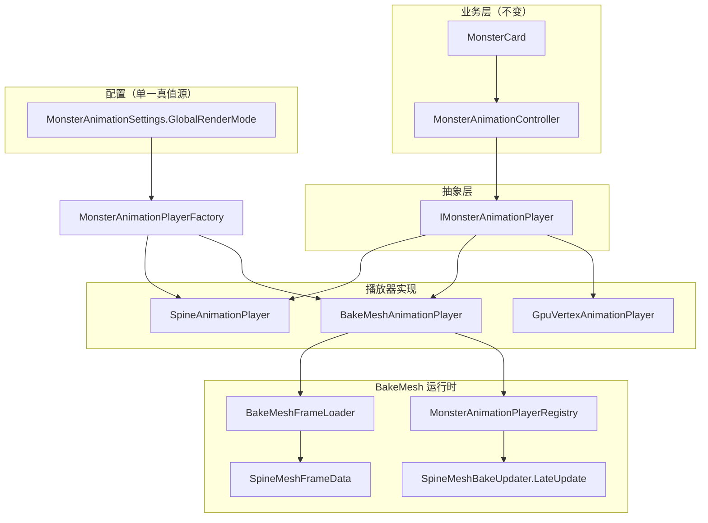

# BakeMesh 怪物动画系统文档

> 局内怪物 Spine 动画的 **BakeMesh（查表播 Mesh 帧）** 与 **Spine Runtime（骨骼实时）** 双模式架构说明。  
> 业务层（`MonsterCard`、状态机、攻击、Buff）**不感知**具体渲染方式，统一通过 `MonsterAnimationController` 调用。

---

## 1. 目标

| 模式 | 运行时行为 | 适用场景 |
|------|-----------|----------|
| **Spine** | 完整骨骼 + AnimationState + Mesh 重建 | 默认、Boss/精英、无烘焙资源 |
| **BakeMesh** | 预烘焙顶点帧查表 + `SetVertexBufferData` 上传 | 大量普通怪同屏，降低 CPU |
| **GpuVertex** | 预留，当前回退 Spine | 未来 GPU 顶点贴图方案 |

---

## 2. 架构总览



### 2.1 数据流对比

**Spine 模式**

```
MonsterCard.Play("walk")
  → MonsterAnimationController.Play
  → SpineAnimationPlayer.Play
  → AnimationState.SetAnimation
  → SkeletonAnimation.LateUpdate（Unity 生命周期）
  → Mesh 重建 + 渲染
```

**BakeMesh 模式**

```
MonsterCard.Play("walk")
  → BakeMeshAnimationPlayer.Play
  → ApplyCurrentFrame
  → UpdateMesh（仅上传 Vertices + Bounds）
  → SpineMeshBakeUpdater.LateUpdate → Registry.TickAll
```

---

## 3. 核心文件索引

| 路径 | 职责 |
|------|------|
| `Monster/Animation/IMonsterAnimationPlayer.cs` | 播放接口 + Context |
| `Monster/Animation/SpineAnimationPlayer.cs` | Spine Runtime 封装 |
| `Monster/Animation/BakeMeshAnimationPlayer.cs` | 烘焙帧查表播放 |
| `Monster/Animation/MonsterAnimationPlayerFactory.cs` | 按配置创建 Player |
| `Monster/Animation/MonsterAnimationSettings.cs` | **全局渲染模式（真值源）** |
| `Monster/Animation/MonsterAnimationPlayerRegistry.cs` | BakeMesh 集中 Tick |
| `Monster/Animation/SpineRuntimeRestore.cs` | Spine 状态恢复（切模式/Release） |
| `Monster/Animation/BakeMeshFrameLoader.cs` | 运行时加载 `.bytes` |
| `Monster/MonsterAnimationController.cs` | 对外门面，业务唯一入口 |
| `SpineBake/SpineMeshFrameData.cs` | 烘焙数据结构 + v2 二进制格式 |
| `SpineBake/SpineMeshBakeSettings.cs` | 兼容旧 API（读 GlobalRenderMode） |
| `SpineBake/SpineMeshBakeUpdater.cs` | LateUpdate 驱动 BakeMesh |
| `SpineBake/SpineMeshBakePerfMonitor.cs` | 性能对比日志 |
| `Monster/Animation/Editor/SpineMeshBakeWindow.cs` | 编辑器烘焙工具 |

---

## 4. 配置与开关（重要）

### 4.1 单一真值源

**唯一决定创建哪种 Player 的变量：**

```csharp
MonsterAnimationSettings.GlobalRenderMode
// AnimationRenderMode.Spine | BakeMesh | GpuVertex
```

`SpineMeshBakeSettings.UseBakedMesh` 是**只读别名**：

```csharp
UseBakedMesh == (GlobalRenderMode == AnimationRenderMode.BakeMesh)
```

> ⚠️ **禁止**只改 `UseBakedMesh` 或单独写 `PlayerPrefs("UseSpineMeshBake")` 而不改 `GlobalRenderMode`。  
> 历史问题：日志显示 `UseBakedMesh=OFF` 但 77 个怪仍用 `BakeMeshAnimationPlayer`，即两套配置不同步。

### 4.2 推荐 API

```csharp
// 推荐：同步改 GlobalRenderMode + 触发存活怪 Rebind
GamePlayManager.Default.SetSpineMeshBakeEnabled(true);   // BakeMesh
GamePlayManager.Default.SetSpineMeshBakeEnabled(false);  // Spine

// 或直接
MonsterAnimationSettings.SetGlobalRenderMode(AnimationRenderMode.BakeMesh);
MonsterAnimationSettings.SetGlobalRenderMode(AnimationRenderMode.Spine);
```

### 4.3 PlayerPrefs 键

| 键 | 说明 |
|----|------|
| `MonsterAnimationRenderMode` | 主键，`int` 枚举值 |
| `UseSpineMeshBake` | 遗留兼容，`SetGlobalRenderMode` 时同步写入 |

### 4.4  per-Monster 解析规则

`MonsterAnimationSettings.ResolveRenderMode(quality, skeletonName)`：

1. `GlobalRenderMode == Spine` → **Spine**
2. `OnlyOrdinaryMonsters && quality != Ordinary` → **Spine**（Boss/精英）
3. `GlobalRenderMode == BakeMesh` 且 `BakeMeshFrameLoader.HasValidData(skeletonName)` → **BakeMesh**
4. 无烘焙资源 → **Spine**（自动回退）
5. `GlobalRenderMode == GpuVertex` → **GpuVertex**（当前内部回退 Spine）

---

## 5. Monster 初始化与 Player 创建

### 5.1 创建时机

仅在 `MonsterAnimationController.RebindActiveSpine()` 时创建 Player：

```
MonsterCard.Init()
  → 加载/激活 Spine prefab
  → AnimationController.RebindActiveSpine(spine.transform, config.Spine, config.MonsterQuality)
      → ReleasePlayer()           // 销毁旧 Player
      → MonsterAnimationPlayerFactory.CreateForMonster(context)
          → ResolveRenderMode()
          → new SpineAnimationPlayer / BakeMeshAnimationPlayer
          → Initialize(context)
      → Play("walk") 等由 Init 后续逻辑触发
```

### 5.2 开关变更后是否 Rebind？

**会。** `GlobalRenderMode` 变更时 `OnRenderModeChanged`：

- 遍历 `MonsterManager.Instance.enemies`
- 对每个存活怪调用 `RebindRenderPlayer()` + `Play("walk")`

已在场、**开关变更前**刷出的怪，必须等此次 Rebind 或**重新进局**，Player 类型才会更新。

### 5.3 如何验证实际 Player 类型

```csharp
// 单个怪
string type = monster.AnimationController.PlayerTypeName;
// "SpineAnimationPlayer" | "BakeMeshAnimationPlayer" | ...

// 运行时日志（EnablePerfLog=true）
// [AnimationPlayer] Create SkeletonGraphic_GoblinSpine GlobalMode=Spine ResolvedMode=Spine Type=SpineAnimationPlayer
// [SpinePerf] 实际PlayerType= SpineAnimationPlayer=77 BakeMeshAnimationPlayer=0
```

**不要只看配置变量**，要看 `Player.GetType().Name` 或 `[SpinePerf]` 中的 `实际PlayerType`。

### 5.4 对象池回收

`MonsterCard.OnDisable`：

```csharp
AnimationController.ResetForPool();
AnimationController.ReleasePlayer();  // BakeMesh 必须 Release，恢复 Spine 组件状态
```

---

## 6. 烘焙资源

### 6.1 编辑器烘焙

菜单：**Tools → Spine → Spine Mesh Bake Window**

- 输出：`Assets/BakeMesh/{SkeletonName}_Frame.bytes`
- 默认 30 FPS，烘焙 Skeleton 上**全部动画**（含 `atk`、`idle`、`walk` 等）
- 烘焙完成后 Console 输出优化报告（`sharedTopology` / `sharedColors`）

### 6.2 运行时加载地址

`BakeMeshFrameLoader` 按顺序尝试 YooAsset：

1. `{SkeletonName}_Frame`（如 `SkeletonGraphic_GoblinSpine_Frame`）
2. `SpineBakedMesh_{SkeletonName}_Frame`（遗留前缀）

### 6.3 二进制格式 v2

| 块 | 内容 |
|----|------|
| Magic | `SMBK` |
| Version | `2` |
| 动作级 | 共享 UV / Triangles / Colors（若全帧一致） |
| 帧级 | 仅 `Vertices` + `Bounds`（+ 必要时 per-frame Colors） |

v1 旧文件加载后自动 `OptimizeAllActions()` 压缩为运行时 Compact 结构。

---

## 7. BakeMesh 运行时上传优化

### 7.1 优化后每帧路径

```
CompactFrame.Vertices
  → SetVertexBufferData(stream 0)     // 直接引用烘焙数组，无 Array.Copy
  → bounds 赋值

共享拓扑（动作级一次）：
  → SetVertexBufferParams + UV(stream 2) + SetTriangles

颜色：
  → Tint==White && SharedColors → stream 1 仅上传一次
  → Tint!=White → 复用 _tintedColors 缓冲，Tint/帧变化时才重算
```

### 7.2 禁止项（热路径）

- 每帧 `Array.Copy` 顶点/颜色
- 每帧 `SetTriangles` / 重复上传 UV
- `Mesh.Clear`
- `UpdateMesh` 内 LINQ / `foreach` 分配

### 7.3 Spine 组件注意

BakeMesh 初始化顺序：

```csharp
skeletonAnimation.clearStateOnDisable = false;
skeletonAnimation.UpdateMode = UpdateMode.Nothing;
skeletonAnimation.enabled = false;
meshFilter.sharedMesh = runtimeMesh;  // 必须在 disabled 之后绑定
```

> `clearStateOnDisable=true` 时，`enabled=false` 会触发 `OnDisable` 把 `sharedMesh` 清为 `null`。

切回 Spine 时 `SpineRuntimeRestore.Apply()` 恢复 `FullUpdate`、清空 foreign mesh。

---

## 8. 性能监控

### 8.1 开启方式

| 方式 | 说明 |
|------|------|
| **菜单** | `Tools → Spine → Spine Performance Debug` |
| **局内浮层** | 开启「局内调试浮层」后，战斗左上角面板 |
| **代码** | `GamePlayManager.Default.SetSpineMeshBakePerfLogEnabled(true)` |

设置项写入 PlayerPrefs，重启后保留：

- `SpineMeshBakeEnablePerfLog` — 性能日志（默认 **关**）
- `SpineMeshBakeShowPerfOverlay` — 局内浮层（默认 **关**）

### 8.2 组件

- `SpineMeshBakePerfMonitor`（挂 `GamePlayManager`）
- `SpineMeshBakePerfStats`（分项累计）
- `SpineRuntimePerfSampler`（Spine 路径，挂 `SkeletonAnimation`）

### 8.3 开启日志（代码）

```csharp
GamePlayManager.Default.SetSpineMeshBakePerfLogEnabled(true);
GamePlayManager.Default.SetSpineMeshBakePerfOverlayVisible(true); // 局内浮层
// 或
SpineMeshBakeSettings.SetPerfLogEnabled(true);
```

### 8.4 日志字段说明

```
[SpinePerf]
  配置GlobalRenderMode=Spine          // 真值源
  UseBakedMesh=OFF                    // 与 GlobalRenderMode 同步
  存活怪=80(RenderMode烘焙=0 Spine=80) // 按 Player.RenderMode 统计
  实际PlayerType= SpineAnimationPlayer=77 BakeMeshAnimationPlayer=3  // 按 GetType() 统计
  抽样 [Monster_1=SpineAnimationPlayer RenderMode=Spine] ...
  BakeMesh Total / UploadVerts / Topology / Bounds / TintColors
  Spine Total
  AvgPerCall / AvgPerFrame / AvgPerMonster
```

---

## 9. 故障排查

| 现象 | 可能原因 | 处理 |
|------|----------|------|
| 开关 OFF 但 `BakeMeshAnimationPlayer` 仍很多 | 只改了旧 `UseBakedMesh`，未改 `GlobalRenderMode` | 使用 `SetSpineMeshBakeEnabled(false)` 或重新进局 |
| 烘焙 ON 但怪不动/ invisible | `sharedMesh` 被 `OnDisable` 清空 | 确认 Initialize 顺序；看 Console 烘焙加载错误 |
| Spine 模式也不播 | 上次 BakeMesh 未 `ReleasePlayer`，Skeleton 仍 disabled | OnDisable 已加 `ReleasePlayer`；`SpineRuntimeRestore` |
| `动作未烘焙: walk` | 缺 `.bytes` 或动作名不匹配 | 重新 Bake；确认 `config.Spine` 与资源名一致 |
| 切换模式后动画不对 | Rebind 后强制 `Play("walk")` | 静止怪/特殊状态可能需状态机重新 Enter |
| `[BakeMeshFrameLoader] 解析失败` | v2 文件损坏或版本不支持 | 重新 Bake；检查 YooAsset 是否打进包 |

### 9.1 自检清单

- [ ] `GlobalRenderMode` 与 `UseBakedMesh` 一致
- [ ] 抽样怪 `PlayerTypeName` 符合预期
- [ ] 切换开关后 `[AnimationPlayer] Rebind` 日志出现
- [ ] Bake ON：`SpineMeshBakeUpdater` 存在且 `TickAll` 有调用
- [ ] Bake OFF：`SkeletonAnimation.enabled == true`，`UpdateMode == FullUpdate`

---

## 10. 后续优化方向

1. **Vertex Animation Texture (VAT)**：顶点写入纹理，Shader 采样，CPU 近零
2. **GPU Instancing**：同 Skeleton 多怪合批 + 帧索引 Uniform
3. **GraphicsBuffer 持久映射**：批量上传（需改渲染架构）
4. **GpuVertexAnimationPlayer**：实现真正的 GPU 路径，替代当前 Spine 回退

---

## 11. 相关 API 速查

```csharp
// 开关
MonsterAnimationSettings.SetGlobalRenderMode(AnimationRenderMode.Spine);
GamePlayManager.Default.SetSpineMeshBakeEnabled(true);

// 预加载（仅 BakeMesh 模式）
GamePlayManager.Default.PreloadStageSpineBakeData();

// 查询
MonsterAnimationSettings.GlobalRenderMode.Value
monster.AnimationController.RenderMode
monster.AnimationController.PlayerTypeName
monster.AnimationController.UseBakedMesh  // 等价 RenderMode==BakeMesh

// 手动 Rebind（一般不需要，开关变更会自动触发）
monster.AnimationController.RebindRenderPlayer();
```

---

## 12. 变更记录摘要

| 版本 | 内容 |
|------|------|
| 架构迁移 | `IMonsterAnimationPlayer` 抽象，`MonsterAnimationController` 门面不变 |
| 数据 v2 | 共享 UV/Topology/Colors，帧级仅 Vertices |
| 上传优化 | 零 Copy 顶点、拓扑/UV/颜色缓存 |
| 配置修复 | 统一 `GlobalRenderMode` 为真值源，修复开关与 Player 不同步 |
| 稳定性 | `SpineRuntimeRestore`、池回收 `ReleasePlayer`、Factory 失败回退 Spine |
