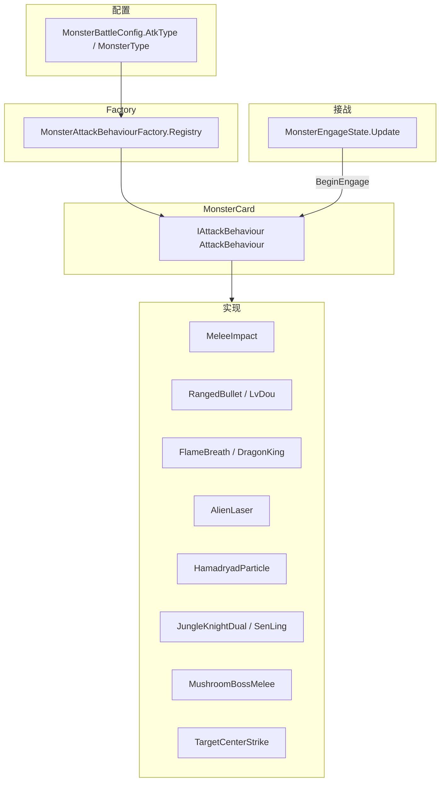

# Monster 攻击行为体系上下文

> 本文档记录怪物攻击表现从 `MonsterCard` / `MonsterAttackHandler` 拆出为 **配置驱动 AttackBehaviour** 的完整上下文，供后续 AI 对话或开发接续使用。  
> 最后更新：2026-07-20

---

## 1. 重构目标

建立可扩展、配置驱动、对象池安全的攻击行为体系：

```
MonsterCard
  ↓
MonsterAttackBehaviourFactory（唯一注册表）
  ↓
IAttackBehaviour（每怪独立实例）
  ↓
具体 AttackBehaviour 实现
```

### 核心原则

| 原则 | 要求 |
|------|------|
| 单一真值源 | 攻击创建与分发**仅**通过 `MonsterAttackBehaviourFactory`；禁止 Card/Handler/EngageState 维护映射 |
| 配置驱动 | `MonsterBattleConfig.AttackBehaviourType` → Factory；禁止 `if (monsterType == xxx)` |
| 开闭原则 | 新怪：新增配置 + 新增 Behaviour + Factory Register；不改 MonsterCard / 状态机转换 |
| 接口依赖 | `MonsterCard` 只依赖 `IAttackBehaviour`，不引用具体实现类 |
| 对象池安全 | 每个 Behaviour 实现 `OnInit` / `OnCleanup`；Die / OnDisable / 回池前释放 Tween/Coroutine/特效 |
| Fail Fast | 未知或未配置 `AttackBehaviourType` → `LogTool.LogError` + `throw`；禁止 Default Fallback |

---

## 2. 当前架构



### 运行时链路

```
Init:
  AttackBehaviour = Factory.Create(config)
  AttackBehaviour.OnInit(this)
  MonsterCreate(...)
  AttackBehaviour.OnSpawnPresentation(this)   // 龙王 roar 等

engage（MonsterEngageState，仅一次）:
  AttackBehaviour.BeginEngage(monster)

退出接战 / 虚弱 / 目标死亡:
  MonsterEngageState.Exit → AttackBehaviour.StopEngage(monster)
  MonsterWeakState.Enter → AttackBehaviour.StopEngage(monster)

Spine 命中（SpineLoop 基类）:
  PlayAttack → Event "atk" → OnSpineEvent → ExecuteAttackHit

Spine 预制体直连（兼容）:
  MonsterCard.SenLingOneAttack() → AttackBehaviour.OnSpineEvent(...)

回收:
  OnDisable / Die / OnDispose / MonsterDeathHandler → AttackBehaviour.OnCleanup
```

---

## 3. 文件清单

### 3.1 新建（AttackBehaviour 模块）

| 文件 | 路径 | 职责 |
|------|------|------|
| IAttackBehaviour | `Game/Monster/AttackBehaviour/IAttackBehaviour.cs` | 生命周期 + 接战 + Spine 事件接口 |
| AttackBehaviourRuntime | `Game/Monster/AttackBehaviour/AttackBehaviourRuntime.cs` | Tween / Coroutine 注册与统一 Stop |
| MonsterAttackBehaviourBase | `Game/Monster/AttackBehaviour/MonsterAttackBehaviourBase.cs` | 基类；幂等 OnCleanup |
| SpineLoopAttackBehaviourBase | `Game/Monster/AttackBehaviour/SpineLoopAttackBehaviourBase.cs` | DOTween 间隔 + Spine atk 循环 |
| MonsterAttackPresentationHelper | `Game/Monster/AttackBehaviour/MonsterAttackPresentationHelper.cs` | 震屏、城墙伤害、池化延迟归还 |
| MonsterAttackBehaviourFactory | `Game/Monster/AttackBehaviour/MonsterAttackBehaviourFactory.cs` | **唯一注册表** + Create + Fail Fast |
| MeleeImpactAttackBehaviour | 同上目录 | 撞击 `guaiwu_gongji_01` |
| LvDouAttackBehaviour | 同上目录 | 射击 `bullet` + BulletController |
| DragonKingAttackBehaviour | 同上目录 | 龙王 roar + 喷火 ChaosDragonKing* |
| AlienLaserAttackBehaviour | 同上目录 | 外星人激光 waixingren_jn1_* |
| HamadryadAttackBehaviour | 同上目录 | 树精出场 + 粒子循环伤害 |
| SenLingAttackBehaviour | 同上目录 | 丛林骑士 conglinqishi_jn1_02/03 |
| MushroomBossAttackBehaviour | 同上目录 | 蘑菇 Boss 震屏 + 城墙伤害 |
| TargetCenterAttackBehaviour | 同上目录 | 中心点目标位置：`(AtkLocation.x, 人物Y)` 生成 Bullet 特效 |

### 3.2 配置

| 文件 | 路径 | 变更 |
|------|------|------|
| AttackBehaviourType | `Data/Client/Luban/AttackBehaviourType.cs` | **新增枚举** |
| MonsterBattleConfig | `Data/Client/Luban/MonsterBattleConfig.cs` | 新增 `AttackBehaviourType` 字段 |
| 怪物战斗表 JSON | `Res/Config/Json/tbmonsterbattleconfig.json` | 每条记录补 `AttackBehaviourType` |

### 3.3 修改

| 文件 | 路径 | 变更摘要 |
|------|------|----------|
| MonsterCard | `Game/MonsterCard.cs` | 持有 `IAttackBehaviour`；删攻击实现 / AttackStage；Spine 转发方法 |
| MonsterEngageState | `Game/Monster/MonsterState/MonsterEngageState.cs` | 仅 `BeginEngage` / `PauseEngage` |
| MonsterMoveState | `Game/Monster/MonsterState/MonsterMoveState.cs` | 删除 `attackStage` 重置 |
| MonsterTweens | `Game/Monster/MonsterTweens.cs` | 删除 `EngagedTarget*` / Handler 分发 |
| MonsterDeathHandler | `Game/Monster/MonsterDeathHandler.cs` | `AttackBehaviour.OnCleanup` |

### 3.4 删除

| 文件 | 说明 |
|------|------|
| `Game/Monster/MonsterAttackHandler.cs` | 逻辑已迁入各 Behaviour |

---

## 4. 配置：AttackBehaviourType

### 枚举值

| 值 | 枚举 | 原逻辑 / AtkType | 典型资源 |
|----|------|------------------|----------|
| 1 | MeleeImpact | ZhuangJi | `guaiwu_gongji_01` |
| 2 | RangedBullet | Shooting | `bullet` |
| 3 | FlameBreath | Flame + 龙王出场 | `ChaosDragonKing*` |
| 4 | AlienLaser | Special + Alien | `waixingren_jn1_*` |
| 5 | HamadryadParticle | MonsterType.Hamadryad | `shujing_cc_01` / `shujing_jn2_01` |
| 6 | JungleKnightDual | MonsterType.JungleKnight | `conglinqishi_jn1_02/03` |
| 7 | MushroomBossMelee | MonsterType.MushroomGiant | 震屏 + 城墙伤害 |
| 8 | TargetCenterStrike | AtkType.TargetCenter（中心点目标位置） | `MonsterBattleConfig.Bullet` 特效名，如 `ShadowFiendAttack01` |

### 分发优先级

`MonsterAttackBehaviourFactory` 解析顺序：

1. 先按 `MonsterType` 特判（树精 / 丛林骑士 / 蘑菇 / 龙王）。
2. 否则按 `AtkType` 映射到上表。
3. 未知 `AtkType` → `LogTool.LogError` + throw（Fail Fast）。

### Excel / Luban

当前运行时以 `AtkType` + `MonsterType` 解析行为，**不依赖**独立的 `AttackBehaviourType` 配置列。

### AtkType 枚举（Luban）

| 值 | 枚举 | 含义 |
|----|------|------|
| 0 | ZhuangJi | 撞击 |
| 1 | Shooting | 射击 |
| 2 | Special | 特殊（外星人激光等） |
| 3 | Flame | 喷火 |
| 4 | TargetCenter | 中心点目标位置：在 `(AtkLocation.x, 人物Y + AtkLocation.y)` 直接生成攻击特效 |

## 5. IAttackBehaviour 契约

```csharp
public interface IAttackBehaviour
{
    bool DeferStraightTravelInit { get; }   // 龙王：延迟 IsInit

    void OnInit(MonsterCard owner);         // Init 时；绑定 Coroutine Host
    void OnCleanup(MonsterCard owner);      // 回池/死亡；幂等
    void OnSpawnPresentation(MonsterCard owner);  // 出场表现（roar 等）

    bool TryHandleStraightTravelArrival(MonsterCard owner, Action onReady);  // 树精入场

    void BeginEngage(MonsterCard owner);
    void PauseEngage(MonsterCard owner);
    void ResumeEngage(MonsterCard owner);
    void StopEngage(MonsterCard owner);   // 退出接战/虚弱；Kill engageTween + 清 Spine 回调

    void OnSpineEvent(MonsterCard owner, string eventName);
}
```

### MonsterCard 对外（攻击相关）

```csharp
public IAttackBehaviour AttackBehaviour { get; private set; }

// Spine / Prefab 兼容转发（无业务逻辑）
public void SenLingOneAttack();
public void SenLingtwoAttack();
public void MoguBoss();
```

### Init 顺序（攻击相关片段）

```
1. _monsterConfig 校验
2. Spine RebindActiveSpine
3. AttackBehaviour = MonsterAttackBehaviourFactory.Create(_monsterConfig)
4. AttackBehaviour.OnInit(this)
5. MonsterCreate(initPos)          // 可调用 TryHandleStraightTravelArrival
6. ... 属性 / AttackRange ...
7. AttackBehaviour.OnSpawnPresentation(this)
8. MoveBehaviour = Factory.Create(MoveType)
```

---

## 6. Factory 注册（唯一入口）

```csharp
MonsterAttackBehaviourFactory.Register(AttackBehaviourType.XXX, () => new XxxAttackBehaviour());
var behaviour = MonsterAttackBehaviourFactory.Create(monsterBattleConfig);
```

**新增攻击类型步骤：**

1. 在 `AttackBehaviourType` 增加枚举值  
2. 实现 `XxxAttackBehaviour : MonsterAttackBehaviourBase` 或 `SpineLoopAttackBehaviourBase`  
3. 在 `MonsterAttackBehaviourFactory` 静态构造函数 `Register`，并在 `ResolveByAtkType` / `ResolveByMonsterType` 增加映射  
4. 在 Luban `AtkType`（或 `MonsterType`）配置怪物  
5. **不要**改 `MonsterCard` / `MonsterEngageState` 状态转换  

---

## 7. 各类 Behaviour 要点

### SpineLoopAttackBehaviourBase（多数怪）

- `BeginEngage`：**必须先** `StopEngage(owner)`，**再** `_owner = owner`，然后创建 DOTween 循环  
- `StopEngage`：Kill `_engageTween`、`_owner = null`、重置冷却、`UnregisterAllSpineCallbacks`  
- `OnCleanup`：`StopEngage` + `Runtime.StopAll`  
- **禁止** `BeginEngage` 在 tween 已存在时仅 `Play()` 复用  
- **禁止** 在 `StopEngage` 之前赋值 `_owner`（见 §14 回归案例）

**正确顺序（强制）：**

```csharp
public override void BeginEngage(MonsterCard owner)
{
    StopEngage(owner);   // 1. 清理旧循环（会 _owner = null）
    _owner = owner;      // 2. 再绑定，供 PlayAttackAnimation 使用
    // 3. 创建 _engageTween ...
}
```

### DragonKingAttackBehaviour

- `DeferStraightTravelInit = true`  
- `OnSpawnPresentation`：roar + `ChaosDragonKingRoar01`，完成后 `IsInit = true`  
- `ExecuteAttackHit`：喷火 `ChaosDragonKingAttack01/02`  

### HamadryadAttackBehaviour

- `TryHandleStraightTravelArrival`：原 `shujing_cc_01` 入场  
- `BeginEngage`：粒子 `shujing_jn2_01` 循环 + 0.5s 延迟城墙伤害（不用 Spine atk）  

### AlienLaserAttackBehaviour

- `ExecuteAttackHit`：创建 `waixingren_jn1_*` 特效 + 分段 DOTween 伤害  
- `OnCleanup`：**必须** Destroy 特效根节点  

### SenLingAttackBehaviour

- 支持 Spine 事件名 `SenLingOneAttack` / `SenLingtwoAttack` 及 Prefab 转发  
- 资源 `conglinqishi_jn1_02` / `_03`  

### TargetCenterAttackBehaviour（中心点目标位置）

- 映射：`AtkType.TargetCenter` → `AttackBehaviourType.TargetCenterStrike`
- 命中点：`(AtkLocation.X, 索敌人物 Y + AtkLocation.Y)`（暗影魔当前为 `(0, 人物Y)`）
- 特效：直接池化生成 `MonsterBattleConfig.Bullet`（如 `ShadowFiendAttack01`），无弹道飞行
- 结算：震屏（精英/Boss）+ 城墙伤害
- 示例怪物：`2303002` 暗影魔

---

## 8. 已从旧架构移除

| 原成员 | 迁移去向 |
|--------|----------|
| `MonsterAttackHandler` | 删除；逻辑在各 Behaviour |
| `MonsterCard.AttackStage` / `attackStage` | 删除；由 Behaviour 自管接战模式 |
| `MonsterCard.BusirenAttack` 等 6 个方法 | 删除实现；SenLing/MoguBoss 保留转发 |
| `MonsterCard` 龙王 / 树精 `MonsterType` 分支 | `DragonKing` / `Hamadryad` Behaviour |
| `MonsterTweens.EngagedTargetRemote/Shujing/Special` | 迁入 Behaviour |
| `MonsterTweens` → `MonsterAttackHandler.Execute` | `SpineLoopAttackBehaviourBase` |

---

## 9. 对象池与生命周期

| 时机 | 调用 |
|------|------|
| `Init` | `OnInit`（每局新 Factory 实例） |
| `OnDisable` | `AttackBehaviour.OnCleanup` |
| `Die` / `OnDispose` | `AttackBehaviour.OnCleanup` |
| `MonsterDeathHandler.Cleanup` | `AttackBehaviour.OnCleanup` |

`MonsterAttackBehaviourBase.OnCleanup` 带 `_isCleaned` 幂等 guard。  
`AttackBehaviourRuntime` 统一 Kill 注册的 Tween、Stop Coroutine。

### 已知修复

- `Instantiate()` 需 `using QFramework;`（扩展方法在 `UnityEngineObjectExtension`）  
- 喷火 `Attack02` 池对象：`ReturnPooledAfterDelay` 注册到 Runtime  
- Alien 特效：`OnCleanup` / `StopEngage` 中 Destroy  

#### 2026-06-25 状态/攻击同步专项

| 问题 | 修复 |
|------|------|
| Boss 破韧仍攻击 | `WeakState.Enter` + `EngageState.Exit` → `StopEngage`；`MonsterAtkRange` 排除 weak |
| 移动无 walk 动画 | 改 `monsterState` 补 `Tick()`；击飞 `specialMove`；`ResumeGame` → `Resume` |
| 普通怪接战不攻击（回归） | `BeginEngage`：`StopEngage` **先于** `_owner = owner` |

完整复盘见 §14–§15；与 FSM 联动见 [MonsterCard_Refactor_Context.md §13](MonsterCard_Refactor_Context.md)。

---

## 10. 关联模块

| 模块 | 关系 |
|------|------|
| [MonsterCard_Refactor_Context.md](MonsterCard_Refactor_Context.md) | 排序 / Spine 动画；攻击循环已迁出 Tweens |
| [DamageSystem_README.md](../DamageCalculator/DamageSystem_README.md) | 怪物**受击** `ReceiveDamage`；与攻击表现独立 |
| `BulletController` / `FlameBulletController` | 仍负责弹道飞行与城墙 `TakeDamage` |
| `MonsterAnimationController` | `PlayAttack` / Event 注册；由 SpineLoop 基类调用 |

---

## 11. 测试检查清单

### 功能（表现与原版一致）

- [ ] MeleeImpact：撞击特效 + 城墙伤害 + 精英震屏  
- [ ] RangedBullet：子弹图标 / 速度 / 命中回收  
- [ ] FlameBreath：龙王 roar 时序 + 喷火三段池  
- [ ] AlienLaser：激光持续时间 ≈ `attackTime - 5f`  
- [ ] HamadryadParticle：入场 + 粒子循环伤害  
- [ ] JungleKnightDual：两段特效 + 伤害  
- [ ] MushroomBossMelee：震屏 + 城墙伤害  
- [ ] 缴械：`AttackState` → `PauseEngage` / `ResumeEngage`  
- [ ] **普通怪接战**：停于攻击范围 → `idle` 循环 → `atk` 造成伤害（`_owner` 非 null）  
- [ ] Boss 破韧：虚弱期间无城墙伤害；恢复后正常 `idle` → `atk` 循环  
- [ ] 击飞落地：walk 动画与 FSM move 状态一致  
- [ ] 改 `BeginEngage`/`StopEngage` 后：必测普通怪 + Boss 破韧/recover（§15）  

### 对象池

- [ ] Die 后立即回池：无 orphan Tween / 外星人特效  
- [ ] 同一 MonsterCard 复用第二次 Init：攻击正常、无旧 tween 触发  
- [ ] OnCleanup 多次调用不报错  

### 配置

- [ ] 缺少 `AttackBehaviourType`：启动/Init 时报错，不静默默认攻击  
- [ ] 未 Register 的枚举：LogError + throw  

---

## 14. 2026-06-25 问题复盘

### 背景

怪物模块拆成 **FSM（表现状态）**、**MoveBehaviour（位移）**、**AttackBehaviour（伤害循环）** 三条链。Spine 播什么动画 ≠ 是否在执行攻击逻辑。

### 问题 1：移动中无 walk 动画

- **原因**：`FixedMoveTick` 只看 `monsterState == move`；walk 只在 `MonsterMoveState.Enter()` 播。多处只改 `monsterState` 未 `Tick()`，FSM 与标记脱节。  
- **修复**：击飞/PushPull/UpdateMove 等统一 `Tick()`；击飞用 `specialMove`；`ResumeGame` 恢复 Spine。

### 问题 2：Boss 破韧仍攻击

- **原因**：虚弱只 `Play("weak")` + `KillAllTweens()`，未停 `AttackBehaviour._engageTween`；`EngageState.Exit` 为空；`MonsterAtkRange` 在 weak 时仍可设 engage。  
- **修复**：新增 `StopEngage`；`WeakState.Enter` / `EngageState.Exit` 调用；`MonsterAtkRange.CanEnterEngage()` 门禁。

### 问题 3：普通怪到脸前不攻击（回归）

- **原因**：为修复问题 2，在 `BeginEngage` 开头加了 `StopEngage`，但错误顺序为：

```csharp
// ❌ 错误 — StopEngage 内部 _owner = null
_owner = owner;
StopEngage(owner);
// PlayAttackAnimation 里 if (_owner == null) return; → 永不攻击
```

- **修复**：

```csharp
// ✅ 正确
StopEngage(owner);
_owner = owner;
```

- **教训**：`StopEngage` 与 `BeginEngage` 共用 `_owner` 字段，**清理与绑定的顺序不可颠倒**。改完必须测普通怪接战，不能只测 Boss 破韧。

---

## 15. 修改 StopEngage / BeginEngage 强制自检

每次改动以下文件时，**至少**跑通两项手动验证：

| 必测场景 | 预期 |
|----------|------|
| 普通怪走到士兵/城墙前 | 停住 → `idle` → 周期性 `atk` + 伤害 |
| Boss 被破韧 | 仅 `weak` 动画，**无**城墙伤害 |
| Boss 虚弱结束 | 恢复 walk，进范围后重新接战攻击 |
| 击飞落地 | walk 动画 + 继续移动 |
| 暂停/恢复 | `PauseGame` → `ResumeGame`，Spine 与攻击均恢复 |

**代码审查清单：**

- [ ] `StopEngage` 是否 Kill 了 `_engageTween` 并 `UnregisterAllSpineCallbacks`？  
- [ ] `BeginEngage` 是否 **StopEngage 在前、`_owner = owner` 在后**？  
- [ ] 进 weak / specialMove 时是否调用了 `StopEngage`（不能只 Kill MonsterTweens）？  
- [ ] 出 engage 时 `EngageState.Exit` 是否 `StopEngage`？  
- [ ] `BeginEngage` 是否仍避免「tween 存在只 Play」？  

---

## 16. 编译陷阱

| 问题 | 处理 |
|------|------|
| `Instantiate()` CS1501 | 添加 `using QFramework;` |
| `Spine.Event` 歧义 | 写 `Spine.Event`（见 MonsterCard_Refactor_Context §8） |
| `DeferStraightTravelInit` | 龙王不在 StraightTravel 完成时设 `IsInit` |

---

## 17. 分析/实现时读取的上下文文件

以下为本次重构分析、方案与落地时涉及的主要文件（AI 接续时可按需打开）：

### 核心实现

```
Assets/Scripts/Game/Monster/AttackBehaviour/IAttackBehaviour.cs
Assets/Scripts/Game/Monster/AttackBehaviour/MonsterAttackBehaviourFactory.cs
Assets/Scripts/Game/Monster/AttackBehaviour/MonsterAttackBehaviourBase.cs
Assets/Scripts/Game/Monster/AttackBehaviour/SpineLoopAttackBehaviourBase.cs
Assets/Scripts/Game/Monster/AttackBehaviour/AttackBehaviourRuntime.cs
Assets/Scripts/Game/Monster/AttackBehaviour/MonsterAttackPresentationHelper.cs
Assets/Scripts/Game/Monster/AttackBehaviour/MeleeImpactAttackBehaviour.cs
Assets/Scripts/Game/Monster/AttackBehaviour/LvDouAttackBehaviour.cs
Assets/Scripts/Game/Monster/AttackBehaviour/DragonKingAttackBehaviour.cs
Assets/Scripts/Game/Monster/AttackBehaviour/AlienLaserAttackBehaviour.cs
Assets/Scripts/Game/Monster/AttackBehaviour/HamadryadAttackBehaviour.cs
Assets/Scripts/Game/Monster/AttackBehaviour/SenLingAttackBehaviour.cs
Assets/Scripts/Game/Monster/AttackBehaviour/MushroomBossAttackBehaviour.cs
Assets/Scripts/Game/Monster/AttackBehaviour/TargetCenterAttackBehaviour.cs
```

### 修改的宿主与状态机

```
Assets/Scripts/Game/MonsterCard.cs
Assets/Scripts/Game/Monster/MonsterState/MonsterEngageState.cs
Assets/Scripts/Game/Monster/MonsterState/MonsterWeakState.cs
Assets/Scripts/Game/MonsterAtkRange.cs
Assets/Scripts/Game/Monster/MonsterTweens.cs
Assets/Scripts/Game/Monster/MonsterDeathHandler.cs
Assets/Scripts/Game/Monster/MonsterAnimationController.cs
```

### 配置与弹道

```
Assets/Scripts/Data/Client/Luban/AttackBehaviourType.cs
Assets/Scripts/Data/Client/Luban/MonsterBattleConfig.cs
Assets/Scripts/Data/Client/Luban/AtkType.cs
Assets/Scripts/Data/Client/Luban/MonsterType.cs
Assets/Res/Config/Json/tbmonsterbattleconfig.json
Assets/Scripts/Game/BulletController.cs
Assets/Scripts/Game/Monster/FlameBulletController.cs
```

### 参考（已删除 / 旧架构）

```
Assets/Scripts/Game/Monster/MonsterAttackHandler.cs          （已删除）
Assets/Scripts/Game/Monster/MonsterCard_Refactor_Context.md  （排序/动画）
Assets/Scripts/Game/DamageCalculator/DamageSystem_README.md  （受击管线）
Assets/Scripts/AI_Context_Index.md
Assets/QFramework/Toolkits/_CoreKit/FluentAPI/0.Unity/0.UnityEngineObjectExtension.cs
```

### 项目规范

```
FusionContinent/AGENTS.md
FusionContinent/CLAUDE.md
```

---

## 18. AI 接续提示词模板

```
我正在继续 FusionContinent Monster 攻击行为体系。

架构：
MonsterCard → MonsterAttackBehaviourFactory → IAttackBehaviour → 具体实现
（与 FSM、MoveBehaviour 三条链并行，见 MonsterCard_Refactor_Context §7.2）

已完成：
- 7 种 AttackBehaviour + Factory 唯一注册表
- MonsterBattleConfig.AttackBehaviourType + JSON 填表
- StopEngage / BeginEngage 生命周期（WeakState、EngageState.Exit）
- 删除 MonsterAttackHandler；EngagedTarget* 迁出 MonsterTweens
- OnInit/OnCleanup 对象池安全；Fail Fast 无 Default Fallback

约束：
- 禁止 MonsterCard 内 switch(monsterType) / switch(cardId) 攻击分发
- 新攻击：枚举 + Behaviour + Register + 配置，不改状态机转换
- BeginEngage 顺序：StopEngage(owner) → _owner = owner（禁止反序）
- 虚弱/退出接战必须 StopEngage；KillAllTweens 不等于停攻击
- 改 BeginEngage/StopEngage 后必测：普通怪接战 + Boss 破韧（§15）
- Instantiate 需 using QFramework
- 日志用 LogTool

详细上下文见：Assets/Scripts/Game/Monster/MonsterAttackBehaviour_Context.md
关联 FSM：Assets/Scripts/Game/Monster/MonsterCard_Refactor_Context.md §13
```
