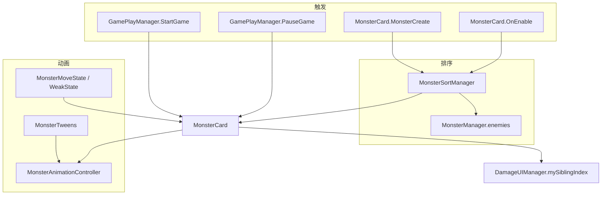

# MonsterCard 职责拆分上下文

> 本文档记录 `MonsterCard` 排序与 Spine 动画职责拆分的完整上下文，供后续 AI 对话或开发接续使用。  
> 最后更新：2026-06-25

---

## 1. 重构目标

将 `MonsterCard` 中两类横切职责拆出，遵循以下原则：

- **所有原有逻辑保持不变**（排序规则、暂停语义、攻击 Event/Complete 时序）
- **MonsterCard 不再** `FindObjectsOfType`、全场 `OrderBy(Y)`、写 `sortingOrder`、运行时频繁 `Transform.Find` Spine
- **组件模式**与 `SoldierAnimationController` 一致：`MonsterAnimationController` 为纯 C# 类；`MonsterSortManager` 为 MonoBehaviour 单例
- 日志使用 `LogTool`，禁止 `Debug.Log`

---

## 2. 当前架构

```
MonsterCard
├── AnimationController (MonsterAnimationController)  — Spine 播放 / 暂停 / Event / 颜色
├── SortTransform / Renderers[]                       — 排序数据暴露（由 SortManager 消费）
├── mySiblingIndex                                    — 排序索引（供飘字分组）
│
├── Play(name, loop)   → 委托 AnimationController
├── Pause()            → 委托 AnimationController（原 PauseSineAnim）
├── Resume(loop)       → 委托 AnimationController（原 ResumeAnimation）
│
├── MonsterManager.enemies                            — 排序数据源
└── MonsterSortManager                                — 全场 Y 轴 sortingOrder

MonsterTweens
└── 攻击循环 DOTween 编排 + AnimationController.PlayAttack(Event/Complete)

GamePlayManager
├── PauseGame()  → 全场 MonsterCard.Pause()
└── StartGame()  → 全场 MonsterCard.Resume()   （ResumeGame 不恢复 Spine，与原行为一致）
```

---

## 3. 文件清单

| 文件 | 路径 | 状态 |
|------|------|------|
| MonsterCard | `Assets/Scripts/Game/MonsterCard.cs` | 已瘦身（排序/Spine 迁出） |
| MonsterSortManager | `Assets/Scripts/Game/Monster/MonsterSortManager.cs` | **新增** |
| MonsterAnimationController | `Assets/Scripts/Game/Monster/MonsterAnimationController.cs` | **新增** |
| MonsterManager | `Assets/Scripts/Game/Monster/MonsterManager.cs` | Awake 自动挂载 SortManager |
| MonsterInit | `Assets/Scripts/Game/Monster/MonsterInit.cs` | skeletonAnim 改 Controller 代理 |
| MonsterTweens | `Assets/Scripts/Game/Monster/MonsterTweens.cs` | 攻击 Event/Complete 迁 Controller |
| MonsterMoveState | `Assets/Scripts/Game/Monster/MonsterState/MonsterMoveState.cs` | Play/TimeScale/ScaleX |
| MonsterWeakState | `Assets/Scripts/Game/Monster/MonsterState/MonsterWeakState.cs` | Play weak |
| JumpMoveBehaviour | `Assets/Scripts/Game/Monster/MoveBehaviour/JumpMoveBehaviour.cs` | 青蛙王子 walk |
| GamePlayManager | `Assets/Scripts/Game/GamePlayManager.cs` | Pause/Resume API；已删 IsSolt |

---

## 4. MonsterSortManager

### 职责

1. 全场怪物按 Y 坐标排序，写入 `MeshRenderer.sortingOrder`
2. 写入 `MonsterCard.mySiblingIndex`（`DamageUIManager` 飘字父节点分组）
3. 5 秒防抖闸门（原 `GamePlayManager.IsSolt`）

### 排序规则（与原 `SortChildrenByPositionY` 一致）

| 项 | 值 |
|----|-----|
| 数据源 | `MonsterManager.Instance.enemies`（筛 `activeInHierarchy`） |
| 排序键 | `OrderBy(-SortTransform.position.y)`，Y 越大 index 越大 |
| baseOrder | `1` |
| finalOrder | `BaseOrder + i`（Boss/Elite 偏移仍为 0） |

### API

| 方法 | 说明 |
|------|------|
| `ResetSortGate()` | 原 `OnEnable` 中 `IsSolt = false` |
| `RequestSort(delay, requester)` | DOTween 延迟后 `SortAll`；`requester` 非空时检查 `activeInHierarchy` |
| `SortAll()` | 核心排序；成功后开启 5 秒闸门 |

### 触发点（MonsterCard）

| 时机 | 调用 |
|------|------|
| `OnEnable` | `ResetSortGate()` + `RequestSort(0.05f, this)` |
| `MonsterCreate` 出场后 | `RequestSort(Random.Range(0.2f, 5f))` |

### MonsterCard 暴露字段（排序消费端）

```csharp
public Transform SortTransform;   // Init 中 = transform
public Renderer[] Renderers;      // Init 中 = Skeleton MeshRenderer[]
public int mySiblingIndex;        // SortManager 写入
```

### 生命周期

- `MonsterManager.Awake` 若不存在则 `AddComponent<MonsterSortManager>()`
- 防抖计时在 `MonsterSortManager.Update`，**不再**使用 `GamePlayManager.IsSolt`

---

## 5. MonsterAnimationController

### 职责

1. 缓存 Spine 引用，禁止运行时频繁 `Transform.Find`
2. 统一 `Play` / `Pause` / `Resume`
3. 收口 Spine `Event` / `Complete` 注册（近战攻击循环）
4. 受击闪红颜色读写（`GetSkeletonColor` / `SetSkeletonColor`）

### 缓存两阶段（对象池 + 动态 Spine 切换）

| 阶段 | 时机 | 缓存内容 |
|------|------|----------|
| `AwakeCache` | `MonsterCard.Awake` | `_spineContent` = `MonsterCard/Spine`（仅此一次 Find） |
| `RebindActiveSpine` | `Init` 切换 Spine 预制后 | `_spineRoot`、`SkeletonAnimation`、`SkeletonGraphic`、`AnimationState` |

> 战斗怪实际使用 `SkeletonAnimation`（世界空间 MeshRenderer）；`SkeletonGraphic` 通常为空，按需求仍缓存。

### 暂停语义（与 Soldier 不同，必须保持）

| | 怪物 `Pause()` | 英灵 `PauseAnimation()` |
|--|----------------|-------------------------|
| 机制 | `ClearTracks()` + 记录动画名 | `AnimationState.TimeScale = 0` |
| 恢复 | `SetAnimation(savedName, loop)` | 恢复 TimeScale |

### API 摘要

| 方法 | 说明 |
|------|------|
| `Play(track, name, loop)` | `AnimationState.SetAnimation` |
| `Pause()` / `Resume(loop)` | 硬暂停语义 |
| `SetTimeScale` | `AnimationState.TimeScale`（全局倍速订阅） |
| `SetSkeletonTimeScale` | `SkeletonAnimation.timeScale`（虚弱状态用） |
| `SetSkeletonScaleX` | 普通怪行走朝向 `Skeleton.ScaleX` |
| `SetSpineFacing(faceLeft)` | 索敌翻转 `localScale.x`（EngageSoldierCard） |
| `PlayAttack(onEvent, onComplete)` | 注册 Event + 播 `atk` + Complete |
| `RegisterSpineEvent` / `UnregisterSpineEvent` | Event 委托包装 |
| `UnregisterAllSpineCallbacks` | `OnDisable` 防泄漏 |

### MonsterCard 对外入口

```csharp
public MonsterAnimationController AnimationController { get; private set; }

public TrackEntry Play(string animName, bool loop = true, int track = 0);
public void Pause();
public void Resume(bool loop = true);
```

### 攻击循环（已迁至 AttackBehaviour）

近战接战循环在 `SpineLoopAttackBehaviourBase.BeginEngage`：

```
DOTween 间隔循环
  → SetEmptyAnimation(0, 0.1f)
  → PlayAttack(OnSpineEvent, OnComplete)
       Event "atk"  → IAttackBehaviour.OnSpineEvent → ExecuteAttackHit
       Complete atk → UnregisterSpineEvent + Play("idle") + 重置冷却标记
```

> 完整攻击体系见：[MonsterAttackBehaviour_Context.md](MonsterAttackBehaviour_Context.md)

Tween 编排已迁入各 `IAttackBehaviour`；`MonsterTweens` 仅保留移动/受击/控制类 Tween。

### 初始化顺序

```
Awake:
  AnimationController = new MonsterAnimationController()
  AnimationController.AwakeCache(this)

pool.Get() → OnEnable（此时 Spine 可能未 Init）
  → Register MonsterManager
  → SortManager.RequestSort(0.05f)

Init(id):
  切换 Spine 预制到 SpineContent
  AnimationController.RebindActiveSpine(spine.transform)
  MonsterInit.Init(this)          // monsterData.skeletonAnim 代理赋值
  Play("walk") / 龙王 roar-idle
  Renderers[] / SpeedMultiplier → SetTimeScale
```

---

## 6. 已从 MonsterCard 移除

| 原成员 | 迁移去向 |
|--------|----------|
| `SortChildrenByPositionY()` | `MonsterSortManager.SortAll()` |
| `FindObjectsOfType<MonsterCard>` | `MonsterManager.enemies` |
| `renderer.sortingOrder = 2`（Init） | 首次 `SortAll` 赋值 |
| `PauseSineAnim()` | `Pause()` → `AnimationController.Pause()` |
| `ResumeAnimation()` | `Resume()` → `AnimationController.Resume()` |
| `FindSkeletonAnimation()` | `RebindActiveSpine` + Awake 缓存 |
| `_skeletonAnimation` 私有字段 | `AnimationController` 内部 |
| `GamePlayManager.IsSolt` | `MonsterSortManager._isSortGateActive` |

---

## 7. 外部调用方

| 调用方 | 方法 | 备注 |
|--------|------|------|
| `GamePlayManager.PauseGame` | `MonsterCard.Pause()` | 全场 FindObjectsOfType |
| `GamePlayManager.StartGame` | `MonsterCard.Resume()` | 全场恢复 Spine |
| `GamePlayManager.ResumeGame` | `MonsterCard.Resume()` | 与 StartGame 一致，恢复 Spine + DOTween |
| `DamageUIManager` | `mySiblingIndex` | 飘字分组，未改接口 |
| `MonsterMoveState` | `monster.Play` / `AnimationController.SetTimeScale` | |
| `MonsterWeakState` | `monster.Play("weak")` | |
| `MonsterTweens` | `m.Play` / `m.AnimationController.PlayAttack` | |
| `JumpMoveBehaviour` | `monster.Play` / `SetTimeScale` | 青蛙王子 |

### monsterData.skeletonAnim 兼容

`MonsterInit` 仍赋值：

```csharp
m.monsterData.spineTransform = m.AnimationController.SpineRoot;
m.monsterData.skeletonAnim = m.AnimationController.SkeletonAnimation;
```

`MonsterMoveState` 等处空检查仍可用；**禁止**新增 `monsterData.skeletonAnim.AnimationState` 直连。

---

## 7.1 状态机与动画同步（2026-06-25）

怪物位移（`FixedMoveTick`）与 Spine 动画（`MonsterMoveState.Enter` → `Play("walk")`）由 **两条链路** 驱动，必须通过 `monsterData.monsterState` + `Tick()` 保持一致。

| 规则 | 说明 |
|------|------|
| 改 `monsterState` 后必须 `Tick()` | 触发 FSM 转换与 `Enter()` 播动画 |
| `FixedMoveTick` 门禁 | 仅 `monsterState == move` 时 `MoveBehaviour.Update` |
| 退出接战 | `MonsterEngageState.Exit` → `AttackBehaviour.StopEngage` |
| 虚弱 | `MonsterWeakState.Enter` → `StopEngage`；`MonsterAtkRange` 不触发 engage |
| 击飞开始 | `KnockUpMonster` → `specialMove` + `Tick()` |
| 击飞结束 | `MonsterTweens.KnockUpMonster` → `MoveBehaviour.Enter` + `Tick()` |
| 推拉 | `PushPull` 改 `move` 后 `Tick()` |
| 移速刷新 | `UpdateMove` 先 `Tick()` 再刷新 Move 状态 |

`MonsterAtkRange` 仅在 `move` / `idle` 等可接战状态下检测距离，**排除** `weak` / `specialMove` / `hurt` / `die` / `engage`。

### 7.2 三套子系统（改状态时必须想清楚停哪条）

怪物行为不是「一个状态机」包办全部，而是 **FSM + MoveBehaviour + AttackBehaviour** 并行：

| 子系统 | 驱动入口 | 管什么 | 不管什么 |
|--------|----------|--------|----------|
| **FSM** | `Tick()` | `Enter/Exit`、walk / weak / engage 状态转换 | 实际位移、伤害结算 |
| **MoveBehaviour** | `FixedMoveTick`（`monsterState==move`） | 坐标变化 | Spine 动画名、攻击 |
| **AttackBehaviour** | `BeginEngage` / `StopEngage` | DOTween 攻击循环、Spine Event 伤害 | walk / weak 动画 |

**典型踩坑：**

- 只 `Play("weak")` 不 `StopEngage` → 画面虚弱，逻辑仍在扣血  
- 只改 `monsterState` 不 `Tick()` → 在移动，FSM 不在 Move，不播 walk  
- `KillAllTweens()` 只杀 `MonsterTweens`，不杀 `AttackBehaviour._engageTween`  
- `BeginEngage` 里 `_owner` 赋值顺序错误 → 接战 idle 正常，永不播 atk（见 AttackBehaviour 文档 §14）

**修改任一子系统时，必须同步检查另外两个。**

---

## 8. 编译陷阱（Spine 与 Unity 命名冲突）

本模块同时 `using Spine` 与 `using UnityEngine` 时：

| 错误写法 | 正确写法 |
|----------|----------|
| `Event` | `Spine.Event` |
| `Action<TrackEntry, Event>` | `Action<TrackEntry, Spine.Event>` |
| `AnimationState.TrackEntryDelegate` 绑 Event | `AnimationState.TrackEntryEventDelegate` |
| `Action<TrackEntry>` 绑 Complete | `AnimationState.TrackEntryDelegate` |

文件顶部可用别名：

```csharp
using AnimationState = Spine.AnimationState;
```

---

## 9. 测试检查清单

### 排序

- [ ] 批量刷怪：Y 高者 `sortingOrder` 更大（在前）
- [ ] 伤害飘字：`mySiblingIndex` 分组正常
- [ ] 分裂体 / 特殊出场：层级不错乱
- [ ] 连续刷怪：5 秒闸门生效，新怪 OnEnable 可重置闸门

### 动画

- [ ] `PauseGame` / `StartGame` / `ResumeGame`：ClearTracks 定帧与 Resume 恢复
- [ ] **普通怪接战**：到脸前停住 → `idle` → 周期 `atk` → 城墙/士兵受伤
- [ ] 近战攻击：`atk` Event → `AttackBehaviour.OnSpineEvent`；Complete → `idle`
- [ ] 行走 / 虚弱 / 击飞后回 `walk`（击飞结束须 `Tick()`）
- [ ] Boss 破韧：虚弱期间不攻击；恢复后重新 `BeginEngage`，不残留 `weak` 动画
- [ ] 龙王：`roar` → `idle` 时序
- [ ] 受击闪红颜色 Tween
- [ ] 索敌翻转朝向
- [ ] 对象池复用：换 Spine 后 Event 不泄漏、不串怪

---

## 10. 后续可继续重构的方向

按优先级排列，**尚未实施**：

1. **GamePlayManager 怪物遍历** — `FindObjectsOfType<MonsterCard>` 改为 `MonsterManager.enemies`（Pause/StartGame）
2. **monsterData.skeletonAnim 废弃** — 全量改为 `AnimationController` 或 `monster.Play`，删除代理字段
3. **移动中动态重排** — 若 Y 变化需实时遮挡，在 `FixedMoveTick` 或 MoveBehaviour 末尾 `RequestSort`
4. **MonsterCard 状态机 / 伤害 / Buff** — 参照 SoldierCard 继续拆组件
5. **Renderers 多 Renderer 支持** — 阴影/附件若需独立层级，扩展 `Renderers[]` 填充逻辑

**攻击表现** 已拆至 [MonsterAttackBehaviour_Context.md](MonsterAttackBehaviour_Context.md)（2026-06-11 完成）。

### 重构约束（必须遵守）

- 怪物暂停用 `ClearTracks`，**不要**照搬 Soldier 的 TimeScale 暂停
- Spine 回调类型必须用 `TrackEntryEventDelegate` / `TrackEntryDelegate`，不能用 `Action<>`
- `Event` 必须写 `Spine.Event`，避免与 `UnityEngine.Event` 歧义
- 排序数据源用 `MonsterManager.enemies`，禁止 `FindObjectsOfType<MonsterCard>`
- `Transform.Find` 仅允许在 `AwakeCache` / `RebindActiveSpine` 各执行一次
- 改 `monsterState` **必须** `Tick()`；进/出虚弱、接战须配合 `StopEngage` / `BeginEngage`（见 §7.1–§7.2、§13）
- `MonsterTweens.KillAllTweens()` **不等于** 停止攻击，须 `AttackBehaviour.StopEngage`

---

## 13. 2026-06-25 问题复盘与规避

### 现象汇总

| # | 现象 | 根因 |
|---|------|------|
| 1 | 怪物在移动，Spine 不播 walk | `monsterState=move` 与 FSM 不同步（改 state 未 `Tick()`）；击飞结束未 `MoveBehaviour.Enter`；`ResumeGame` 未 `Resume` Spine |
| 2 | Boss 破韧仍播 weak 且扣血 | 进虚弱只换动画，`AttackBehaviour._engageTween` 未停；`MonsterAtkRange` 未排除 weak |
| 3 | **回归** 普通怪到脸前不攻击 | `BeginEngage` 先 `_owner=owner` 再 `StopEngage`，后者把 `_owner` 清 null，`PlayAttackAnimation` 空转 |

### 已落地修复（文件级）

| 文件 | 改动要点 |
|------|----------|
| `MonsterWeakState` | `Enter` → `StopEngage`；`Exit` 重置 engage 标记 |
| `MonsterEngageState` | `Exit` → `StopEngage` |
| `MonsterAtkRange` | `CanEnterEngage()` 排除 weak / specialMove / hurt / die |
| `SpineLoopAttackBehaviourBase` | 新增 `StopEngage`；`BeginEngage` 顺序：**先 Stop 再赋 `_owner`** |
| `MonsterTweens` / `MonsterCard` | 击飞/PushPull/UpdateMove 补 `Tick()`；击飞进 `specialMove` |
| `GamePlayManager` | `ResumeGame` 恢复全场 `MonsterCard.Resume()` |

### 后续修改强制自检（AI / 人工）

1. **改 `monsterState`** → 同帧或回调末尾是否调用了 `Tick()`？  
2. **进不可攻击状态**（weak / 击飞 / 击退 / 死亡）→ 是否 `StopEngage` + 必要时 `MoveBehaviour.StopMove`？  
3. **进 engage** → 是否经 `MonsterEngageState` 调 `BeginEngage`，而非直接改动画？  
4. **动 `BeginEngage` / `StopEngage`** → 普通怪接战 + Boss 破韧/recover 各测一遍（见 AttackBehaviour 文档 §15）  
5. **Kill tween** → 确认杀的是哪条链：`MonsterTweens` ≠ `AttackBehaviour.Runtime`  

### 禁止事项（本次教训）

- ❌ 以为「换了 Spine 动画」就等于「停了攻击逻辑」  
- ❌ 在 `BeginEngage` 里先写 `_owner = owner` 再调 `StopEngage`（`StopEngage` 会清 `_owner`）  
- ❌ `BeginEngage` 发现 tween 存在时只 `Play()` 不复建（虚弱后残留循环）  
- ❌ 只 `KillAllTweens()` 当停攻击  
- ❌ 改 `monsterState` 不 `Tick()` 指望 FSM 自己跟上  

---

## 11. 依赖关系图



---

## 12. AI 接续提示词模板

在新对话中可粘贴以下内容作为上下文：

```
我正在继续 FusionContinent 项目中 MonsterCard 的职责拆分。

已完成：
- MonsterSortManager：全场 Y 轴 sortingOrder；数据源 MonsterManager.enemies；5 秒防抖；mySiblingIndex 供飘字
- MonsterAnimationController：Spine 缓存/Rebind；Play/Pause/Resume；攻击 Event/Complete；受击颜色
- MonsterCard 对外：Play / Pause / Resume；暴露 SortTransform、Renderers[]
- 已删除：SortChildrenByPositionY、PauseSineAnim、ResumeAnimation、FindSkeletonAnimation、GamePlayManager.IsSolt

约束：
- 怪物暂停用 ClearTracks（不是 Soldier 的 TimeScale=0）
- Spine.Event / TrackEntryEventDelegate / TrackEntryDelegate 类型要写全
- 禁止 FindObjectsOfType 排序；禁止运行时频繁 Transform.Find Spine
- 日志用 LogTool
- 三套子系统 FSM / MoveBehaviour / AttackBehaviour 必须同步（改 monsterState 要 Tick；虚弱要 StopEngage）
- BeginEngage 顺序：StopEngage → _owner = owner（禁止反序）

详细上下文见：Assets/Scripts/Game/Monster/MonsterCard_Refactor_Context.md
攻击行为见：Assets/Scripts/Game/Monster/MonsterAttackBehaviour_Context.md
```
