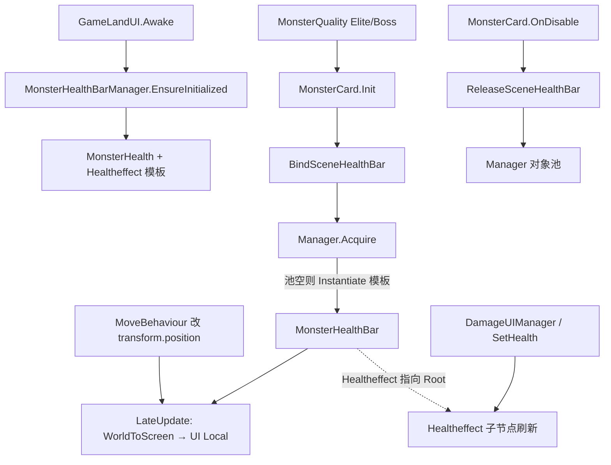

# 精英/Boss 场景血条跟随上下文

> 本文档记录精英怪与 Boss 血条从 `MonsterCard` 预制体 World Space Canvas 迁移到 `GameLandUI/MonsterHealth` 屏幕 UI，并按怪物位移跟随的完整上下文。  
> 最后更新：2026-07-21

---

## 1. 改动目标

| 之前 | 之后 |
|------|------|
| 血条挂在 `MonsterCard1` 预制体 `Canvas/Healtheffect`（World Space） | 血条模板在 GamePlay 场景 `GameLandUI/MonsterHealth/Healtheffect`（Screen Space - Camera） |
| 靠父子关系跟随怪物 | 世界坐标 → 屏幕坐标 → UI 本地坐标，每帧同步 |
| 每只怪自带一份预制体血条 | 以场景模板克隆 + 对象池，多精英可同时显示 |

**显示条件不变：** 仅 `MonsterQuality.Elite` / `MonsterQuality.Boss`（`MonsterCard.IsBoos == true`）。

---

## 2. 场景与资源层级

```
GamePlay 场景
└── GameLandUI                    ← Canvas, RenderMode = Screen Space - Camera, SortingOrder = 150
    └── MonsterHealth             ← 血条容器（Manager 挂在此节点或运行时 AddComponent）
        └── Healtheffect          ← 模板（默认 inactive），克隆源
            ├── name
            ├── healthimage / MonsterIcon
            ├── Healthcount
            ├── health / healthBar、healthEffect
            └── StaggerBar / CurStaggerBar、CurStaggerEffect
```

预制体 `MonsterCard1` 内原有 `Canvas/Healtheffect` **保留但永久关闭**（`Awake` 时 `SetActive(false)`），逻辑不再激活；确认稳定后可从预制体删除。

---

## 3. 当前架构



### 运行时链路

```
GameLandUI.Awake
  → MonsterHealthBarManager.EnsureInitialized(transform)
  → 查找 MonsterHealth / Healtheffect，模板 SetActive(false)

MonsterCard.Init（Elite/Boss）
  → IsBoos = true
  → BindSceneHealthBar()
      → Manager.Acquire(this) → MonsterHealthBar.Bind(...)
      → Healtheffect = bar.Root
  → HealthInit() / SetHealth()   // 仍写在 MonsterCard，Find 子节点更新 UI

每帧 LateUpdate（MonsterHealthBar）
  → worldPos = monster.position + worldOffset
  → Camera.main.WorldToScreenPoint
  → ScreenPointToLocalPointInRectangle(MonsterHealth, uiCam)
  → anchoredPosition = localPoint

MonsterCard.OnDisable
  → ReleaseSceneHealthBar()
  → Manager.Release(bar) → Unbind + 入池
  → Healtheffect 还原为预制体引用并保持关闭
  → 清空韧性条等 UI 缓存字段
```

---

## 4. 关键文件

| 文件 | 职责 |
|------|------|
| `Scripts/Game/Monster/MonsterHealthBarManager.cs` | 单例、模板、对象池、`Acquire`/`Release`、`worldOffset` |
| `Scripts/Game/Monster/MonsterHealthBar.cs` | 单条血条跟随组件 |
| `Scripts/Game/MonsterCard.cs` | `BindSceneHealthBar` / `ReleaseSceneHealthBar`；`HealthInit`/`SetHealth` 仍操作 `Healtheffect` |
| `Scripts/Game/GameLandUI.cs` | `Awake` 中 `EnsureInitialized` |
| `Scenes/GamePlay.unity` | `GameLandUI/MonsterHealth/Healtheffect` 模板节点 |
| `Scripts/UI/DamageUIManager.cs` | 受击时 `IsBoos` → `SetHealth()` |
| `Scripts/Game/DamageCalculator/MonsterDamageService.cs` | 引导锚点绑 `Healtheffect/.../health` |

---

## 5. API 摘要

### MonsterHealthBarManager

```csharp
// 从 GameLandUI 根初始化（可重复调用，仅首次生效）
MonsterHealthBarManager.EnsureInitialized(Transform gameLandUIRoot);

// 为怪物取一条血条（池或新建）
MonsterHealthBar Acquire(MonsterCard monster);

// 回收
void Release(MonsterHealthBar bar);

// Inspector / 运行时可调：血条相对怪物的世界坐标偏移，默认 (0, 1.5, 0)
[SerializeField] Vector3 worldOffset;
```

### MonsterHealthBar

```csharp
void Bind(MonsterCard target, RectTransform parentRect, Canvas canvas, Vector3 worldOffset);
void Unbind();
GameObject Root { get; }  // 即 MonsterCard.Healtheffect 指向的对象
```

### MonsterCard 侧

- `Healtheffect`：精英/Boss 存活期间指向**场景克隆条**；回池后还原为预制体引用（保持关闭）。
- `_prefabHealtheffect`：缓存预制体原引用。
- `_sceneHealthBar`：当前绑定的跟随组件。

---

## 6. 坐标转换说明

与引导系统（`GuideFingerWaitMethod`）一致：

1. **世界相机** `Camera.main`：`WorldToScreenPoint(monster.position + offset)`
2. **UI 相机** `GameLandUI` Canvas 的 `worldCamera`（Screen Space - Camera；Overlay 则传 `null`）
3. **父节点** `MonsterHealth` 的 `RectTransform`：`ScreenPointToLocalPointInRectangle` → `anchoredPosition`

---

## 7. 调参与验收

### 位置偏移

运行时选中 `MonsterHealth` 上的 `MonsterHealthBarManager`，调整 **World Offset**：

- Y 增大 → 血条上移
- 默认 `(0, 1.5, 0)`，按怪体型再微调

### 测试清单

- [ ] 精英怪出生：场景下出现血条，跟怪移动
- [ ] Boss 出生：同上；出场特效/音效不受影响
- [ ] 多只精英同时在场：各有一条，互不抢占
- [ ] 受击：`SetHealth` 百分比与双层条动画正常
- [ ] 韧性条：虚弱/恢复动画正常
- [ ] 死亡/回池：血条隐藏并入池，无残留
- [ ] 引导（破韧/虚弱）：锚点仍能绑到 `health` 节点
- [ ] 普通怪：不显示场景血条；预制体血条保持关闭

---

## 8. 已知限制与后续

1. **血条 UI 刷新逻辑仍在 `MonsterCard`**（`HealthInit`/`SetHealth`/`Find`），未抽成独立 View；后续可对齐 `SoldierHealthBarController` 再拆。
2. **预制体 Canvas 血条未删除**，仅禁用；稳定一周后再清预制体节点。
3. **`IsBoos` 命名** 含 Elite+Boss，语义易混，后续可改为 `IsBossOrElite`。
4. **`UpdateHealthBarAppearance` 换色逻辑仍注释**，与本次迁移无关。
5. Manager 运行时 `AddComponent` 时，`worldOffset` 用代码默认值；若需场景持久化，可在编辑器里提前挂上组件并序列化。

---

## 9. 禁止事项（接续开发）

- 不要再 `Healtheffect.SetActive(true)` 激活预制体 World Space 血条。
- 不要为普通怪绑定场景血条。
- 不要用 `RemoveAllListeners` 或静默 fallback 到旧 Canvas 路径掩盖模板缺失；模板找不到应 `LogTool.LogError`。
- 不要在 View 层再缓存一份与 `Healtheffect` 重复的血量真值；HP 真值仍在 `MonsterCard.hp/maxHp`。
