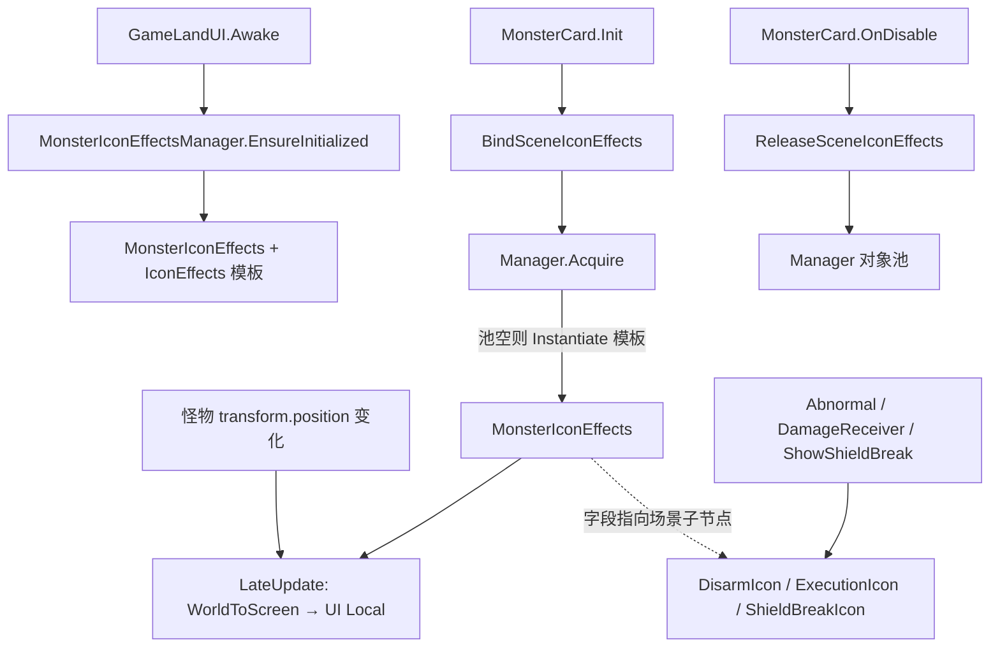

# 怪物状态图标（IconEffects）场景 UI 跟随上下文

> 本文档记录怪物状态图标从 `MonsterCard` 预制体 World Space Canvas 迁移到 `GameLandUI/MonsterIconEffects` 屏幕 UI，并按怪物位移跟随的完整上下文。  
> 模式对齐：`MonsterHealthBar`（`Healtheffect` 外移）。  
> 最后更新：2026-07-24

---

## 1. 改动目标

| 之前 | 之后 |
|------|------|
| 图标挂在 `MonsterCard1` 预制体 `Canvas/IconEffects`（World Space） | 图标模板在 GamePlay 场景 `GameLandUI/MonsterIconEffects/IconEffects`（Screen Space - Camera） |
| 靠父子关系跟随怪物 | 世界坐标 → 屏幕坐标 → UI 本地坐标，每帧同步 |
| 每只怪自带一份预制体图标节点 | 以场景模板克隆 + 对象池，多怪可同时显示 |

**显示范围：** 所有怪物在 `Init` 时绑定（不限 Elite/Boss）。各子图标默认关闭，由业务逻辑按需 `SetActive(true)`。

**子图标：**

| 节点 | 用途 | 主要调用方 |
|------|------|------------|
| `DisarmIcon` | 缴械 | `MonsterAbnormal` |
| `ExecutionIcon` | 斩杀提示 | `MonsterDamageReceiver` |
| `ShieldBreakIcon` | 破盾提示 | `MonsterCard.ShowShieldBreakIcon` / `MonsterDamageReceiver` |

---

## 2. 场景与资源层级

```
GamePlay 场景
└── GameLandUI                         ← Canvas, RenderMode = Screen Space - Camera
    └── MonsterIconEffects             ← 容器（Manager 挂在此节点或运行时 AddComponent）
        └── IconEffects                ← 模板（默认 inactive），克隆源
            ├── DisarmIcon
            ├── ExecutionIcon
            └── ShieldBreakIcon
```

预制体 `MonsterCard1` 内原有 `Canvas/IconEffects` **保留但永久关闭**（`Awake` 时 `SetActive(false)`），逻辑不再激活；确认稳定后可从预制体删除。

同场景对比（血条）：

```
GameLandUI
├── MonsterHealth / Healtheffect       ← 仅 Elite/Boss
└── MonsterIconEffects / IconEffects   ← 全部怪物
```

---

## 3. 当前架构



### 运行时链路

```
GameLandUI.Awake
  → MonsterIconEffectsManager.EnsureInitialized(transform)
  → 查找 MonsterIconEffects / IconEffects，模板 SetActive(false)

MonsterCard.Awake
  → 缓存预制体 Disarm/Execution/ShieldBreak 与父节点 IconEffects
  → 预制体 IconEffects.SetActive(false)

MonsterCard.Init（所有怪）
  → BindSceneIconEffects()
      → Manager.Acquire(this) → MonsterIconEffects.Bind(...)
      → DisarmIcon / ExecutionIcon / ShieldBreakIcon = 场景实例子节点
  → 业务侧按需开关图标（字段名不变）

每帧 LateUpdate（MonsterIconEffects）
  → worldPos = monster.position + worldOffset
  → Camera.main.WorldToScreenPoint
  → ScreenPointToLocalPointInRectangle(MonsterIconEffects, uiCam)
  → anchoredPosition = localPoint

MonsterCard.OnDisable
  → ReleaseSceneIconEffects()
  → Manager.Release(effects) → Unbind（关根节点 + 重置三图标）+ 入池
  → 三图标字段还原为预制体引用；预制体 IconEffects 保持关闭
```

---

## 4. 关键文件

| 文件 | 职责 |
|------|------|
| `Scripts/Game/Monster/MonsterIconEffectsManager.cs` | 单例、模板、对象池、`Acquire`/`Release`、`worldOffset` |
| `Scripts/Game/Monster/MonsterIconEffects.cs` | 单组图标跟随组件；缓存三子节点 |
| `Scripts/Game/MonsterCard.cs` | `BindSceneIconEffects` / `ReleaseSceneIconEffects`；业务仍操作 `DisarmIcon` 等字段 |
| `Scripts/Game/GameLandUI.cs` | `Awake` 中 `EnsureInitialized`（与血条并列） |
| `Scenes/GamePlay.unity` | `GameLandUI/MonsterIconEffects/IconEffects` 模板节点 |
| `Scripts/Game/Monster/MonsterAbnormal.cs` | 缴械图标显隐 |
| `Scripts/Game/DamageCalculator/MonsterDamageReceiver.cs` | 斩杀 / 破盾图标 |

---

## 5. API 摘要

### MonsterIconEffectsManager

```csharp
// 从 GameLandUI 根初始化（可重复调用，仅首次生效）
MonsterIconEffectsManager.EnsureInitialized(Transform gameLandUIRoot);

// 为怪物取一组状态图标（池或新建）
MonsterIconEffects Acquire(MonsterCard monster);

// 回收
void Release(MonsterIconEffects effects);

// Inspector / 运行时可调：相对怪物的世界坐标偏移，默认 (0, 1.6, 0)
[SerializeField] Vector3 worldOffset;
```

### MonsterIconEffects

```csharp
void Bind(MonsterCard target, RectTransform parentRect, Canvas canvas, Vector3 worldOffset);
void Unbind();
GameObject Root { get; }
GameObject DisarmIcon { get; }
GameObject ExecutionIcon { get; }
GameObject ShieldBreakIcon { get; }
```

### MonsterCard 侧

- `DisarmIcon` / `ExecutionIcon` / `ShieldBreakIcon`：存活期间指向**场景克隆实例**子节点；回池后还原为预制体引用。
- `_prefabDisarmIcon` / `_prefabExecutionIcon` / `_prefabShieldBreakIcon`：缓存预制体原引用。
- `_prefabIconEffects`：预制体 `IconEffects` 根，永久关闭。
- `_sceneIconEffects`：当前绑定的跟随组件。

---

## 6. 坐标转换说明

与 `MonsterHealthBar` / 引导系统一致：

1. **世界相机** `Camera.main`：`WorldToScreenPoint(monster.position + offset)`
2. **UI 相机** `GameLandUI` Canvas 的 `worldCamera`（Screen Space - Camera；Overlay 则传 `null`）
3. **父节点** `MonsterIconEffects` 的 `RectTransform`：`ScreenPointToLocalPointInRectangle` → `anchoredPosition`

默认偏移略高于血条：血条 `(0, 1.5, 0)`，图标 `(0, 1.6, 0)`，可按表现再调。

---

## 7. 调参与验收

### 位置偏移

运行时选中 `MonsterIconEffects` 上的 `MonsterIconEffectsManager`，调整 **World Offset**：

- Y 增大 → 图标上移
- 默认 `(0, 1.6, 0)`

### 测试清单

- [ ] 普通怪 / 精英 / Boss 出生：场景下出现 IconEffects 根节点并跟随移动
- [ ] 缴械：`DisarmIcon` 显示与清除正常
- [ ] 斩杀提示：`ExecutionIcon` 正常
- [ ] 破盾：`ShieldBreakIcon` 延时关闭正常
- [ ] 多怪同屏：各组图标互不抢占
- [ ] 死亡/回池：图标隐藏、三子节点重置，无残留
- [ ] 预制体 `Canvas/IconEffects` 始终关闭，不再作为显示源

---

## 8. 已知限制与后续

1. **图标开关逻辑仍散落在业务侧**（`MonsterAbnormal`、`MonsterDamageReceiver`、`MonsterCard`），未抽独立 Controller；字段名保持兼容。
2. **预制体 Canvas/IconEffects 未删除**，仅禁用；稳定后再清预制体节点。
3. Manager 运行时 `AddComponent` 时，`worldOffset` 用代码默认值；若需场景持久化，可在编辑器里提前挂上组件并序列化。
4. 与血条共用 GameLandUI 坐标系，但**分属两个容器/对象池**，互不影响生命周期。

---

## 9. 禁止事项（接续开发）

- 不要再激活预制体 World Space `IconEffects` 作为显示源。
- 不要为缺失模板静默 fallback 到预制体路径；找不到应 `LogTool.LogError`。
- 不要假设仅 Elite/Boss 才绑定（与血条不同，图标是全怪绑定）。
- 不要在回池后继续持有场景图标引用做延迟回调而不检查生命周期（`DOVirtual.DelayedCall` 等需注意怪已回收）。
