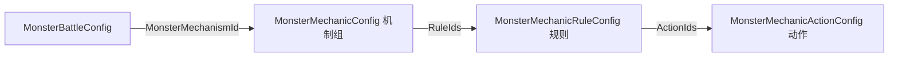

# 怪物通用机制配置指南

本文档说明怪物通用机制系统的配置方式、运行时语义和扩展规则。目标是通过组合“机制组、触发规则、执行动作”实现怪物能力，不再为每个 Boss 增加专属字段或专属机制类。

## 1. 适用范围

当前系统适合配置以下能力：

- 出生、受伤前、按攻击英灵职业（法师/战士）受伤前、生命值阈值、死亡时触发效果。
- 按伤害类型修改怪物受到的伤害。
- 在限定时间内修改怪物造成的伤害。
- 通过 Buff 模板 ID 给怪物添加已有 Buff（如无敌）。
- 随机沉默**已上阵英雄**的主动技能卡，并在持续时间结束后恢复。
- 将多个规则和动作组合成一个怪物机制。

系统不是“任何新玩法都不需要代码”。已有触发器和动作可以完全通过表组合；出现新的基础触发器或基础动作时，只扩展一次通用解释器，不为具体怪物增加分支。

## 2. 配置关系



配置入口为 `MonsterBattleConfig.MonsterMechanismId`：

- `MonsterMechanismId <= 0`：怪物没有通用机制（Factory 返回空列表，`MechanicCount=0`）。
- `MonsterMechanismId > 0`：该值必须引用一个机制组 ID。
- 一个怪物当前绑定一个机制组，一个机制组可以包含多条规则。
- 一条规则可以按顺序执行多个动作。
- 同一规则或动作可以被多个机制组复用。

> 排查提示：日志 `[MonsterMechanic] InitializeMechanics MechanismId=0 MechanicCount=0` 表示当前刷出的怪物未绑定机制组。暗影魔机制只在 `2303002`（`MechanismId=10003`）上，常见 Boss `2303001` 的 `MechanismId=0`。

## 3. 相关文件

| 类型 | 路径 | 作用 |
| --- | --- | --- |
| XML 定义 | `Luban/Defines/MonsterMechanic.xml` | 定义枚举、Bean 和表引用 |
| 机制组表 | `Luban/Datas/GamePlay/MonsterMechanicConfig.xlsx` | 组合规则 |
| 规则表 | `Luban/Datas/GamePlay/MonsterMechanicRuleConfig.xlsx` | 定义触发条件 |
| 动作表 | `Luban/Datas/GamePlay/MonsterMechanicActionConfig.xlsx` | 定义执行效果和时间 |
| 怪物战斗表 | `Luban/Datas/GamePlay/MonsterBattleConfig.xlsx` | 给怪物绑定机制组 |
| 创建入口 | `Assets/Scripts/Game/Monster/Mechanic/MonsterMechanicFactory.cs` | 根据机制组 ID 创建解释器 |
| 通用解释器 | `Assets/Scripts/Game/Monster/Mechanic/RuleBasedMonsterMechanic.cs` | 执行规则、动作及配置校验 |
| 技能沉默 | `Assets/Scripts/Game/GameLand.SkillSilence.cs` | 管理沉默选择、叠加和恢复 |
| Buff 施加 | `Assets/Scripts/Game/Skill/Handler/Buff/BuffApplier.cs` | 按 `BuffID` 读模板并创建 Buff |
| Buff 模板库 | `Assets/SkillGraph/SkillBuffTemplateLibrary.asset` | `BuffId` → 效果列表（含时长、`BuffTypeId`） |

不要手工修改 `Assets/Scripts/Data/Client/Luban` 下的生成代码，也不要手工修改生成的 JSON。

## 4. 机制组表

表：`MonsterMechanicConfig.xlsx`

| 字段 | 类型 | 说明 |
| --- | --- | --- |
| `Id` | int | 机制组唯一 ID，供 `MonsterBattleConfig.MonsterMechanismId` 引用 |
| `Desc` | string | 机制组说明，仅用于阅读和排查 |
| `RuleIds` | int list | 规则 ID 列表，使用 `|` 分隔 |

示例：

| Id | Desc | RuleIds |
| --- | --- | --- |
| 10003 | 暗影魔机制组 | `11002|11003|11004` |

## 5. 规则表

表：`MonsterMechanicRuleConfig.xlsx`

| 字段 | 类型 | 说明 |
| --- | --- | --- |
| `Id` | int | 规则唯一 ID |
| `Desc` | string | 规则说明 |
| `Trigger` | enum | 触发时机 |
| `HpThreshold` | float | 生命值阈值，使用 0 到 1 的比例 |
| `DamageType` | enum | 受伤规则匹配的伤害类型 |
| `TriggerOnce` | int | `0` 可重复触发，`1` 每只怪物实例只触发一次 |
| `ActionIds` | int list | 动作 ID 列表，使用 `|` 分隔，按填写顺序执行 |

### 5.1 Trigger

| 值 | 含义 | 配置要求 |
| --- | --- | --- |
| `Spawn` | 怪物出生时 | `HpThreshold` 填 0，`DamageType` 填 `All` |
| `TakeDamageBefore` | 本次伤害结算前 | 可使用 `DamageType` 过滤 |
| `HpBelow` | 生命值从阈值上方下降到阈值或以下 | `HpThreshold` 必须在 `(0, 1]`，通常配置 `TriggerOnce=1` |
| `Death` | 怪物死亡时 | 引用动作的 `Delay` 必须为 0 |
| `TakeMageDamageBefore` | 受到法师（`CareerType.Wizard`）伤害结算前 | 可使用 `DamageType` 过滤；无攻击英灵时不触发 |
| `TakeWarriorDamageBefore` | 受到战士（`CareerType.Warrior`）伤害结算前 | 可使用 `DamageType` 过滤；无攻击英灵时不触发 |

`HpBelow` 使用“跨越阈值”语义。例如上一帧生命值为 85%，本次受伤后变为 35%，则 80% 和 40% 两条规则都会触发。触发顺序与机制组中的 `RuleIds` 顺序一致。

运行时：`MonsterDamageReceiver` 扣血后调用 `NotifyMechanicsHpChanged(hp/maxHp)`；仅当护甲结算后 `Armor == 0` 才会扣血并通知。

### 5.2 DamageType

| 值 | 含义 |
| --- | --- |
| `All` | 全部伤害 |
| `Physical` | 物理伤害 |
| `Magic` | 普通魔法伤害和落雷魔法伤害 |
| `Real` | 真实伤害 |
| `Burn` | 燃烧 Buff 伤害管线 |

`DamageType` 当前在 `TakeDamageBefore` / `TakeMageDamageBefore` / `TakeWarriorDamageBefore` 规则中参与匹配。其他触发器建议填写 `All`。

职业判定来源为本次伤害 `DamageContext.Soldier.soldierBattle.CarType`（英灵攻击怪物时写入攻击方）。场景技能、Buff/DOT 等无攻击英灵的伤害不会触发职业专属触发器。

## 6. 动作表

表：`MonsterMechanicActionConfig.xlsx`

| 字段 | 类型 | 说明 |
| --- | --- | --- |
| `Id` | int | 动作唯一 ID |
| `Desc` | string | 动作说明 |
| `Type` | enum | 动作类型 |
| `Target` | enum | 动作目标 |
| `Delay` | float | 触发后延迟多少秒开始执行，必须大于等于 0 |
| `Duration` | float | 状态持续秒数，必须大于等于 0；对 `AddBuff` 可填 0（时长由 Buff 模板决定） |
| `Value` | float | 倍率修正值，`1` 表示提高 100%，`-0.5` 表示降低 50% |
| `Count` | int | 数量参数，目前用于随机沉默技能数量 |
| `BuffID` | int | Buff 模板 ID，仅 `AddBuff` 使用；对应 `SkillBuffTemplateLibrary` 中的 `BuffId`。非 AddBuff 填 `0` |

`Delay` 和 `Duration` 均使用 Unity 游戏时间，受 `Time.timeScale` 影响。

> 已废弃：动作表不再使用 `BuffType` 枚举字段。`AddBuff` 一律填 `BuffID`。

### 6.1 动作约束

| Type | Target | Delay | Duration | 主要参数 | 说明 |
| --- | --- | --- | --- | --- | --- |
| `ModifyIncomingDamage` | `Self` | 必须为 0 | 必须为 0 | `Value` | 在每次伤害结算前直接修改该次伤害 |
| `ModifyOutgoingDamage` | `Self` | 大于等于 0 | 必须大于 0 | `Value` | 在持续时间内修改怪物造成的伤害 |
| `AddBuff` | `Self` | 大于等于 0 | 可填 0 | `BuffID` | 通过 `BuffApplier.ApplyBuff(BuffID)` 施加；时长与效果由模板决定 |
| `SilenceRandomSkills` | `PlayerSkillDeck` | 大于等于 0 | 必须大于 0 | `Count` | 随机沉默已上阵英雄的主动技能卡 |

### 6.2 Value 计算方式

伤害倍率计算为：

```text
最终倍率 = max(0, 1 + 所有有效 Value 之和)
```

常用值：

| 需求 | Value |
| --- | --- |
| 伤害降低 30% | `-0.3` |
| 伤害降低 50% | `-0.5` |
| 伤害提高 50% | `0.5` |
| 伤害提高 100% | `1` |

多个同时生效的 `ModifyOutgoingDamage` 使用加法叠加。例如两个 `Value=1` 的动作同时生效时，最终造成 300% 伤害。

`ModifyIncomingDamage` 的 `Duration=0` 是有意设计。它不是一个临时状态，而是在每次匹配的伤害到来时即时修改该次伤害。

### 6.3 随机沉默规则

实现：`GameLand.SilenceRandomSkillCards`，候选过滤使用 `IsSkillHeroAvailable`。

`SilenceRandomSkills` 只会从以下技能中选择：

- 已解锁。
- 主动技能（`PassiveSkill == 0`）。
- 所属英雄已上场且未死亡（`ActsOnCard=0` 的全局技能始终可选）。
- 当前没有被其他沉默标记。

不会选择：

- 被动技能。
- **未上阵**或**已阵亡**英雄绑定的技能。
- 已处于沉默状态的技能。

候选技能不足 `Count` 时，只沉默实际可选数量。多个沉默效果使用独立令牌管理，持续时间结束后只移除对应效果。

### 6.4 AddBuff 规则

1. `BuffID` 必须 `> 0`，且在 `SkillBuffTemplateLibrary` 中存在对应模板；创建机制时缺失模板会直接 fail fast。
2. 运行时通过 `BuffApplier.ApplyBuff(BuffID, null, monster)` 创建并挂到怪物 `BuffController`。
3. 模板中的 `BuffTypeId` 决定具体 Buff 实现（如 `Invincible=5`）；该类型必须在怪物侧 `BuffFactory` 注册。
4. **持续时间以 Buff 模板为准**，不以动作表 `Duration` 为准（动作表 `Duration` 对 AddBuff 可填 0）。
5. 无敌免伤门禁同时认：
   - `MonsterAbnormal.invincible`
   - `BuffController.HasBuff(BuffType.Invincible)`
6. `MonsterCard.Tick` 会调用 `BuffController.Update`，否则 Buff 无法按模板时长结束。

当前暗影魔 40% 阶段：`BuffID=2140105`（模板名「无敌」，`BuffTypeId=Invincible`，模板时长 10 秒）。

## 7. 暗影魔完整示例

怪物 ID：`2303002`（暗影魔）

- `MonsterBattleConfig.MonsterMechanismId = 10003`
- `AtkType = TargetCenter`（中心点目标位置攻击，见攻击行为文档）
- 刷怪：目前主要在 `MonsterGenConfig` `GenId=3001001` 的 Day 2

注意：`2303001` 的 `MonsterMechanismId=0`，不会挂载本机制。

### 7.1 机制组

| Id | RuleIds |
| --- | --- |
| 10003 | `11002|11003|11004` |

### 7.2 规则

| Id | Trigger | HpThreshold | DamageType | TriggerOnce | ActionIds |
| --- | --- | --- | --- | --- | --- |
| 11002 | `TakeDamageBefore` | 0 | `Magic` | 0 | `12002` |
| 11003 | `HpBelow` | 0.8 | `All` | 1 | `12003|12004` |
| 11004 | `HpBelow` | 0.4 | `All` | 1 | `12003|12005|12006` |

### 7.3 动作

| Id | Type | Target | Delay | Duration | Value | Count | BuffID |
| --- | --- | --- | --- | --- | --- | --- | --- |
| 12002 | `ModifyIncomingDamage` | `Self` | 0 | 0 | -0.5 | 0 | 0 |
| 12003 | `SilenceRandomSkills` | `PlayerSkillDeck` | 0 | 3 | 0 | 3 | 0 |
| 12004 | `ModifyOutgoingDamage` | `Self` | 0 | 3 | 1 | 0 | 0 |
| 12005 | `AddBuff` | `Self` | 0 | 0 | 0 | 0 | `2140105` |
| 12006 | `ModifyOutgoingDamage` | `Self` | 3 | 3 | 1 | 0 | 0 |

最终表现：

1. 暗影魔每次受到魔法伤害时，该次伤害降低 50%。
2. 生命值首次降到 80% 或以下时，随机沉默最多 3 张**已上阵**主动技能，持续 3 秒，同时造成的伤害提高 100%，持续 3 秒。
3. 生命值首次降到 40% 或以下时，再次随机沉默最多 3 张已上阵主动技能，并获得无敌（时长见 Buff 模板，当前 10 秒）。
4. 40% 阶段触发 3 秒后，造成的伤害提高 100%，持续 3 秒。

如果一次伤害让生命值从 80% 以上直接降到 40% 以下，80% 和 40% 规则都会执行。由于沉默动作不会重复选择当前已沉默技能，在候选充足时会选中两组不同技能。

### 7.4 排查日志前缀

过滤 Console：`[MonsterMechanic]`

| 日志 | 含义 |
| --- | --- |
| `InitializeMechanics ... MechanismId=10003 MechanicCount=1` | 机制已挂载 |
| `创建机制组 ... RuleIds=11002\|11003\|11004` | 机制组加载成功 |
| `OnTakeDamage` / `ModifyIncomingDamage` | 受伤减伤链路 |
| `OnHpChanged Prev=... Curr=...` | 血量比例变化 |
| `HpBelow 触发 RuleId=11003/11004` | 血量阈值触发 |
| `SilenceRandomSkillCards SkillIds=...` | 实际沉默的技能 |
| `AddBuff ... BuffID=2140105 HasInvincibleBuff=True AbnormalInvincible=True` | 无敌已生效 |

## 8. 新增怪物机制

### 8.1 只使用已有动作

1. 在 `MonsterMechanicActionConfig.xlsx` 新增或复用动作（`AddBuff` 填 `BuffID`）。
2. 在 `MonsterMechanicRuleConfig.xlsx` 新增规则，并填写动作 ID。
3. 在 `MonsterMechanicConfig.xlsx` 新增机制组，并填写规则 ID。
4. 在 `MonsterBattleConfig.xlsx` 将怪物的 `MonsterMechanismId` 指向机制组。
5. 若使用新 Buff：先在 `SkillBuffTemplateLibrary` 配置模板，并确认怪物 `BuffFactory` 已注册对应 `BuffType`。
6. 运行 Luban 生成。
7. 在 Unity Play Mode 验证触发次数、持续时间、死亡清理和 UI 状态。

不要为新怪物增加新的 `MechanicType`，也不要复制一份新的 `XXXBossMechanic` 类。

### 8.2 新增基础动作

只有现有动作无法表达需求时才增加新的 `MonsterMechanicActionType`：

1. 在 `Defines/MonsterMechanic.xml` 增加通用动作枚举。
2. 如果现有 `Value`、`Count`、`BuffID` 无法表达参数，增加可复用的通用参数，不增加怪物名称字段。
3. 在 `RuleBasedMonsterMechanic.ExecuteAction` 增加执行逻辑。
4. 在 `RuleBasedMonsterMechanic.ValidateAction` 增加目标、时间和参数校验。
5. 明确状态由谁持有、死亡时是否取消、重叠时如何叠加。
6. 更新本文档和至少一个表配置示例。

合适的通用动作示例：召唤怪物、修改移动速度、释放效果组、切换攻击行为。不要增加“暗影魔狂暴”“某某 Boss 二阶段”这类只描述具体怪物的动作类型。

### 8.3 新增基础触发器

新增触发器需要同时具备稳定的运行时事件来源。例如新增“攻击命中后”触发器时，应先在怪物统一伤害出口提供生命周期回调，再由解释器匹配规则。

新增后必须定义：

- 触发发生在结算前还是结算后。
- 一次行为触发一次还是每个目标触发一次。
- 是否支持 `TriggerOnce`。
- 怪物死亡或回收时是否仍允许触发。

## 9. Luban 生成

在 `Luban` 目录运行：

```bat
gen.bat
```

脚本会生成客户端 C#、客户端 JSON、服务端配置，并将客户端 JSON 复制到 Unity 工程。生成后重点检查：

- Luban 没有缺失引用或枚举错误。
- `MonsterMechanicActionConfig` 字段为 `BuffID`（不是旧的 `BuffType`）。
- `Assets/Scripts/Data/Client/Luban/Tables.cs` 包含三张机制表。
- Unity 使用的 JSON 与 `Config/Luban/c` 对应文件一致。
- Unity 完成脚本编译且没有新增错误。

## 10. 配置校验和失败规则

系统采用 fail fast。以下配置会在怪物机制创建时直接失败：

- 机制组没有规则或引用了不存在的规则。
- 规则没有动作或引用了不存在的动作。
- `TriggerOnce` 不是 0 或 1。
- `HpBelow` 阈值不在 `(0, 1]`。
- `Delay` 或 `Duration` 为负数。
- `Death` 规则引用延迟动作。
- 受伤减伤动作不是 `TakeDamageBefore`（或 `TakeMageDamageBefore` / `TakeWarriorDamageBefore`）`+ Self + Delay=0 + Duration=0`。
- 限时增伤的 `Duration <= 0`。
- `AddBuff` 的 `BuffID <= 0`，或 `SkillBuffTemplateLibrary` 中无该模板。
- 随机沉默的目标、数量或持续时间无效。

不要通过默认值或旧字段兜底这些错误，否则错误会被隐藏到战斗表现中。

## 11. 测试清单

- [ ] 无机制怪物行为不受影响（`MechanismId=0`）。
- [ ] 机制组、规则、动作引用均能被 Luban 解析。
- [ ] 物理、魔法、真实和燃烧伤害过滤符合预期。
- [ ] 法师/战士职业专属受伤前触发器只对对应职业英灵生效；无攻击英灵时不触发。
- [ ] 血量刚好等于阈值时能触发。
- [ ] 单次伤害跨过多个阈值时，所有对应规则按顺序触发。
- [ ] `TriggerOnce=1` 的规则不会重复触发。
- [ ] 延迟动作在正确时间开始。
- [ ] 增伤在持续时间结束后恢复。
- [ ] `AddBuff` 按模板时长生效/结束；无敌期间不再扣血。
- [ ] 沉默只命中已上阵且未死亡英雄的主动技能；未上阵英雄技能不被选中。
- [ ] 候选技能少于沉默数量时不会报错。
- [ ] 手动释放和自动释放都不能使用被沉默技能。
- [ ] 怪物死亡后，未执行的延迟动作和临时增伤被清理。
- [ ] 对象池复用怪物时不保留上一只怪物的触发记录或状态。

## 12. 设计原则

1. 怪物只绑定机制组，不绑定具体实现类。
2. 规则只描述“什么时候触发”，动作只描述“做什么”。
3. 时间、数值和数量放在动作表或 Buff 模板，不写死在怪物代码中。
4. 优先复用通用动作与既有 Buff 模板，避免以 Boss 名称增加枚举和字段。
5. 新的基础能力只实现一次，并由所有怪物通过表复用。
6. 运行时不兼容旧机制字段（如动作表 `BuffType`），错误配置应尽早暴露。
