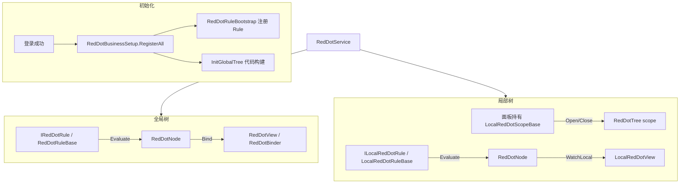
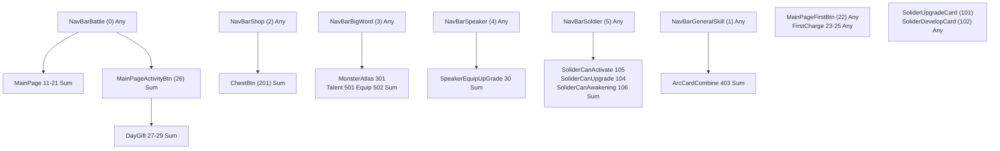
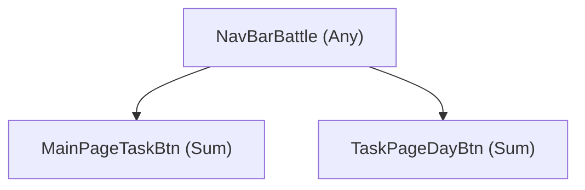

# 红点系统使用文档

## 概述

红点模块位于 `Assets/Scripts/Game/RedDot/`，核心由 **RedDotService** 统一管理，支持两类树：

红点模块采用**统一底层树 `RedDotTree`**，全局与局部仅在 **scope、生命周期、结构来源** 上分工：

| 类型 | Scope | 结构来源 | 生命周期 |
|------|-------|----------|----------|
| **全局树** | `"Global"` | 代码 `GlobalRedDotTreeSetup.Build` | 登录 → 登出 |
| **局部树** | 面板名如 `"SoldierPanel"` | 代码 `BuildNodes` + `RegisterNodeType` | 面板 Open → Close |

| 类型 | 用途 | 标识 |
|------|------|------|
| **全局树** | 主界面入口、跨面板聚合 | `RedNodeType` 枚举 |
| **局部树** | 面板内、带上下文参数 | `scope` + `RedNodeType` / `path` |

设计原则：

- **Service 不存业务红点字段**，只负责树结构、Rule 调度、UI 绑定。
- **Rule 负责计算**：订阅数据变化 → `Evaluate` → 写节点 count。
- **带参数的红点走局部树**，不在 Service 上挂 `SetSelectedXxxId` 之类 API。

---

## 架构



### 节点计数

每个 `RedDotNode` 的展示 count 来自：

```
count = Aggregate(localCount, children)
```

- **localCount**：Rule 写入，或 `SetLocal` 手动写入。
- **children**：子节点按 `RedDotAggregateMode`（Sum / Any / Max）聚合。

---

## 目录结构

```
Game/RedDot/
├── RedDotService.cs          # 核心服务
├── RedDotTree.cs             # 统一底层树（全局 / 局部共用）
├── RedDotTreeScopes.cs       # Scope 常量（Global 等）
├── RedDotNode.cs             # 节点
├── RedNodeType.cs            # 红点节点类型枚举（代码维护）
├── LocalRedDotScopeBase.cs   # 局部 Scope 基类（可继承）
├── LocalRedDotRuleBase.cs    # 局部 Rule 基类（可继承）
├── LocalRedDotKey.cs         # scope + path 键
├── RedDotRuleRegistry.cs     # Rule 工厂注册表
├── RedDotExtensions.cs       # UI 绑定扩展方法
├── View/ ...
    └── Business/
        ├── GlobalRedDotTreeSetup.cs    # 全局树结构（硬编码，唯一入口）
        ├── RedDotBusinessSetup.cs
        ├── RedDotRuleBootstrap.cs
        └── Rules/ ...
```

---

## 初始化与销毁

### 注册 Service

在 `GameStartMono` 中注册：

```csharp
GameServiceManager.Register(new RedDotService());
```

### 登录后初始化

```csharp
GameServiceManager.Get<RedDotService>();
RedDotBusinessSetup.RegisterAll(RedDotService.Instance);
```

内部流程：

1. `RedDotRuleBootstrap.RegisterAll` — 注册全局 / 局部 Rule 工厂。
2. `InitGlobalTree(GlobalRedDotTreeSetup.Build)` — 代码构建全局树并 Bind Rule。

### 登出重置

```csharp
GameServiceManager.Get<RedDotService>().Reset();
```

会销毁全局树及所有局部树。

---

## 全局树

### 适用场景

- 固定 UI 入口，**不依赖**面板内选中状态、动态 path。
- 需要在 `GlobalRedDotTreeSetup` 里配置**父子层级**，父节点自动聚合子节点（如导航栏 → 主页面 → 任务按钮）。
- 多处 UI 绑定**同一个** `RedNodeType`（主界面按钮与子页面按钮同步）。
- 登录后常驻，直到登出才销毁。

与局部树的边界：

| 场景 | 用全局树 | 用局部树 |
|------|----------|----------|
| 主界面「任务」按钮 | ✅ `MainPageTaskBtn` | |
| 任务页「日任务」页签 | ✅ `TaskPageDayBtn`（子节点，聚合到父） | |
| 英灵面板「当前卡升级」按钮 | | ✅ `SoldierPanel/Current/Upgrade` |
| 英灵导航栏「有任意英灵可升级」 | ✅ `SoliderCanUpgrade` | |
| 左右切换箭头（依赖当前选中卡） | | ✅ `SoldierPanel/Arrow/Left` |

---

### 核心概念

| 概念 | 说明 |
|------|------|
| **RedNodeType** | 红点节点类型枚举（`Game/RedDot/RedNodeType.cs`），UI 与 Rule 的统一标识 |
| **RedDotTree** | 统一底层树，`scope="Global"`，由 `GlobalRedDotTreeSetup.Build` 构建 |
| **GlobalRedDotTreeSetup** | 全局树结构定义（节点、父子、AggregateMode） |
| **IRedDotRule** | 全局 Rule 接口，`Evaluate()` 返回该节点的 **localCount** |
| **RedDotRuleBase** | 全局 Rule 基类，内置道具/等级变化订阅 |

全局树**没有** Scope / Path，也**没有**类似 `LocalRedDotScopeBase` 的实例类——结构由 `GlobalRedDotTreeSetup` + Rule 注册共同定义。

---

### RedNodeType 号码段 ↔ 导航 Tab ↔ 父节点

`RedNodeType` 在 `RedNodeType.cs` 中按**导航栏 Tab / 业务模块**分段编号，百位约等于所属 Tab，个位/十位留给该 Tab 下子功能。号码段是**团队约定**，C# 枚举不会自动校验范围，新增节点时需手动选对段号并在 `GlobalRedDotTreeSetup` 中挂好父节点。

#### 号码段总览

| 号码段 | 所属 Tab / 模块 | 导航根节点（`NavBar*`） | 说明 |
|--------|-----------------|-------------------------|------|
| **0–100** | 主界面 | `NavBarBattle` (0) 等 | 0–5 为导航栏根；6–10 预留；11–30 为主界面 / 轮语者子功能 |
| **100–200** | 英灵 | `NavBarSoldier` (5) | 英灵面板相关（103 技能升级节点已随技能升级移除而删除） |
| **200–300** | 商城 | `NavBarShop` (2) | 商城功能 |
| **300–400** | 世界 | `NavBarBigWord` (3) | 世界 / 大地图功能 |
| **400–500** | 奥术卡 | `NavBarGeneralSkill` (1) | 奥术卡 Tab 下功能 |
| **500–600** | 世界扩展 | `NavBarBigWord` (3) | 天赋、装备等（枚举注释仍写「奥术卡」，实际父节点为世界 Tab） |

\* `NavBarSoldier` 已注册为英灵 Tab 根节点，子节点：`SoliderCanActivate` / `SoliderCanUpgrade` / `SoliderCanAwakening`。

#### 导航栏根节点（0–5）

底部 / 顶部导航 Tab 根红点，全局树中 `AggregateMode = Any`（有子红点亮 1，不累加数量）。

| 值 | RedNodeType | 注释 | 默认全局树 |
|----|-------------|------|------------|
| 0 | `NavBarBattle` | 导航栏主页面按钮 | ✅ 根节点 |
| 1 | `NavBarGeneralSkill` | 导航栏奥术卡 | ✅ 根节点 |
| 2 | `NavBarShop` | 导航栏商店 | ✅ 根节点 |
| 3 | `NavBarBigWord` | 导航栏世界 | ✅ 根节点 |
| 4 | `NavBarSpeaker` | 导航栏轮语者 | ✅ 根节点 |
| 5 | `NavBarSoldier` | 导航栏英灵 | ✅ 根节点 |

> **命名说明：** `NavBarBattle` 枚举名来自历史命名，注释为「主页面按钮」；默认树中挂机 / 签到 / 任务等主界面功能均挂在其下，实际职责是**主界面 Tab 根节点**。

#### 全节点对照表（GlobalRedDotTreeSetup）

| 值 | RedNodeType | 注释 | 父节点 | 聚合 | 备注 |
|----|-------------|------|--------|------|------|
| **0–5** | *见上表* | 导航栏根 | — | Any | |
| 11 | `MainPageAFKBtn` | 主页面挂机 | `NavBarBattle` | Sum | |
| 12 | `AFKPageClaimBtn` | 挂机领取 | `NavBarBattle` | Sum | |
| 13 | `MainPageSignInBtn` | 主页面七日签到 | `NavBarBattle` | Sum | |
| 14 | `SignInPageClaimBtn` | 签到领取 | `NavBarBattle` | Sum | |
| 15 | `MainPageMonthCardBtn` | 主页面月卡 | `NavBarBattle` | Sum | |
| 16 | `MonthCardPageClaimBtn` | 月卡领取 | `NavBarBattle` | Sum | |
| 17 | `MainPageBattlePassBtn` | 主页面战令 | `NavBarBattle` | Sum | |
| 18 | `BattlePassPageClaimBtn` | 战令领取 | `NavBarBattle` | Sum | |
| 19 | `MainPageFundBtn` | 主页面基金 | `NavBarBattle` | Sum | |
| 20 | `MainPageTaskBtn` | 主页面任务 | `NavBarBattle` | Sum | |
| 21 | `TaskPageDayBtn` | 日任务页签 | `NavBarBattle` | Sum | |
| 22 | `MainPageFirstBtn` | 主页面首充 | — | Any | **独立根**，未挂 `NavBarBattle` |
| 23 | `FirstChargePageBeginnerBtn` | 首充特惠 | — | Any | 独立根 |
| 24 | `FirstChargePageIntermediateBtn` | 首充豪华 | — | Any | 独立根 |
| 25 | `FirstChargePageAdvancedBtn` | 首充至尊 | — | Any | 独立根 |
| 26 | `MainPageActivityBtn` | 主页面活动 | `NavBarBattle` | Sum | 活动入口中间层 |
| 27 | `DayGiftBtn` | 每日礼包 | `MainPageActivityBtn` | Sum | |
| 28 | `DayPayGiftBtn` | 每日充值 | `MainPageActivityBtn` | Sum | |
| 29 | `PayGoodGiftBtn` | 累充豪礼 | `MainPageActivityBtn` | Sum | |
| 30 | `SpeakerEquipUpGradeBtn` | 轮语者装备锻造入口 | `NavBarSpeaker` | Sum | |
| 33 | `MainPageMailBtn` | 主页面邮件 | — | Sum | 独立根，未挂 `NavBarBattle` |
| 101 | `SoliderUpgradeCard` | 英灵可升级 | — | Any | 全局根 + 局部树 `SoldierPanel` |
| 102 | `SoliderDevelopCard` | 英灵养成可领 | — | Any | 全局根 + 局部树 `SoldierPanel` |
| ~~103~~ | ~~`SoliderSkillUpGrade`~~ | 英灵技能升级 | — | — | **已删除**：技能升级移除，技能等级跟随英灵等级 |
| 104 | `SoliderCanUpgrade` | 英灵可升级+养成 | `NavBarSoldier` | Sum | 导航栏英灵入口聚合 |
| 201 | `ChestBtn` | 商城卡包 | `NavBarShop` | Sum | |
| 301 | `MonsterAtlasBtn` | 怪物图鉴 | `NavBarBigWord` | Sum | |
| ~~401~~ | ~~`GeneralSkillUpGrade`~~ | 英灵通用技能升级 | — | — | **已删除**：奥术卡升级红点链路废弃 |
| 501 | `TalentUpgradeBtn` | 天赋可升级 | `NavBarBigWord` | Sum | 号码段 500–600 |
| 502 | `EquipUpGradeBtn` | 装备可升级（世界入口） | `NavBarBigWord` | Sum | 号码段 500–600 |

#### 默认树层级示意



#### 新增节点 checklist

1. 在 `RedNodeType.cs` 对应号码段内增加枚举值，并写 `/// <summary>` 注释。
2. 在 **`GlobalRedDotTreeSetup.Build`** 追加 `Add(...)`：导航根用 **Any**，叶子/中间层用 **Sum** 并指定父节点。
3. 在 `RedDotRuleBootstrap.RegisterAll` 注册 Rule。
4. UI 绑定：`BindRedDot` / `RedDotBinder.SetRedType`；导航 Tab 按钮绑定对应 `NavBar*` 根节点。

**号码段与父节点不一致时：** 以 `GlobalRedDotTreeSetup` 中的**实际父节点**为准（决定 UI 聚合路径）；号码段仅用于枚举规划与沟通。

---

### 全局树结构（GlobalRedDotTreeSetup）

全局树由 **`GlobalRedDotTreeSetup.Build`** 在代码中硬编码构建，登录时通过 `RedDotBusinessSetup.RegisterAll` → `InitGlobalTree(GlobalRedDotTreeSetup.Build)` 初始化。

| 组件 | 说明 |
|------|------|
| `GlobalRedDotTreeSetup` | 唯一结构定义：`RegisterNodeType` + `SetAggregateMode` + `SetParent` |
| `RedDotRuleBootstrap` | Rule 工厂注册，与树结构独立 |

**追加节点示例：**

```csharp
// GlobalRedDotTreeSetup.Build 内
Add(RedNodeType.MyFeatureBtn, sum, true, RedNodeType.NavBarBattle);
```

树形关系示例：



> **已废弃：** `GlobalRedDotTreeConfig` ScriptableObject、`GlobalRedDotTreeConfigProvider` YooAsset 加载、Global Tree Editor 窗口及 `Assets/Res/UIConfig/GlobalRedDotTreeConfig.asset` 均不再使用。

---

### 构建与刷新流程

**登录时：**

```
RedDotBusinessSetup.RegisterAll
  ├─ RedDotRuleBootstrap.RegisterAll   // 注册 Rule 工厂到 Registry
  └─ InitGlobalTree(GlobalRedDotTreeSetup.Build)
       ├─ GlobalRedDotTreeSetup.Build(tree)
       ├─ BindGlobalRules
       └─ MarkAllGlobalDirty + FlushNow
```

**运行时刷新：**

```
数据变化 → Rule 订阅回调 → Context.MarkDirty()
  → 写入 dirty 集合（全局 HashSet<RedNodeType> / 局部 HashSet<LocalRedDotKey>）
  → ScheduleFlush()（同一帧内多次 MarkDirty 合并为一次）
  → 帧末 LastPostLateUpdate 统一 Flush
       ├─ EvaluateGlobal(type)：该 type 下所有 Rule Evaluate() 求和 → SetLocalCount
       ├─ FlushLocalDirty(scope)：dirty 中的 key 各 Evaluate 一次
       └─ 节点 RefreshUpward()，父节点按 AggregateMode 聚合
  → UI Bind 回调 / BindableProperty 更新
```

**立即刷新（FlushNow）：** 登录初始化、面板 `Open()` 后需立刻绑定 UI 时，会同步调用 `FlushNow()`，不走帧末合并。

**Evaluate 多 Rule 同一节点：**

同一 `RedNodeType` 可注册多个 Rule，Service 会将它们的 `Evaluate()` **相加**后写入 `localCount`：

```csharp
// 示例：SoliderUpgradeAndDep 同时挂升级 Rule + 养成 Rule
registry.RegisterGlobal(RedNodeType.SoliderUpgradeAndDep, () => new SoliderDevelopRedDotRule());
registry.RegisterGlobal(RedNodeType.SoliderUpgradeAndDep, () => new SoliderUpgradeRedDotRule());

// 示例：MainPageFirstBtn 挂 3 个首充档位 Rule
registry.RegisterGlobal(RedNodeType.MainPageFirstBtn, () => new FirstRechargeRedDotRule(0));
registry.RegisterGlobal(RedNodeType.MainPageFirstBtn, () => new FirstRechargeRedDotRule(1));
registry.RegisterGlobal(RedNodeType.MainPageFirstBtn, () => new FirstRechargeRedDotRule(2));
```

---

### 节点 count 计算

```
count = Aggregate(localCount, children)
```

| 字段 | 来源 |
|------|------|
| **localCount** | 全局 Rule 的 `Evaluate()` 之和，或 `SetGlobalCount` 手动设置 |
| **children** | 代码定义的父子关系，按 `RedDotAggregateMode` 聚合 |

| AggregateMode | 行为 |
|---------------|------|
| **Sum** | localCount + 所有子节点 count 之和（适合显示数量） |
| **Any** | localCount 或任一子节点 count > 0 则返回 1（适合「有没有红点」） |
| **Max** | localCount 与所有子节点 count 的最大值 |

---

### 新增全局红点（四步）

#### 1. 在 RedNodeType 与 GlobalRedDotTreeSetup 增加节点

在 `RedNodeType.cs` 增加枚举值；在 **`GlobalRedDotTreeSetup.Build`** 追加 `Add(...)` 并设置父级与 `AggregateMode`。

#### 2. 编写 Rule

在 `Business/Rules/` 继承 `RedDotRuleBase`：

```csharp
public sealed class MyFeatureRedDotRule : RedDotRuleBase
{
    public override RedNodeType NodeType => RedNodeType.MyFeatureBtn;

    protected override void OnBind()
    {
        Global.Publisher.Subscribe(MessagePublisher.SOME_EVENT, OnDataChanged);
    }

    protected override void OnUnbind()
    {
        Global.Publisher.Unsubscribe(MessagePublisher.SOME_EVENT, OnDataChanged);
    }

    void OnDataChanged(object obj) => Context.MarkDirty();

    public override int Evaluate()
    {
        return SomeCondition() ? 1 : 0;   // 返回 0 表示无红点；>0 表示有（或数量）
    }
}
```

`RedDotRuleBase` 已默认订阅 `CHANGE_ITEM_CHANGE`、`CHANGE_USER_LEVEL_INFO`，不需要时可覆写：

```csharp
protected override bool CanWatchItemAllChange => false;
protected override bool CanWatchLevelUpdate => false;
```

#### 3. 注册 Rule

在 `RedDotRuleBootstrap.RegisterAll`：

```csharp
registry.RegisterGlobal(RedNodeType.MyFeatureBtn, () => new MyFeatureRedDotRule());
```

#### 4. UI 绑定

```csharp
myButton.BindRedDot(RedNodeType.MyFeatureBtn);
```

业务数据变更后若默认订阅未覆盖，手动：

```csharp
RedDotService.Instance.MarkDirty(RedNodeType.MyFeatureBtn);
```

---

### UI 绑定（全局）

**方式 A：扩展方法（推荐）**

```csharp
using Game.RedDot;

myButton.BindRedDot(RedNodeType.MainPageTaskBtn);
```

**方式 B：RedDotBinder 组件（Prefab / 旧面板）**

```csharp
btn.GetOrAddComponent<RedDotBinder>().SetRedType(RedNodeType.MainPageTaskBtn);
```

**方式 C：代码监听**

```csharp
RedDotService.Instance.Bind(RedNodeType.MainPageTaskBtn, count =>
{
    // 自定义 UI 更新
});

// 读取当前值
int count = RedDotService.Instance.GetCount(RedNodeType.MainPageTaskBtn);
BindableProperty<int> prop = RedDotService.Instance.GetCountProperty(RedNodeType.MainPageTaskBtn);
```

---

### 参考示例：英灵全局节点

`SoliderUpgradeAndDep`（导航栏英灵入口）由两个全局 Rule 共同驱动：

| Rule | Evaluate 逻辑 |
|------|----------------|
| `SoliderUpgradeRedDotRule` | 遍历全部已拥有英灵，统计可升级数量 |
| `SoliderDevelopRedDotRule` | 遍历全部已拥有英灵，统计养成奖励可领数量 |

两者 `Evaluate()` 相加写入节点 localCount，**不依赖**当前选中英灵 ID。

面板内「当前卡升级按钮」则走局部树 `SoldierPanel/Current/Upgrade`，见下文局部树章节。

---

### 全局树 API 速查

```csharp
RedDotService service = RedDotService.Instance;

// 查询
int count = service.GetCount(RedNodeType.Xxx);
service.GetCountProperty(RedNodeType.Xxx);

// 监听
service.Bind(RedNodeType.Xxx, listener);
service.Unbind(RedNodeType.Xxx, listener);

// 刷新（触发 Rule Evaluate）
service.MarkDirty(RedNodeType.Xxx);
service.MarkAllGlobalDirty();          // 内部使用，登录初始化时调用

// 手动设数（无 Rule 或覆盖 Rule 结果时使用，少见）
service.SetGlobalCount(RedNodeType.Xxx, count);

// 状态
bool ready = service.IsGlobalInitialized;
```

---

## 局部树

### 适用场景

- 依赖**面板上下文**（当前选中 ID、筛选条件、动态列表项）。
- 面板关闭后红点逻辑应销毁。
- 路径可动态生成，如 `Card/{cardId}/Upgrade`。

### 核心概念

| 概念 | 说明 |
|------|------|
| **Scope** | 局部树命名空间，如 `"SoldierPanel"` |
| **RedDotTree** | 与全局相同的底层树，由 `BuildNodes` 代码构建 |
| **RedNodeType** | 固定节点的统一标识（与全局树共用枚举），UI / Rule 优先使用 |
| **Path** | 无对应 `RedNodeType` 的动态节点路径，如 `Card/{id}/Upgrade` |
| **Scope 实例** | 面板 `new` 持有，**不要**做成 static 单例 |
| **Active 注册表** | `Open()` 时注册、`Close()` 时注销，供 Rule 的 `GetScope<T>()` 读取状态 |

固定节点与动态节点：

| 节点类型 | 标识 | 示例 |
|----------|------|------|
| **固定 UI 入口** | `RedNodeType` | `SoliderUpgradeCard` → 当前卡升级按钮 |
| **动态列表项** | `path` | `Card/1001/Upgrade` |

在 `BuildNodes` 中通过 `RegisterNodeType` 绑定 Type ↔ Path：

```csharp
RegisterNodeType(tree, RedNodeType.SoliderUpgradeCard, Paths.CurrentUpgrade);
EnsureNode(tree, Paths.CardUpgrade(cardId));   // 动态节点仍用 path
```

### 新增局部树（三步）

#### 1. 继承 LocalRedDotScopeBase

```csharp
public sealed class MyPanelRedDotScope : LocalRedDotScopeBase
{
    public const string ScopeName = "MyPanel";
    public override string Scope => ScopeName;

    public static class Paths
    {
        public const string Confirm = "Confirm";
        public static string Item(int id) => $"Item/{id}";
    }

    int _selectedId;

    public int SelectedId => _selectedId;

    public static void RegisterRules(RedDotRuleRegistry registry)
    {
        RegisterRule(registry, ScopeName, () => new MyPanelLocalRedDotRule());
    }

    public void OpenWithData(int selectedId)
    {
        _selectedId = selectedId;
        Open();
    }

    protected override void BuildNodes(LocalRedDotTree tree)
    {
        RegisterNodeType(tree, RedNodeType.MyFeatureBtn, Paths.Confirm);
        EnsureNode(tree, Paths.Item(_selectedId));
    }

    public void SetSelectedId(int id)
    {
        _selectedId = id;
        MarkDirty(RedNodeType.MyFeatureBtn);
    }

    protected override void ResetState()
    {
        _selectedId = 0;
    }
}
```

#### 2. 继承 LocalRedDotRuleBase

```csharp
public sealed class MyPanelLocalRedDotRule : LocalRedDotRuleBase
{
    public override string Scope => MyPanelRedDotScope.ScopeName;

    protected override void OnBind()
    {
        Global.Publisher.Subscribe(MessagePublisher.CHANGE_ITEM_CHANGE, _ => MarkAllDirty());
    }

    protected override void OnUnbind()
    {
        Global.Publisher.Unsubscribe(MessagePublisher.CHANGE_ITEM_CHANGE, _ => MarkAllDirty());
    }

    public override int Evaluate(LocalRedDotKey key)
    {
        MyPanelRedDotScope scope = GetScope<MyPanelRedDotScope>();
        if (scope == null) return 0;

        if (TryGetNodeType(key, out RedNodeType nodeType)
            && nodeType == RedNodeType.MyFeatureBtn)
        {
            return CheckConfirm(scope.SelectedId) ? 1 : 0;
        }

        return 0;
    }
}
```

#### 3. 注册 Rule + 面板生命周期

**Bootstrap：**

```csharp
MyPanelRedDotScope.RegisterRules(registry);
```

**面板：**

```csharp
readonly MyPanelRedDotScope _redDotScope = new MyPanelRedDotScope();

protected override void OnOpen()
{
    _redDotScope.OpenWithData(currentId);
    confirmBtn.BindLocalRedDot(_redDotScope, RedNodeType.MyFeatureBtn);
}

protected override void OnClose()
{
    _redDotScope.Close();
}

void OnSelectionChanged(int id)
{
    _redDotScope.SetSelectedId(id);
}
```

### 外部模块通知（面板可能未打开）

```csharp
LocalRedDotScopeBase
    .GetActive<MyPanelRedDotScope>(MyPanelRedDotScope.ScopeName)
    ?.MarkAllDirty();
```

使用 `?.` 避免面板未打开时报错。

### 同步刷新全局聚合节点

局部数据变化若需影响全局入口（如英灵总览），在 Scope 中显式调用：

```csharp
public void NotifyDataChanged()
{
    MarkAllDirty();
    Service.MarkDirty(RedNodeType.SoliderUpgradeAndDep);
}
```

---

## UI 绑定方式对照

| 方式 | 组件 | 数据源 | 适用 |
|------|------|--------|------|
| `BindRedDot(RedNodeType)` | `RedDotView` | 全局树 | 固定入口 |
| `BindLocalRedDot(scope, RedNodeType)` | `LocalRedDotView` | 局部树固定节点 | 面板内按钮 |
| `BindLocalRedDot(scope, path)` | `LocalRedDotView` | 局部树动态 path | 列表项等 |
| `SetLocalRedCount(count)` | `LocalRedDot` | 手动传入数字 | 列表项、一次性逻辑，不走 Rule |
| `RedDotBinder.SetRedType` | `RedDotBinder` | 全局树 | 旧面板 / Prefab 挂组件 |

局部树绑定示例：

```csharp
// 固定节点：RedNodeType
btn.BindLocalRedDot(_redDotScope, RedNodeType.SoliderUpgradeCard);

// 动态节点：path
btn.BindLocalRedDot(_redDotScope.Scope, SoldierPanelRedDotScope.Paths.CardUpgrade(cardId));
```

---

## 参考示例：英灵面板

文件：`Game/Soldier/RedDot/`

| 文件 | 职责 |
|------|------|
| `SoldierPanelRedDotScope.cs` | 路径定义、选中卡状态、Open/Close |
| `SoldierPanelLocalRedDotRule.cs` | 升级/养成/箭头红点计算 |

路径约定：

| RedNodeType | Path（内部） | 用途 |
|-------------|--------------|------|
| `SoliderUpgradeCard` | `Current/Upgrade` | 当前卡升级按钮 |
| `SoliderDevelopCard` | `Current/Develop` | 当前卡养成 |
| `SoliderLeftDevelopCard` | `Arrow/Left` | 左箭头 |
| `SoliderRightDevelopCard` | `Arrow/Right` | 右箭头 |
| — | `Card/{id}/Upgrade` | 指定卡升级（动态，无 Type） |
| — | `Card/{id}/Develop` | 指定卡养成（动态，无 Type） |

面板侧（`SoldierPanelNew`）：

```csharp
readonly SoldierPanelRedDotScope _redDotScope = new SoldierPanelRedDotScope();

void OnOpen()
{
    _redDotScope.Open(soldierCardIds);
    upGradeBtn.BindLocalRedDot(_redDotScope, RedNodeType.SoliderUpgradeCard);
}

void OnCardChanged(int cardId) => _redDotScope.SetSelectedCard(cardId);
void OnClose() => _redDotScope.Close();
```

全局节点 `SoliderUpgradeAndDep` 仍由 `SoliderUpgradeRedDotRule` / `SoliderDevelopRedDotRule` 遍历全部英灵计算，**不依赖**当前选中 ID。

---

## 约定与注意

### 应该做

- Rule 只负责 `Evaluate` 和订阅；业务 Service **不要**存 `HasRedDot` 字段。
- 局部 Scope 由**面板实例** `new` 持有，生命周期与面板一致。
- Path 常量集中定义在 Scope 的 `Paths` 静态类中。
- 新增 Rule 后在 `RedDotRuleBootstrap` 注册；新增全局节点后在 `GlobalRedDotTreeSetup` 注册。

### 不应该做

- 在 `RedDotService` 上添加 `SetSelectedXxxId` 等传参 API。
- 把局部 Scope 做成 static 单例（与面板生命周期脱节）。
- 在旧 `RedDotManager` / `CHANGE_RED_TYPE` 链路上新增逻辑（已废弃）。
- 同一 scope 重复 `Open` 而不 `Close`（基类会复用已有树，但应保证只有一个面板实例持有该 scope）。

### 手动红点 vs Rule 驱动

- **Rule 驱动**：条件可复现、多处 UI 要同步、需聚合 → 用全局/局部树。
- **手动 `LocalRedDot.SetRed(n)`**：仅某一列表 cell、逻辑简单、不需要向上聚合 → 直接设数。

---

## 常用 API 速查

### RedDotService

```csharp
// 全局
int count = service.GetCount(RedNodeType.Xxx);
service.Bind(RedNodeType.Xxx, listener);
service.MarkDirty(RedNodeType.Xxx);   // 帧末合并刷新
service.FlushNow();                   // 立即刷新全部 pending dirty

// 局部
service.MarkLocalDirty(scope, RedNodeType.Xxx);
service.GetLocalCount(scope, RedNodeType.Xxx);
service.WatchLocal(scope, RedNodeType.Xxx, listener);
```

### LocalRedDotScopeBase

```csharp
scope.Open();
scope.Close();
scope.MarkDirty(RedNodeType.Xxx);
scope.MarkDirty("path/a");
scope.MarkAllDirty();
LocalRedDotScopeBase.GetActive<TScope>(scopeName);
```

### 扩展方法（RedDotExtensions）

```csharp
BindRedDot(target, RedNodeType);
BindLocalRedDot(target, scope, RedNodeType);
BindLocalRedDot(target, scope, path);
BindLocalRedDot(target, scopeInstance, RedNodeType);
MarkLocalRedDotDirty(scope, RedNodeType);
MarkLocalRedDotDirty(LocalRedDotKey);
SetLocalRedCount(target, count);
```

---

## 排查清单

### 全局树

1. **红点不显示**
   - 是否已登录并调用 `RedDotBusinessSetup.RegisterAll`？
   - `GlobalRedDotTreeSetup` 是否注册了对应 `RedNodeType`？
   - Rule 是否已在 `RedDotRuleBootstrap` 注册？
   - UI 绑定的 `RedNodeType` 是否与 Rule / 树结构一致？

2. **父节点不亮、子节点亮**
   - 检查父节点 `AggregateMode`（Any / Sum）。
   - 父节点在 `GlobalRedDotTreeSetup` 的 `SetParent` 链是否正确。

3. **数据变了不刷新**
   - Rule 是否订阅了对应事件并 `Context.MarkDirty()`？
   - 是否误把「依赖选中状态」的逻辑写在全局 Rule（应改局部树）？

4. **count 数量不对**
   - 同一 `RedNodeType` 是否挂了多个 Rule（Evaluate 会**相加**）？

### 局部树

1. **红点不显示**
   - Rule 是否已在 Bootstrap 注册？
   - `BuildNodes` 是否创建了对应 path？
   - 面板是否已 `_redDotScope.Open()`？

2. **数据变了红点不刷新**
   - Rule 是否 `MarkDirty` / `MarkAllDirty`？
   - 外部通知是否用了 `GetActive<T>()?.`？

3. **面板关闭后报错**
   - `OnClose` 是否调用了 `scope.Close()`？

4. **count 不符合预期**
   - 检查 `RedDotAggregateMode` 与子节点聚合是否正确。
