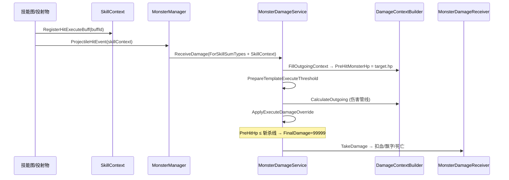

# Execute（斩杀）Buff — 配置与实现说明

> **适用对象**：策划、程序  
> **最后更新**：2026-07-03  
> **相关代码**：`BuffApplier.cs`、`MonsterDamageService.cs`、`DamageContextBuilder.cs`、`SkillContext.HitExecuteBuffIds`

---

## 一、语义说明

**斩杀（BuffTypeId = 15，`BuffType.Execute`）** 不是「命中后再单独判定是否击杀」，而是：

> **若本段伤害结算前，目标血量 ≤ 斩杀线，则把本段伤害的 `FinalDamage` 升格为 99999。**

要点：

| 项 | 说明 |
|----|------|
| 判定血量 | **受击前血量**（`DamageContext.PreHitMonsterHp`），不是扣血后 |
| 伤害表现 | 本段命中伤害变为 **99999**，走正常扣血 / 飘字 / 死亡流程 |
| 不创建常驻 Buff | Execute 模板不会在目标身上挂 Buff 实例 |
| Boss | 模板斩杀对 Boss **不生效** |
| 概率 | `Probability` 在写入斩杀线时掷骰，未通过则本段无模板斩杀线 |

另有 **模块斩杀线**（全局属性 `MonsterExecutionThreshold`，血量**比例**），与模板斩杀并行判定，任一满足即可升格伤害。

---

## 二、数据配置（SkillBuffTemplateLibrary）

模板资源：`Assets/SkillGraph/SkillBuffTemplateLibrary.asset`  
读取入口：`SkillBuffTemplateProvider.GetEffects(buffId)`

### 2.1 核心字段

| 字段 | 说明 |
|------|------|
| `BuffTypeId` | 固定 **15**（Execute） |
| `PercentValueSourceAttrName` | 斩杀线比例来源属性，常用 `MonsterMaxHealth` |
| `PercentEffectValue` | 比例系数：`< 1` 为小数（`0.6` = 60%）；`≥ 1` 按百分数（`5` = 5%） |
| `EffectValue` / `EffectValueAttrName` | 可选固定斩杀线（绝对血量）；一般留空，用比例公式 |
| `BuffValueSource` | `Target`：读目标属性；`Caster`：读施法者属性 |
| `Probability` | 本段命中是否启用该斩杀模板（0~1） |
| `Duration` | 通常为 `-1`（不挂 Buff） |

### 2.2 斩杀线计算公式

入口：`BuffApplier.GetExecuteThreshold`

1. 若配置了 `PercentValueSourceAttrName`：  
   `threshold = ReadAttribute(来源属性) × percentMultiplier`  
   其中 `percentMultiplier = |PercentEffectValue| > 1 ? PercentEffectValue/100 : PercentEffectValue`
2. 否则使用 `EffectValue`（或 `EffectValueAttrName` 解析值）作为绝对斩杀线。

**判定**：`PreHitMonsterHp ≤ threshold` → 本段伤害升格为 99999。

### 2.3 配置示例

| BuffId | 名称 | PercentEffectValue | 含义（maxHp=1000） |
|--------|------|-------------------|-------------------|
| 10003 | 万箭齐发斩杀效果 | `0.6` | 斩杀线 = 600（60% 最大生命） |
| 30006 | 拔刀斩斩杀效果 | `0.05` | 斩杀线 = 50（5% 最大生命） |

示例（10003 片段）：

```yaml
BuffTypeId: 15
PercentEffectValue: 0.6
PercentValueSourceAttrName: MonsterMaxHealth
BuffValueSource: Target
Probability: 1
```

---

## 三、技能图配置

斩杀必须在 **同次命中造成伤害之前** 注册到 `SkillContext`，伤害管线才能读到斩杀线。

### 3.1 推荐：投射物 AttachBuff 命中模块

在 `Projectile` / `FanProjectile` 的 `hit_modules` 中增加：

```text
Penetrate|3:0;AttachBuff|<buffId>:...|...|...|...|...|...|...|...|...|...|...|...|...|...|...|...|...|...|Enemy|<buffId>
```

（具体参数以技能图编辑器 `AttachBuff` 模块为准；`buffId` 填 `SkillBuffTemplateLibrary` 中的斩杀模板 Id。）

**模块解析时**会调用 `BuffApplier.RegisterHitExecuteBuff`，将 BuffId 写入 `SkillContext.HitExecuteBuffIds`。

典型链路：

```text
Cast → Projectile(Penetrate + AttachBuff斩杀) → ...
```

### 3.2 ApplyBuff 节点（技能图）

`ApplyBuffHandler` 在施加前也会 `RegisterHitExecuteBuff`。

**注意节点顺序**：`ApplyBuff`（斩杀）必须排在 **发布伤害之前**（如 `AoeDamage`、依赖 `ProjectileHitEvent` 的命中），否则 `HitExecuteBuffIds` 为空，本段伤害无法升格。

```text
✅ ApplyBuff(buff_id=斩杀) → AoeDamage
❌ AoeDamage → ApplyBuff(buff_id=斩杀)   # 伤害已结算，斩杀不生效
```

### 3.3 AttachBuffHitModule 与伤害时序

投射物命中流程（简化）：

```text
ProcessHitModules
  → 各模块 CollectHits
  → 各模块 OnHit（顺序取决于 hit_modules 配置）
      → PenetrateHitModule：发布 ProjectileHitEvent → MonsterManager → ReceiveDamage
      → AttachBuffHitModule：ApplyBuff（Execute 类型仅标记 applied，不单独扣血）
```

**注册时机**：创建投射物解析 `AttachBuff` 模块时已完成注册，与 `OnHit` 顺序无关；  
**伤害时机**：以 `ProjectileHitEvent` / `ReceiveDamage` 为准。

---

## 四、运行时流程



### 4.1 关键 API

| 阶段 | 方法 | 文件 |
|------|------|------|
| 注册 | `BuffApplier.RegisterHitExecuteBuff` | `BuffApplier.cs` |
| 写斩杀线 | `BuffApplier.PrepareTemplateExecuteThreshold` | `BuffApplier.cs` |
| 记录受击前血量 | `FillOutgoingContext` → `PreHitMonsterHp` | `DamageContextBuilder.cs` |
| 模块斩杀标记 | `FillOutgoingContext` → `IsExecution`（`MonsterExecutionThreshold`） | `DamageContextBuilder.cs` |
| 升格伤害 | `MonsterDamageService.ApplyExecuteDamageOverride` | `MonsterDamageService.cs` |
| 飘字/死亡 | `MonsterDamageReceiver` + `DamageUIManager` | `IsExecution` 时 Damage=99999 |

### 4.2 DamageContext 斩杀字段

| 字段 | 说明 |
|------|------|
| `PreHitMonsterHp` | 本段伤害结算前怪物血量 |
| `TemplateExecuteThreshold` | 模板斩杀线（绝对血量，0=本段无模板斩杀） |
| `TemplateExecuteBuffId` | 命中的模板 BuffId（日志用） |
| `IsExecution` | 本段是否按斩杀结算（含模块斩杀） |

### 4.3 SkillContext 字段

| 字段 | 说明 |
|------|------|
| `HitExecuteBuffIds` | 本次技能执行中注册的斩杀 BuffId 列表 |

### 4.4 MonsterDamageRequest

`ForSkillSumTypes(..., skillContext)` 可选传入 `SkillContext`，供 `ReceiveSingleDamage` 调用 `PrepareTemplateExecuteThreshold`。

已接入：

- `MonsterManager.OnAddHitEvent`
- `BulletDamageDetector`

---

## 五、模块斩杀线（全局）

与模板斩杀独立，由局内模块属性控制：

| 属性 | `AttributeType.MonsterExecutionThreshold` |
|------|-------------------------------------------|
| 语义 | 怪物当前血量**比例** ≤ 该值时，普通怪可斩杀 |
| 写入 | `DamageContextBuilder.FillOutgoingContext` → `ctx.IsExecution` |
| 升格 | `ApplyExecuteDamageOverride` 与模板斩杀合并判定 |

模板斩杀用 **绝对血量**；模块斩杀用 **血量比例**。二者满足其一即升格本段伤害。

---

## 六、调试日志

Console 过滤：`[Execute判定]`

触发示例：

```text
[BuffApplier][Execute判定] 触发 buffId=10003, skillId=..., target=..., maxHp=1000,
hpForThreshold=550(55.0%), hpSource=PreHitMonsterHp, preHitHp=550, currentHp=520,
templateThreshold=600.0(60.0%), moduleThreshold=0.0%, moduleExecute=False, templateExecute=True,
finalDamage=99999
```

未触发时 `result=未触发`，并打印 `hpForThreshold` 与 `templateThreshold` 对比。

---

## 七、验收清单

- [ ] 怪物受击前 65% 血、斩杀线 60%：本段**不**升格，正常伤害
- [ ] 怪物受击前 55% 血、斩杀线 60%：本段伤害 **99999**，怪物死亡
- [ ] 命中后 ApplyBuff 顺序错误时：斩杀不生效（需调整技能图顺序或使用 AttachBuff 命中模块）
- [ ] Boss 不受模板斩杀影响
- [ ] `Probability < 1` 时多次命中表现符合概率
- [ ] 飘字显示斩杀伤害（99999），非被增伤放大的常规伤害数字

---

## 八、相关文件索引

| 类型 | 路径 |
|------|------|
| 本文档 | `Assets/Scripts/Game/Skill/Doc/ExecuteBuff_配置说明.md` |
| Buff 模板库说明 | `Assets/Scripts/Game/Skill/Config/SkillBuffTemplateLibrary_README.md` |
| 伤害系统说明 | `Assets/Scripts/Game/DamageCalculator/DamageSystem_README.md` |
| 模板资源 | `Assets/SkillGraph/SkillBuffTemplateLibrary.asset` |
| 施加逻辑 | `Assets/Scripts/Game/Skill/Handler/Buff/BuffApplier.cs` |
| 伤害编排 | `Assets/Scripts/Game/DamageCalculator/MonsterDamageService.cs` |
| 命中 Buff 模块 | `Assets/Scripts/Game/Projectile/HitModule/AttachBuffHitModule.cs` |
| 投射物 Handler | `ProjectileHandler.cs` / `FanProjectileHandler.cs` |
| ApplyBuff 节点 | `ApplyBuffHandler.cs` |

---

## 九、变更记录

| 日期 | 说明 |
|------|------|
| 2026-07-03 | 斩杀改为本段伤害升格 99999；判定用 `PreHitMonsterHp`；移除单独 `ApplyTemplateExecute` 击杀路径 |
| 2026-07-03 | 新增 `HitExecuteBuffIds` / `TemplateExecuteThreshold` / `ApplyExecuteDamageOverride` |
