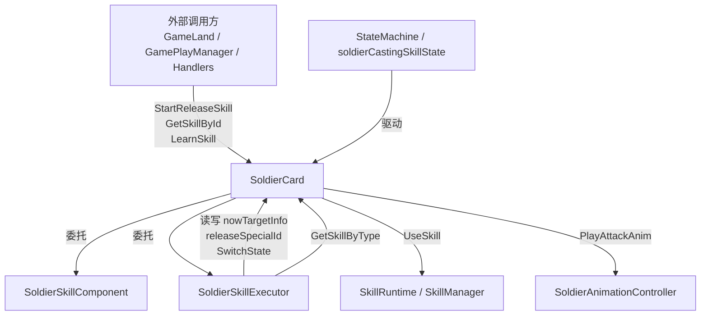

# SoldierCard 技能系统重构上下文

> 本文档记录 SoldierCard 技能相关重构的完整上下文，供后续 AI 对话或开发接续使用。  
> **总览文档：** 同目录 `SoldierCard_README.md`  
> 最后更新：2026-06-05

---

## 1. 重构目标

将 `SoldierCard` 中臃肿的技能逻辑拆分为职责单一的组件，遵循以下原则：

- **所有原有逻辑保持不变**
- **不修改外部调用接口**（外部仍通过 `SoldierCard` 公开方法访问）
- **SoldierCard 通过组件委托**，自身只保留流程编排与动画/攻击逻辑
- **不修改** `AnimationController`、`StateMachine`、`SkillRuntime`
- 组件模式与现有 `SoldierBuffController`、`SoldierAnimationController` 一致：**纯 C# 类，非 MonoBehaviour**

---

## 2. 当前架构

```
SoldierCard
├── SkillComponent   (SoldierSkillComponent)  — 技能数据：字典、学习、查询
├── SkillExecutor    (SoldierSkillExecutor)    — 主动释放流程：条件、目标、状态、事件
├── AnimationController                      — 动画（未改动）
├── BuffController                           — Buff（未改动）
├── HealthBarController                      — 血条（未改动）
│
├── StartReleaseSkill()  → 委托 SkillExecutor
├── GetSkillById/LearnSkill/...  → 委托 SkillComponent
│
├── UseSkill()           — 仍留在 SoldierCard（技能图释放）
├── PlayAttackAnim()     — 仍留在 SoldierCard（动画）
├── ExecuteAttack()      — 仍留在 SoldierCard（命中后触发 UseSkill）
└── PlayAtkAnimation()   — 仍留在 SoldierCard（普攻入口）
```

---

## 3. 文件清单

| 文件 | 路径 | 状态 |
|------|------|------|
| SoldierCard | `Assets/Scripts/Game/SoldierCard.cs` | 已重构（委托层） |
| SoldierSkillComponent | `Assets/Scripts/Game/Soldier/SoldierSkillComponent.cs` | 新增 |
| SoldierSkillExecutor | `Assets/Scripts/Game/Soldier/SoldierSkillExecutor.cs` | 已实现 |
| SoldierSkillExecutor（空壳） | 原为空类，已填充 | 已替换 |

---

## 4. SoldierSkillComponent

### 职责

1. 管理 `Dictionary<int, ISkill> _skills`
2. `LearnSkill` — 学习新技能（已存在则返回 null）
3. `RelearnSkill` — 重学/覆盖技能
4. `GetSkillById` / `GetSkillByType` / `GetReadySkillById` / `GetSkillAll`
5. `Reset()` — Init 时清空技能字典

### 不负责

- 技能释放逻辑
- 动画
- 目标选择

### 关键实现细节

```csharp
// 构造：Awake 中 new SoldierSkillComponent(this)
// Init：SkillComponent.Reset() 替代原 this._skills = new()

// LearnSkill：ContainsKey 守卫后 Add，已存在返回 null
// RelearnSkill：_skills[skillId] = skill（覆盖写入，修复了原 Add 重复 Key 崩溃）
//   触发场景：CheckNormalAttackHeavyBlowSkill 中破军一击/重击等级变化

// GetReadySkillById：
//   isActiveRelease=true → 跳过冷却
//   否则 skillId == NormalAttackSkillId || skill.IsReady(false)
```

### SoldierCard 委托方法

```csharp
public Dictionary<int, ISkill> GetSkillAll()      => SkillComponent.GetSkillAll();
public ISkill GetSkillById(int skillId)          => SkillComponent.GetSkillById(skillId);
public ISkill GetSkillByType(SpecialEffectType)  => SkillComponent.GetSkillByType(skillType);
public ISkill GetReadySkillById(...)             => SkillComponent.GetReadySkillById(...);
public ISkill LearnSkill(...)                    => SkillComponent.LearnSkill(...);
public ISkill RelearnSkill(...)                  => SkillComponent.RelearnSkill(...);

// AddSkillAttributeModifier 中遍历：
foreach (var skill in SkillComponent.GetSkillAll().Values) { ... }
```

---

## 5. SoldierSkillExecutor

### 职责

1. **释放条件检查** — 死亡、skillId==0、SoldierUnableToReleaseSkills
2. **目标构建** — `BuildTarget()`
3. **状态切换** — 在 `StartReleaseSkill` 中直接操作 `soldierCastingSkillState` + `SwitchState`
4. **释放副作用** — `ApplyReleaseEffects()`
5. **事件触发** — `TriggerReleaseEvents()`

### 不负责

- `AnimationController`（动画由状态机 → SoldierCard.PlayAttackAnim 驱动）
- `SkillRuntime` / `SkillManager.CastSkill`（由 SoldierCard.UseSkill 处理）
- 技能字典管理（由 SkillComponent 处理）

### StartReleaseSkill 执行流程

```
1. 条件检查（死亡 / specialId==0 / SoldierUnableToReleaseSkills）
2. BuildTarget(specialId, targetPosition, useNearestEnemy)
   ├── 指定坐标 → EnemyTargetFinder.FromPosition
   ├── useNearestEnemy → 全局最近敌人
   ├── currentTarget → 当前普攻锁定
   └── 无目标 + AutoReleaseSkillState → return false
3. ApplyReleaseEffects(Comet)          ← 秘法彗星（状态切换前）
4. 状态切换
   ├── 已在 CastingSkill → UseNewSkill
   └── 否则 → SetSkillId + SwitchState(CastingSkill)
5. ApplyReleaseEffects(Health)         ← 概率回血 + 满血恢复（状态切换后）
6. TriggerReleaseEvents(specialId)
7. 成功日志 + return true
```

> **顺序约束**：彗星效果必须在状态切换**之前**，回血效果必须在状态切换**之后**。
> 通过内部枚举 `ReleaseEffectPhase { Comet, Health }` 分阶段调用 `ApplyReleaseEffects` 保持原顺序。

### 方法拆分

| 方法 | 职责 |
|------|------|
| `StartReleaseSkill` | 流程入口，编排各步骤 |
| `BuildTarget` | 目标构建，写入 `_soldier.nowTargetInfo` |
| `ApplyReleaseEffects` | 彗星 / 回血副作用 |
| `TriggerReleaseEvents` | 引导、Publisher、条件、连击计数 |
| `CheckStartReleaseCometSkill` | 秘法彗星内部实现（含 `_cometSkillReleaseTime` CD） |

### SoldierCard 委托

```csharp
public bool StartReleaseSkill(int specialId, Vector3 targetPosition = default, bool useNearestEnemy = false)
{
    return SkillExecutor.StartReleaseSkill(specialId, targetPosition, useNearestEnemy);
}
```

---

## 6. SoldierCard 仍保留的逻辑

| 方法 | 职责 |
|------|------|
| `UseSkill` | 技能图释放、事件触发、SkillManager.CastSkill、Legacy 技能 |
| `StartReleaseSkill` | 委托 SkillExecutor（一行） |
| `PlayAttackAnim` | 技能/普攻动画播放 |
| `ExecuteAttack` | 命中帧真正攻击，内部调用 UseSkill |
| `PlayAtkAnimation` | 普攻入口 |
| `RefreshSkillCastDirection` | 施法前重新索敌 |
| `TryResolveLiveSkillTarget` | 解析存活敌人目标 |
| `CastLegacySkill` | 老技能逻辑 |
| `CheckNormalAttackHeavyBlowSkill` | 普攻重击/破军一击（调用 RelearnSkill + Cast） |

---

## 7. SoldierCard 新增/变更字段

```csharp
// 新增
public SoldierSkillComponent SkillComponent { get; private set; }
public SoldierSkillExecutor SkillExecutor { get; private set; }
public SoldierStateType CurrentStateType => _currentStateType;  // 供 Executor 读取状态

// 移除
// private Dictionary<int, ISkill> _skills          → 迁入 SkillComponent
// private DateTime _cometSkillReleaseTime          → 迁入 SkillExecutor
// private void CheckStartReleaseCometSkill(...)    → 迁入 SkillExecutor
```

### 初始化顺序

```
Awake:
  SkillExecutor = new SoldierSkillExecutor(this)
  SkillComponent = new SoldierSkillComponent(this)

Init:
  SkillComponent.Reset()
  NormalAttackSkillId = soldierBattle.NormalAttackSkillId  // 第 315 行
  foreach InitSpecialIds → LearnSkill(...)                  // 第 493-496 行
```

> Unity `Instantiate` 同步触发 `Awake`，`AddSoldierCard` 中 `Init` 在 `Awake` 之后调用，顺序安全。

---

## 8. 外部调用方（无需修改）

以下代码仍通过 `SoldierCard` 公开 API 调用，接口未变：

| 调用方 | 方法 |
|--------|------|
| `GameLand.SkillCards.cs` | `soldierCard.StartReleaseSkill(...)` |
| `GamePlayManager.cs` | `GetSkillById`, `LearnSkill` |
| `AttributeManager.cs` | `LearnSkill`, `GetSkillAll` |
| `BuffController` / `TriggerBuff` | `GetSkillById`, `LearnSkill` |
| `GeneralSkillManager.cs` | `GetSkillById` |
| 各 Skill Handler | `GetSkillById`（通过 `context.Caster.GetComponent<SoldierCard>()`） |
| `Projectile` / `BurnArea` 等 | `GetSkillById`, `GetSkillByType` |

---

## 9. 已修复的历史问题

### RelearnSkill 重复 Key 崩溃

- **原代码**：`_skills.Add(skillId, skill)` — 技能已存在时抛 `ArgumentException`
- **修复**：`_skills[skillId] = skill` — 覆盖写入
- **触发路径**：`CheckNormalAttackHeavyBlowSkill` 中破军一击/重击等级变化时 `RelearnSkill`

---

## 10. 后续可继续重构的方向

按优先级排列，**尚未实施**：

1. **UseSkill 迁移** — 可迁入 `SoldierSkillExecutor` 或新建 `SoldierSkillCaster`
   - 含 `RefreshSkillCastDirection`、`CastLegacySkill`、事件发布、`SkillManager.CastSkill`
2. **ExecuteAttack + PlayAttackAnim 迁移** — 可迁入 `SoldierAnimationController` 扩展或新建 `SoldierAttackExecutor`
3. **CheckNormalAttackHeavyBlowSkill** — 普攻附加技能，与主动释放流程不同，可独立处理
4. **状态切换逻辑** — 可从 `StartReleaseSkill` 提取为 `EnterCastingSkillState(int specialId)` 私有方法

### 重构约束（必须遵守）

- 不改外部调用接口
- 不改 `AnimationController`、`StateMachine`、`SkillRuntime` 内部实现
- 日志使用 `LogTool`，禁止 `Debug.Log`
- 组件为纯 C# 类，在 `Awake` 中 `new` 初始化
- 保持执行顺序（尤其彗星 vs 状态切换 vs 回血）
- `RelearnSkill` 必须用覆盖写入，禁止 `Dictionary.Add`

---

## 11. 依赖关系图



---

## 12. AI 接续提示词模板

在新对话中可粘贴以下内容作为上下文：

```
我正在继续 FusionContinent 项目中 SoldierCard 技能系统的重构。

已完成：
- SoldierSkillComponent：技能字典、LearnSkill、RelearnSkill、查询（GetSkillById/Type/Ready/All）
- SoldierSkillExecutor：StartReleaseSkill 拆分为 BuildTarget / ApplyReleaseEffects / TriggerReleaseEvents
- SoldierCard 保留 UseSkill、PlayAttackAnim、ExecuteAttack，其余技能数据/释放入口均委托组件

约束：
- 不改外部接口、不改 AnimationController/StateMachine/SkillRuntime
- 纯 C# 组件，Awake 初始化
- RelearnSkill 用 _skills[skillId] = skill 覆盖写入

详细上下文见：Assets/Scripts/Game/Soldier/SoldierCard_Refactor_Context.md
```
