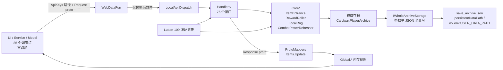
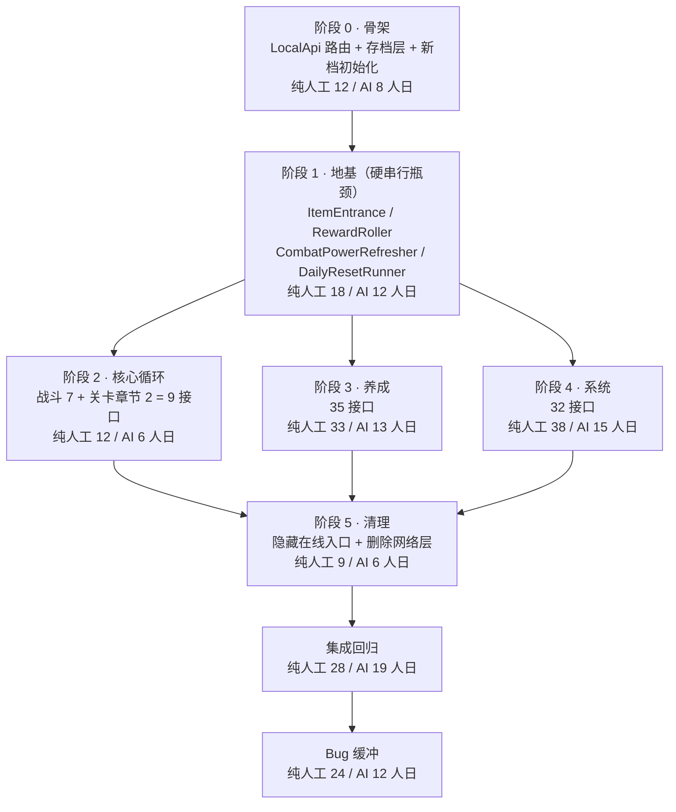
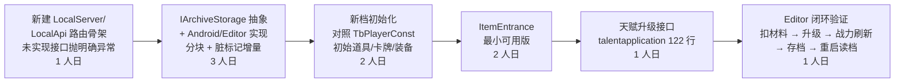
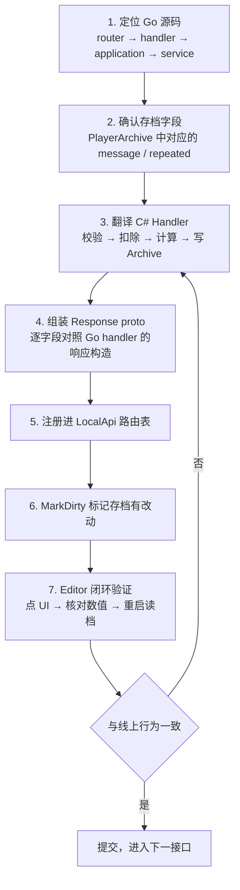
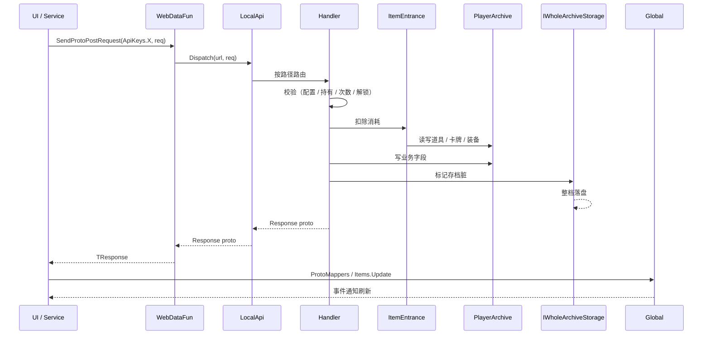
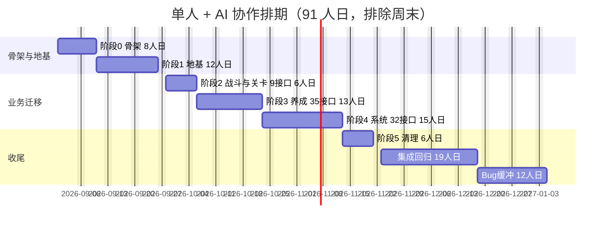
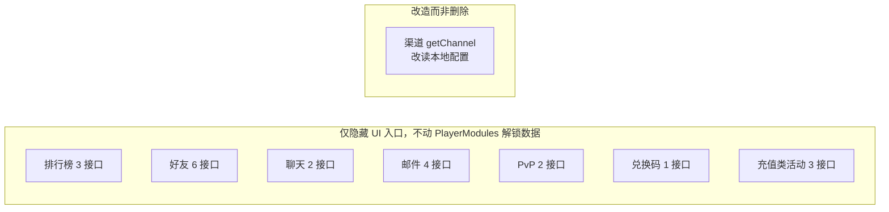
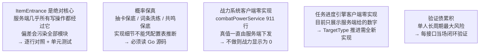

# 服务端逻辑单机化：流程图与工时

> 目标：去掉游戏服务器，玩家数据存本地，业务逻辑与线上完全一致。
> 范围：不含微信小游戏平台工程（转换工具、分包、CDN 化、WASM 优化），详见文末遗留事项。
> 配套计划：`服务端逻辑单机化_迁移计划.md`（同目录，含当前进度）。

---

## 一、工时总览

| 口径 | 开发 | 集成回归 | Bug 缓冲 | 合计 | 单人周期 |
|---|---|---|---|---|---|
| 纯人工 | 122 | 28 | 24 | **174 人日** | 约 8.3 个月 |
| 单人 + AI 协作 | 60 | 19 | 12 | **91 人日** | 约 4.3 个月 |

AI 协作口径的加速比按工作性质区分：机械翻译 2.5x（阶段 3、4）、高保真核心 1.5x（阶段 1、2）、架构与测试 1.5x。

**需迁移接口：76 个**（服务端 101 条客户端路由，扣除 19 个在线模块接口与若干未调用接口）

**代码规模**：需翻译 Go 有效业务代码约 17,800 行，预计产出 C# 约 22,000～28,000 行。

---

## 二、架构数据流

改造后的数据流向与线上保持同构：本地存档扮演原 MySQL 的角色作为权威数据，`Global.*` 仍是它的内存视图。

关键点：`WebDataFun.SendProtoPostRequest` 是全部 HTTP 的唯一出口，只替换它的函数体即可覆盖 85 个活跃调用点，无需改动任何 Service / Model / Panel。

---

## 三、阶段依赖与工时

阶段 0 与阶段 1 合计 30 人日（AI 口径 20）是**硬串行瓶颈**：`ItemEntrance`、`RewardRoller`、`CombatPowerRefresher` 是阶段 2、3、4 里几乎每个模块的公共依赖，未完成前无法拆分并行。

---

## 四、起步路径：垂直切片优先

不按阶段横向铺开，先打通一条最小完整链路验证全部架构假设。单人长周期项目最怕架构错误在第二个月才暴露。

**切片合计约 10 人日（AI 协作口径）**，一次性验证四件事：

1. `LocalApi` 拦截点是否真的对 85 个调用点零改动
2. `ItemEntrance` 的设计能否承载后续全部模块
3. 存档分块结构是否合理、重启后能否正确恢复
4. `ProtoMappers` 与 `Items.Update` 能否原样复用

选 `api/talent/upGradeTalent` 作首个业务接口：`talentapplication` 仅 122 行，却同时覆盖「扣材料 + 战力刷新 + 有现成 UI 可点击验证」，是覆盖面与复杂度比最优的样本。

切片跑通后，剩余 70 余个接口本质是重复劳动，节奏与风险都可预测。

---

## 五、单接口迁移 SOP

阶段 2、3、4 的每个接口都按同一套流程推进，这是工时估算能成立的前提。

第 7 步不可跳过。**不允许积累验证债**——这是 174 人日不膨胀成 250 人日的关键约束。

---

## 六、单次请求的处理时序

与线上唯一的差别是把「HTTP 往返 + MySQL 事务」换成「本地方法调用 + 整档落盘」，请求与响应的 Protobuf 结构完全不变。因此 `resourceLockModel`（MySQL 行锁做并发控制）不需要迁移，单机单线程天然不需要。

---

## 七、排期甘特图

假设 2026-08-31 起、单人全职、AI 协作口径 91 人日、每周 5 个工作日。

阶段 0 结束时（约第 2 周）应当已完成垂直切片并跑通天赋接口——这是第一个可验证里程碑。若此时架构假设被推翻，返工成本仅 8 人日；若拖到阶段 3 才发现，返工成本超过 30 人日。

甘特图中的集成回归是**跨模块**回归；各阶段自身的模块级验证已包含在该阶段工时内。

---

## 八、工时明细（纯人工口径）

### 阶段 0 · 骨架 —— 12 人日

- `LocalApi` 路由分发（76 条路径表）：1
- `IArchiveStorage` 抽象 + Android/Editor 实现 + 分块 + 脏标记增量 + A/B 双槽：6
- `NewPlayerInitializer`（反向构造 archive，对照 `application_player_archive.go` 504 行）：3
- 登录界面改存档槽（开始 / 继续游戏）：2

### 阶段 1 · 地基 —— 18 人日

- `ItemEntrance`，对照 `UniteAddItemsEntranceLogic`（`application_player_items.go` 147 + `ItemService` 284 + `ResourceService` 87），含单元测试：5
- `RewardRoller` + `LocalRng`（`RewardService` 42 + 权重算法）：2
- `CombatPowerRefresher`（`combatPowerService` **911 行**，9 个模块 Provider，客户端零实现）：7
- `DailyResetRunner`（`ArchiveService` 37 + 分散在各 service 的 10 余处 DailyReset）：4

### 阶段 2 · 核心循环（9 接口）—— 12 人日

- 战斗 7 接口（`battleapplication` 816 行，结算牵连 12～14 张表联动）+ 关卡章节 2 接口

### 阶段 3 · 养成（35 接口）—— 33 人日

- 卡牌 7 接口（`cardapplication` 444 + `application_card.go` 436 + `CardService` 222）：7
- 编队 3 接口（`teamapplication` 261 + `TeamService` 143）：3
- 装备 4 + 装备槽 1 接口（`equipapplication` 435 + `EquipService` 196 + `EntryService` 71 + `EquipModel` 226）：6
- 融合石 5 接口（187 + 256 + 77 + 64，含 Go 硬编码 `ComposeProbJSON`）：4
- 天赋 2 + 奥数共鸣 1 接口（122 + 85 + 204，含 progress 保底）：3
- 城墙 4 接口（`citywallapplication` 417 + `CityWallModel` 220）：5
- 轮语者 8 接口（`weaponapplication` 300 + 133 + `CycleSpeakerService` 155）：5

### 阶段 4 · 系统（32 接口）—— 38 人日

- 抽卡 1 接口（166 + 47，权重 + PromiseNum 保底 + 奥数池分段）：3
- 商店 2 接口（101 + 120 + stagegiftpack 140，每日折扣与商品刷新随机）：3
- 任务引擎 2 接口（172 + `TaskService` 313 + `TaskModel` 179，客户端零进度计算）：6
- 活动 6 接口（421 + 82 + `activityModel` 206）：5
- 门票 1 + 体力 2 接口（244 + 168 + 148 + 27）：4
- 图鉴 2 + 模块 1 接口（77 + 76 + 42）：2
- 用户 5 + 玩家 3 接口（100 + 238 + 52 + `AvatarService` 97）：4
- 无尽塔 3 接口（202 + 58 + 136）：3
- 挑战 Boss 2 + 融合石小游戏 2 接口（168 + 146）：3
- 秘境塔（`HiddenRealmTowerService` **463** + Model 128，词条随机 + 首通冻结，无独立路由）：5

### 阶段 5 · 清理 —— 9 人日

- 隐藏 8 类在线入口（排查 UI 调用点，避免破坏任务与模块解锁）：4
- 删除网络层（`NetWork/` 全套 WebSocket、`Global.Token`、`Global.Server`、选服 UI、AOT fallback）：3
- `getChannel` 跳过并改读本地配置：2

---

## 九、隐藏入口的在线模块

无服务器后这些模块不可用，按决策仅隐藏入口、不做本地假数据。

合计 21 个接口无需迁移。注意隐藏时**只改 UI 层**——任务系统可能依赖模块解锁进度，不能动 `PlayerModules` 数据。

---

## 十、关键风险

另有编码约束（见 `FusionContinent/AGENTS.md`）：新代码禁用 `Debug.Log`（用 `LogTool`）、禁用 `?.`、非必要不判空、不写 `private static`、保持单一真值源。

---

## 十一、遗留事项（上微信小游戏前必须补做）

本次不做，但已核实约束、并在存档层预留了抽象接口，届时是增量而非重做。

| 事项 | 说明 |
|---|---|
| WX-WASM-SDK 接入 | 转换工具与构建流水线 |
| 分包与 CDN 化 | 首包上限 30MB，本项目美术原始素材约 1.1GB |
| ~~`IArchiveStorage` 小游戏实现~~（已接入，待真机验证） | 全平台统一整档单 JSON 方案（`IWholeArchiveStorage`）：存档整体序列化为单个 JSON 文件（`JsonFormatter`），不分块。微信用 `WxArchiveStorage`：`WXFileSystemManager` 直写 `wx.env.USER_DATA_PATH/save_archive.json`，不经过 MEMFS、不建目录（SDK 的 `MkdirSync(recursive=true)` 有坑）；Editor/Android 用 `FileArchiveStorage`：System.IO 写 `persistentDataPath/save_archive.json`，.tmp 原子替换。`HotFix.asmdef` 已加 `wx-runtime.dll` 引用；真机需验证读写与配额 |
| WASM 性能优化 | 单线程环境下新增 2.2～2.8 万行逻辑与存档序列化的卡顿排查 |
| `link.xml` 裁剪 | 补充 `LocalServer` 与 Protobuf 类型 |
| `getChannel` 改 CDN 静态 JSON | 小游戏资源必须走 CDN |
| 小游戏真机回归 | —— |

合计约 28～38 人日（纯人工口径）。

已核实的硬约束（微信官方文档）：

- `wx.setStorage` 单 key 1MB、总 10MB —— 容量不够，不能用
- 文件系统 `wx.env.USER_DATA_PATH` 总 200MB（可申请至 1GB）—— 应当使用
- **WebGL 下绝对不能用 `Application.persistentDataPath`**，它指向 Emscripten MEMFS（内存虚拟文件系统），重启即丢失
- 路径须以 `/CustomWritablePath/` 开头才映射到微信文件系统
- 官方建议单文件 1～2MB，最大不超过 10MB

好消息是两项基础已就绪：HybridCLR 支持微信小游戏（`Packages/hybridclr_unity-main/RELEASELOG.md` 第 478 行有平台专项修复），YooAsset 的 `WebPlayMode` 分支已写好（`Assets/AOT/Pipeline/ResourceInitStep.cs` 第 310、389 行）。
